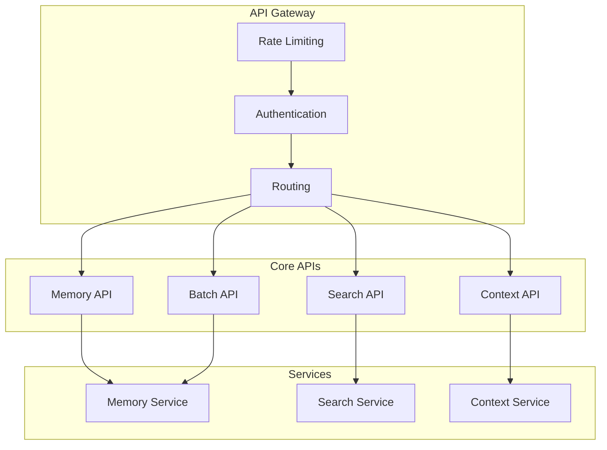
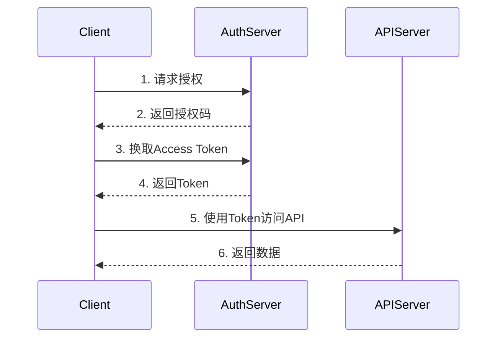

# Agent Memory System V3.0 API参考文档

## Agent Memory System V3.0 API Reference

**版本号**: V3.0.0  
**API版本**: v1  
**文档状态**: 正式发布  
**最后更新**: 2026-05-16  

---

## 目录

1. [概述](#1-概述)
2. [认证](#2-认证)
3. [核心API](#3-核心api)
4. [搜索API](#4-搜索api)
5. [上下文API](#5-上下文api)
6. [批量操作API](#6-批量操作api)
7. [系统API](#7-系统api)
8. [错误码](#8-错误码)
9. [使用示例](#9-使用示例)
10. [SDK文档](#10-sdk文档)
11. [版本历史](#11-版本历史)

---

## 1. 概述

### 1.1 API介绍

Agent Memory System (AMS) API 是一套 RESTful API，用于管理AI Agent的记忆存储、检索和上下文管理。API 设计遵循 OpenAPI 3.0 规范，支持 JSON 数据格式。

### 1.2 基础信息

| 项目 | 说明 |
|------|------|
| **基础URL** | `https://api.agent-memory.io/v1` |
| **协议** | HTTPS |
| **数据格式** | JSON |
| **字符编码** | UTF-8 |
| **时区** | UTC |

### 1.3 API架构



---

## 2. 认证

### 2.1 认证方式

AMS API 支持以下认证方式：

| 方式 | 适用场景 | 说明 |
|------|----------|------|
| **API Key** | 服务器端应用 | 通过 Header 传递 |
| **OAuth 2.0** | 第三方应用 | 标准OAuth流程 |
| **JWT** | 用户认证 | 短期有效令牌 |

### 2.2 API Key认证

```http
GET /v1/memories HTTP/1.1
Host: api.agent-memory.io
Authorization: Bearer {your-api-key}
Content-Type: application/json
```

### 2.3 OAuth 2.0

#### 2.3.1 授权流程



#### 2.3.2 获取Token

```http
POST /oauth/token HTTP/1.1
Host: auth.agent-memory.io
Content-Type: application/x-www-form-urlencoded

grant_type=client_credentials&
client_id={client_id}&
client_secret={client_secret}&
scope=memory:read memory:write
```

**响应示例**:

```json
{
  "access_token": "eyJhbGciOiJSUzI1NiIs...",
  "token_type": "Bearer",
  "expires_in": 3600,
  "scope": "memory:read memory:write"
}
```

---

## 3. 核心API

### 3.1 Memory API

#### 3.1.1 存储记忆

```http
POST /v1/memories
```

**请求参数**:

| 参数 | 类型 | 必填 | 说明 |
|------|------|------|------|
| `agent_id` | string | 是 | Agent唯一标识 |
| `content` | string/object | 是 | 记忆内容 |
| `content_type` | string | 否 | 内容类型，默认text |
| `metadata` | object | 否 | 元数据 |
| `importance` | number | 否 | 重要性评分 0-1 |
| `ttl` | integer | 否 | 过期时间(秒) |

**请求示例**:

```json
{
  "agent_id": "agent-001",
  "content": "用户喜欢科幻电影，特别是《星际穿越》",
  "content_type": "text",
  "metadata": {
    "source": "conversation",
    "topic": "movies",
    "language": "zh"
  },
  "importance": 0.8,
  "ttl": 2592000
}
```

**响应示例**:

```json
{
  "id": "mem_abc123",
  "agent_id": "agent-001",
  "content": "用户喜欢科幻电影，特别是《星际穿越》",
  "content_type": "text",
  "metadata": {
    "source": "conversation",
    "topic": "movies",
    "language": "zh"
  },
  "importance": 0.8,
  "vector_id": "vec_xyz789",
  "created_at": "2026-05-16T08:30:00Z",
  "expires_at": "2026-06-15T08:30:00Z",
  "version": 1
}
```

#### 3.1.2 获取记忆

```http
GET /v1/memories/{memory_id}
```

**路径参数**:

| 参数 | 类型 | 说明 |
|------|------|------|
| `memory_id` | string | 记忆ID |

**查询参数**:

| 参数 | 类型 | 说明 |
|------|------|------|
| `include_vector` | boolean | 是否包含向量数据 |

**响应示例**:

```json
{
  "id": "mem_abc123",
  "agent_id": "agent-001",
  "content": "用户喜欢科幻电影，特别是《星际穿越》",
  "content_type": "text",
  "metadata": {
    "source": "conversation",
    "topic": "movies"
  },
  "importance": 0.8,
  "vector_id": "vec_xyz789",
  "created_at": "2026-05-16T08:30:00Z",
  "updated_at": "2026-05-16T08:30:00Z",
  "version": 1
}
```

#### 3.1.3 更新记忆

```http
PATCH /v1/memories/{memory_id}
```

**请求参数**:

| 参数 | 类型 | 说明 |
|------|------|------|
| `content` | string/object | 新内容 |
| `metadata` | object | 元数据更新 |
| `importance` | number | 重要性评分 |

**请求示例**:

```json
{
  "content": "用户喜欢科幻电影，特别是《星际穿越》和《盗梦空间》",
  "importance": 0.9
}
```

#### 3.1.4 删除记忆

```http
DELETE /v1/memories/{memory_id}
```

**查询参数**:

| 参数 | 类型 | 说明 |
|------|------|------|
| `permanent` | boolean | 是否永久删除，默认false |

#### 3.1.5 列出记忆

```http
GET /v1/memories
```

**查询参数**:

| 参数 | 类型 | 说明 |
|------|------|------|
| `agent_id` | string | 按Agent筛选 |
| `content_type` | string | 按类型筛选 |
| `importance_min` | number | 最小重要性 |
| `created_after` | string | 创建时间之后 |
| `created_before` | string | 创建时间之前 |
| `limit` | integer | 返回数量，默认20 |
| `offset` | integer | 偏移量 |
| `sort_by` | string | 排序字段 |
| `sort_order` | string | 排序方向 asc/desc |

**响应示例**:

```json
{
  "data": [
    {
      "id": "mem_abc123",
      "agent_id": "agent-001",
      "content": "用户喜欢科幻电影...",
      "importance": 0.8,
      "created_at": "2026-05-16T08:30:00Z"
    }
  ],
  "pagination": {
    "total": 150,
    "limit": 20,
    "offset": 0,
    "has_more": true
  }
}
```

---

## 4. 搜索API

### 4.1 语义搜索

```http
POST /v1/search
```

**请求参数**:

| 参数 | 类型 | 必填 | 说明 |
|------|------|------|------|
| `query` | string | 是 | 搜索查询 |
| `agent_id` | string | 否 | 限定Agent |
| `top_k` | integer | 否 | 返回数量，默认10 |
| `threshold` | number | 否 | 相似度阈值 0-1 |
| `filters` | object | 否 | 过滤条件 |
| `include_metadata` | boolean | 否 | 包含元数据 |

**请求示例**:

```json
{
  "query": "用户喜欢什么类型的电影",
  "agent_id": "agent-001",
  "top_k": 5,
  "threshold": 0.7,
  "filters": {
    "content_type": "text",
    "created_after": "2026-01-01T00:00:00Z"
  }
}
```

**响应示例**:

```json
{
  "results": [
    {
      "memory": {
        "id": "mem_abc123",
        "content": "用户喜欢科幻电影，特别是《星际穿越》",
        "metadata": {
          "topic": "movies"
        }
      },
      "score": 0.92,
      "distance": 0.08
    },
    {
      "memory": {
        "id": "mem_def456",
        "content": "用户推荐过《盗梦空间》",
        "metadata": {
          "topic": "movies"
        }
      },
      "score": 0.85,
      "distance": 0.15
    }
  ],
  "total": 2,
  "query_embedding": [0.1, 0.2, ...],
  "search_time_ms": 45
}
```

### 4.2 混合搜索

```http
POST /v1/search/hybrid
```

**请求参数**:

| 参数 | 类型 | 说明 |
|------|------|------|
| `query` | string | 语义查询 |
| `keywords` | array | 关键词列表 |
| `vector_weight` | number | 向量搜索权重 |
| `keyword_weight` | number | 关键词搜索权重 |

**请求示例**:

```json
{
  "query": "电影推荐",
  "keywords": ["科幻", "星际穿越"],
  "vector_weight": 0.7,
  "keyword_weight": 0.3,
  "top_k": 10
}
```

### 4.3 相似记忆搜索

```http
POST /v1/memories/{memory_id}/similar
```

**请求参数**:

| 参数 | 类型 | 说明 |
|------|------|------|
| `top_k` | integer | 返回数量 |
| `threshold` | number | 相似度阈值 |

---

## 5. 上下文API

### 5.1 获取上下文

```http
GET /v1/contexts/{session_id}
```

**路径参数**:

| 参数 | 类型 | 说明 |
|------|------|------|
| `session_id` | string | 会话ID |

**查询参数**:

| 参数 | 类型 | 说明 |
|------|------|------|
| `agent_id` | string | Agent ID |
| `window_size` | integer | 窗口大小 |
| `include_summary` | boolean | 包含摘要 |

**响应示例**:

```json
{
  "session_id": "sess_xyz789",
  "agent_id": "agent-001",
  "window_size": 10,
  "memories": [
    {
      "id": "mem_001",
      "content": "你好，我是AI助手",
      "role": "assistant",
      "timestamp": "2026-05-16T08:00:00Z"
    },
    {
      "id": "mem_002",
      "content": "请推荐一些科幻电影",
      "role": "user",
      "timestamp": "2026-05-16T08:01:00Z"
    }
  ],
  "summary": {
    "content": "用户询问科幻电影推荐",
    "tokens": 150,
    "compressed_at": "2026-05-16T08:05:00Z"
  },
  "token_count": 450,
  "created_at": "2026-05-16T08:00:00Z",
  "last_accessed": "2026-05-16T08:10:00Z"
}
```

### 5.2 添加上下文记忆

```http
POST /v1/contexts/{session_id}/memories
```

**请求参数**:

| 参数 | 类型 | 必填 | 说明 |
|------|------|------|------|
| `memory_id` | string | 是 | 记忆ID |
| `role` | string | 是 | 角色 user/assistant |
| `content` | string | 是 | 内容 |

### 5.3 压缩上下文

```http
POST /v1/contexts/{session_id}/compress
```

**请求参数**:

| 参数 | 类型 | 说明 |
|------|------|------|
| `target_tokens` | integer | 目标token数 |
| `strategy` | string | 压缩策略 |

---

## 6. 批量操作API

### 6.1 批量存储

```http
POST /v1/batch/memories
```

**请求参数**:

| 参数 | 类型 | 必填 | 说明 |
|------|------|------|------|
| `memories` | array | 是 | 记忆数组 |
| `options` | object | 否 | 批处理选项 |

**请求示例**:

```json
{
  "memories": [
    {
      "agent_id": "agent-001",
      "content": "记忆内容1",
      "importance": 0.8
    },
    {
      "agent_id": "agent-001",
      "content": "记忆内容2",
      "importance": 0.6
    }
  ],
  "options": {
    "batch_size": 100,
    "continue_on_error": true,
    "timeout_ms": 30000
  }
}
```

**响应示例**:

```json
{
  "success_count": 2,
  "failure_count": 0,
  "results": [
    {
      "index": 0,
      "success": true,
      "memory_id": "mem_001"
    },
    {
      "index": 1,
      "success": true,
      "memory_id": "mem_002"
    }
  ],
  "processing_time_ms": 150
}
```

### 6.2 批量删除

```http
DELETE /v1/batch/memories
```

**请求参数**:

| 参数 | 类型 | 说明 |
|------|------|------|
| `memory_ids` | array | 记忆ID数组 |
| `filter` | object | 删除条件 |

### 6.3 批量更新

```http
PATCH /v1/batch/memories
```

---

## 7. 系统API

### 7.1 健康检查

```http
GET /v1/health
```

**响应示例**:

```json
{
  "status": "healthy",
  "version": "3.0.0",
  "timestamp": "2026-05-16T08:30:00Z",
  "checks": {
    "database": "healthy",
    "vector_store": "healthy",
    "cache": "healthy"
  }
}
```

### 7.2 获取API状态

```http
GET /v1/status
```

**响应示例**:

```json
{
  "version": "3.0.0",
  "api_version": "v1",
  "environment": "production",
  "region": "us-west-2",
  "features": {
    "semantic_search": true,
    "hybrid_search": true,
    "context_management": true,
    "batch_operations": true
  }
}
```

### 7.3 获取用量统计

```http
GET /v1/usage
```

**查询参数**:

| 参数 | 类型 | 说明 |
|------|------|------|
| `start_date` | string | 开始日期 |
| `end_date` | string | 结束日期 |
| `granularity` | string | 粒度 day/hour |

**响应示例**:

```json
{
  "period": {
    "start": "2026-05-01T00:00:00Z",
    "end": "2026-05-16T23:59:59Z"
  },
  "summary": {
    "total_requests": 150000,
    "total_memories_stored": 50000,
    "total_searches": 80000,
    "storage_bytes": 1073741824
  },
  "daily": [
    {
      "date": "2026-05-16",
      "requests": 10000,
      "memories_stored": 3000,
      "searches": 5000
    }
  ]
}
```

---

## 8. 错误码

### 8.1 HTTP状态码

| 状态码 | 说明 | 场景 |
|--------|------|------|
| 200 | OK | 请求成功 |
| 201 | Created | 创建成功 |
| 204 | No Content | 删除成功 |
| 400 | Bad Request | 请求参数错误 |
| 401 | Unauthorized | 认证失败 |
| 403 | Forbidden | 权限不足 |
| 404 | Not Found | 资源不存在 |
| 409 | Conflict | 资源冲突 |
| 429 | Too Many Requests | 请求频率限制 |
| 500 | Internal Server Error | 服务器错误 |
| 503 | Service Unavailable | 服务不可用 |

### 8.2 业务错误码

| 错误码 | 说明 | HTTP状态 |
|--------|------|----------|
| `MEM001` | 记忆不存在 | 404 |
| `MEM002` | 记忆已存在 | 409 |
| `MEM003` | 记忆内容无效 | 400 |
| `MEM004` | 记忆存储失败 | 500 |
| `CTX001` | 上下文不存在 | 404 |
| `CTX002` | 上下文已满 | 400 |
| `SCH001` | 搜索查询无效 | 400 |
| `SCH002` | 索引未就绪 | 503 |
| `AUTH001` | API Key无效 | 401 |
| `AUTH002` | 令牌过期 | 401 |
| `RATE001` | 请求频率超限 | 429 |
| `QUOTA001` | 配额已用完 | 429 |

### 8.3 错误响应格式

```json
{
  "error": {
    "code": "MEM001",
    "message": "Memory not found",
    "details": {
      "memory_id": "mem_abc123",
      "resource": "memory"
    },
    "request_id": "req_xyz789",
    "timestamp": "2026-05-16T08:30:00Z"
  }
}
```

---

## 9. 使用示例

### 9.1 cURL示例

#### 存储记忆

```bash
curl -X POST https://api.agent-memory.io/v1/memories \
  -H "Authorization: Bearer YOUR_API_KEY" \
  -H "Content-Type: application/json" \
  -d '{
    "agent_id": "agent-001",
    "content": "用户喜欢科幻电影",
    "importance": 0.8
  }'
```

#### 搜索记忆

```bash
curl -X POST https://api.agent-memory.io/v1/search \
  -H "Authorization: Bearer YOUR_API_KEY" \
  -H "Content-Type: application/json" \
  -d '{
    "query": "用户喜欢什么电影",
    "agent_id": "agent-001",
    "top_k": 5
  }'
```

### 9.2 Python示例

```python
import requests

class AMSClient:
    def __init__(self, api_key, base_url="https://api.agent-memory.io/v1"):
        self.api_key = api_key
        self.base_url = base_url
        self.headers = {
            "Authorization": f"Bearer {api_key}",
            "Content-Type": "application/json"
        }
    
    def store_memory(self, agent_id, content, **kwargs):
        """存储记忆"""
        data = {
            "agent_id": agent_id,
            "content": content,
            **kwargs
        }
        response = requests.post(
            f"{self.base_url}/memories",
            headers=self.headers,
            json=data
        )
        response.raise_for_status()
        return response.json()
    
    def search_memories(self, query, agent_id=None, top_k=10):
        """搜索记忆"""
        data = {
            "query": query,
            "top_k": top_k
        }
        if agent_id:
            data["agent_id"] = agent_id
        
        response = requests.post(
            f"{self.base_url}/search",
            headers=self.headers,
            json=data
        )
        response.raise_for_status()
        return response.json()
    
    def get_context(self, session_id, agent_id):
        """获取上下文"""
        response = requests.get(
            f"{self.base_url}/contexts/{session_id}",
            headers=self.headers,
            params={"agent_id": agent_id}
        )
        response.raise_for_status()
        return response.json()

# 使用示例
client = AMSClient("your-api-key")

# 存储记忆
memory = client.store_memory(
    agent_id="agent-001",
    content="用户喜欢科幻电影",
    importance=0.8
)
print(f"Memory stored: {memory['id']}")

# 搜索记忆
results = client.search_memories(
    query="用户喜欢什么电影",
    agent_id="agent-001",
    top_k=5
)
for result in results['results']:
    print(f"{result['score']}: {result['memory']['content']}")
```

### 9.3 TypeScript/JavaScript示例

```typescript
import axios, { AxiosInstance } from 'axios';

interface Memory {
  id: string;
  agent_id: string;
  content: string;
  importance: number;
  created_at: string;
}

interface SearchResult {
  memory: Memory;
  score: number;
}

class AMSClient {
  private client: AxiosInstance;

  constructor(apiKey: string, baseURL = 'https://api.agent-memory.io/v1') {
    this.client = axios.create({
      baseURL,
      headers: {
        'Authorization': `Bearer ${apiKey}`,
        'Content-Type': 'application/json'
      }
    });
  }

  async storeMemory(
    agentId: string,
    content: string,
    options?: Partial<Memory>
  ): Promise<Memory> {
    const response = await this.client.post('/memories', {
      agent_id: agentId,
      content,
      ...options
    });
    return response.data;
  }

  async searchMemories(
    query: string,
    agentId?: string,
    topK = 10
  ): Promise<SearchResult[]> {
    const response = await this.client.post('/search', {
      query,
      agent_id: agentId,
      top_k: topK
    });
    return response.data.results;
  }

  async getMemory(memoryId: string): Promise<Memory> {
    const response = await this.client.get(`/memories/${memoryId}`);
    return response.data;
  }

  async deleteMemory(memoryId: string, permanent = false): Promise<void> {
    await this.client.delete(`/memories/${memoryId}`, {
      params: { permanent }
    });
  }
}

// 使用示例
const client = new AMSClient('your-api-key');

async function main() {
  try {
    // 存储记忆
    const memory = await client.storeMemory(
      'agent-001',
      '用户喜欢科幻电影',
      { importance: 0.8 }
    );
    console.log(`Memory stored: ${memory.id}`);

    // 搜索记忆
    const results = await client.searchMemories(
      '用户喜欢什么电影',
      'agent-001',
      5
    );
    results.forEach(result => {
      console.log(`${result.score}: ${result.memory.content}`);
    });
  } catch (error) {
    console.error('Error:', error);
  }
}

main();
```

### 9.4 Go示例

```go
package main

import (
	"bytes"
	"encoding/json"
	"fmt"
	"net/http"
	"time"
)

type AMSClient struct {
	APIKey  string
	BaseURL string
	Client  *http.Client
}

type Memory struct {
	ID        string                 `json:"id"`
	AgentID   string                 `json:"agent_id"`
	Content   string                 `json:"content"`
	Importance float64               `json:"importance"`
	CreatedAt time.Time             `json:"created_at"`
	Metadata  map[string]interface{} `json:"metadata"`
}

type SearchRequest struct {
	Query   string `json:"query"`
	AgentID string `json:"agent_id,omitempty"`
	TopK    int    `json:"top_k"`
}

type SearchResult struct {
	Memory Memory  `json:"memory"`
	Score  float64 `json:"score"`
}

func NewClient(apiKey string) *AMSClient {
	return &AMSClient{
		APIKey:  apiKey,
		BaseURL: "https://api.agent-memory.io/v1",
		Client:  &http.Client{Timeout: 30 * time.Second},
	}
}

func (c *AMSClient) StoreMemory(agentID, content string, importance float64) (*Memory, error) {
	data := map[string]interface{}{
		"agent_id":   agentID,
		"content":    content,
		"importance": importance,
	}
	
	jsonData, _ := json.Marshal(data)
	req, _ := http.NewRequest("POST", c.BaseURL+"/memories", bytes.NewBuffer(jsonData))
	req.Header.Set("Authorization", "Bearer "+c.APIKey)
	req.Header.Set("Content-Type", "application/json")
	
	resp, err := c.Client.Do(req)
	if err != nil {
		return nil, err
	}
	defer resp.Body.Close()
	
	var memory Memory
	if err := json.NewDecoder(resp.Body).Decode(&memory); err != nil {
		return nil, err
	}
	
	return &memory, nil
}

func (c *AMSClient) SearchMemories(query, agentID string, topK int) ([]SearchResult, error) {
	reqData := SearchRequest{
		Query:   query,
		AgentID: agentID,
		TopK:    topK,
	}
	
	jsonData, _ := json.Marshal(reqData)
	req, _ := http.NewRequest("POST", c.BaseURL+"/search", bytes.NewBuffer(jsonData))
	req.Header.Set("Authorization", "Bearer "+c.APIKey)
	req.Header.Set("Content-Type", "application/json")
	
	resp, err := c.Client.Do(req)
	if err != nil {
		return nil, err
	}
	defer resp.Body.Close()
	
	var result struct {
		Results []SearchResult `json:"results"`
	}
	if err := json.NewDecoder(resp.Body).Decode(&result); err != nil {
		return nil, err
	}
	
	return result.Results, nil
}

func main() {
	client := NewClient("your-api-key")
	
	// 存储记忆
	memory, err := client.StoreMemory("agent-001", "用户喜欢科幻电影", 0.8)
	if err != nil {
		panic(err)
	}
	fmt.Printf("Memory stored: %s\n", memory.ID)
	
	// 搜索记忆
	results, err := client.SearchMemories("用户喜欢什么电影", "agent-001", 5)
	if err != nil {
		panic(err)
	}
	
	for _, result := range results {
		fmt.Printf("%.2f: %s\n", result.Score, result.Memory.Content)
	}
}
```

---

## 10. SDK文档

### 10.1 Python SDK

#### 安装

```bash
pip install agent-memory-sdk
```

#### 快速开始

```python
from agent_memory import AMSClient

# 初始化客户端
client = AMSClient(api_key="your-api-key")

# 存储记忆
memory = client.memories.store(
    agent_id="agent-001",
    content="用户喜欢科幻电影",
    importance=0.8
)

# 搜索记忆
results = client.search.semantic(
    query="用户喜欢什么电影",
    agent_id="agent-001"
)

# 使用上下文
context = client.contexts.get(
    session_id="session-001",
    agent_id="agent-001"
)
```

### 10.2 TypeScript SDK

#### 安装

```bash
npm install @agent-memory/sdk
```

#### 快速开始

```typescript
import { AMSClient } from '@agent-memory/sdk';

const client = new AMSClient({ apiKey: 'your-api-key' });

// 存储记忆
const memory = await client.memories.store({
  agentId: 'agent-001',
  content: '用户喜欢科幻电影',
  importance: 0.8
});

// 搜索记忆
const results = await client.search.semantic({
  query: '用户喜欢什么电影',
  agentId: 'agent-001'
});
```

### 10.3 SDK功能对比

| 功能 | Python SDK | TypeScript SDK | Go SDK |
|------|-----------|----------------|--------|
| 同步API | 支持 | 支持 | 支持 |
| 异步API | asyncio | Promise | goroutine |
| 类型提示 | 完整 | 完整 | 完整 |
| 本地缓存 | 支持 | 支持 | 支持 |
| 自动重试 | 支持 | 支持 | 支持 |
| 连接池 | 支持 | 支持 | 支持 |

---

## 11. 版本历史

### 11.1 API版本

| 版本 | 发布日期 | 状态 | 主要变更 |
|------|----------|------|----------|
| v1.0 | 2026-05-16 | 当前 | 初始版本 |
| v1.1 | 2026-06-01 | 计划中 | 批量操作增强 |
| v1.2 | 2026-07-01 | 计划中 | 多模态支持 |
| v2.0 | 2027-01-01 | 规划中 | 协议升级 |

### 11.2 变更日志

#### v1.0.0 (2026-05-16)

**新增**:
- 记忆CRUD操作
- 语义搜索
- 混合搜索
- 上下文管理
- 批量操作
- OAuth 2.0认证

**改进**:
- 性能优化
- 错误处理
- 文档完善

### 11.3 弃用策略

| 版本 | 弃用功能 | 替代方案 | 移除时间 |
|------|----------|----------|----------|
| v1.1 | `POST /v1/search/legacy` | `POST /v1/search` | v2.0 |
| v1.2 | `importance` 字段整数 | `importance` 浮点数 | v2.0 |

---

## 附录

### A. 术语表

| 中文 | English | 定义 |
|------|---------|------|
| 向量 | Vector | 文本的高维数学表示 |
| 嵌入 | Embedding | 将文本转换为向量的过程 |
| 语义搜索 | Semantic Search | 基于意义的搜索 |
| 上下文 | Context | 对话的历史记录 |
| 记忆 | Memory | 存储的信息单元 |

### B. 参考资源

1. [开发者指南](./developer_guide.md)
2. [运营维护手册](./operations_manual.md)
3. [OpenAPI规范](https://api.agent-memory.io/openapi.json)

### C. 变更记录

| 版本 | 日期 | 作者 | 变更说明 |
|------|------|------|----------|
| 1.0 | 2026-05-16 | API团队 | 初始版本 |

---

**文档版本历史**

| 版本 | 日期 | 作者 | 变更说明 |
|------|------|------|----------|
| 1.0 | 2026-05-16 | API团队 | 初始版本 |

---

*本文档由 Agent Memory System API团队编写，版权归属于项目所有方。*
