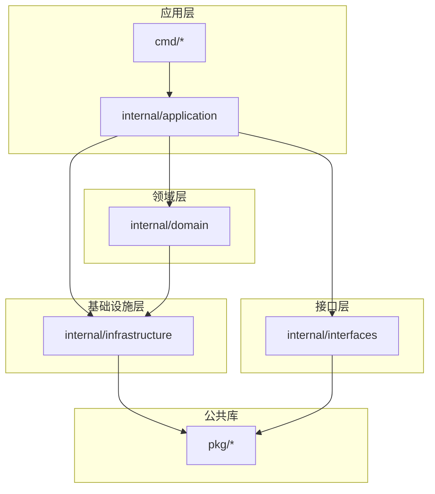
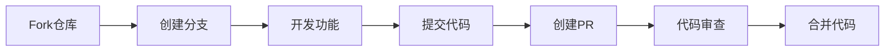

# Agent Memory System V3.0 开发者指南

## Agent Memory System V3.0 Developer Guide

**版本号**: V1.0  
**适用版本**: V3.0.x  
**文档状态**: 正式发布  
**最后更新**: 2026-05-16  

---

## 目录

1. [环境搭建](#1-环境搭建)
2. [代码规范](#2-代码规范)
3. [项目结构](#3-项目结构)
4. [贡献指南](#4-贡献指南)
5. [测试指南](#5-测试指南)
6. [调试技巧](#6-调试技巧)
7. [发布流程](#7-发布流程)
8. [附录](#8-附录)

---

## 1. 环境搭建

### 1.1 系统要求

| 组件 | 最低版本 | 推荐版本 |
|------|----------|----------|
| Go | 1.21 | 1.22 |
| Python | 3.10 | 3.11 |
| Node.js | 18 | 20 |
| Docker | 24.0 | 24.0+ |
| Kubernetes | 1.25 | 1.28 |
| Helm | 3.12 | 3.13 |
| Terraform | 1.5 | 1.7 |

### 1.2 开发环境配置

#### 1.2.1 克隆仓库

```bash
# 克隆主仓库
git clone https://github.com/agent-memory-system/ams.git
cd ams

# 初始化子模块
git submodule update --init --recursive

# 安装依赖
make deps
```

#### 1.2.2 使用Docker开发

```bash
# 构建开发镜像
docker build -t ams-dev -f Dockerfile.dev .

# 运行开发容器
docker run -it \
  -v $(pwd):/workspace \
  -v /var/run/docker.sock:/var/run/docker.sock \
  -p 8080:8080 \
  -p 9090:9090 \
  ams-dev /bin/bash
```

#### 1.2.3 使用Tilt本地开发

```bash
# 安装Tilt
curl -fsSL https://raw.githubusercontent.com/tilt-dev/tilt/master/scripts/install.sh | bash

# 启动开发环境
tilt up

# 查看服务状态
tilt status
```

### 1.3 本地Kubernetes集群

#### 1.3.1 使用kind创建集群

```bash
# 创建集群
kind create cluster --name ams-dev --config kind-config.yaml

# 配置kubectl
kubectl cluster-info --context kind-ams-dev

# 安装依赖组件
make install-deps
```

**kind-config.yaml**:

```yaml
kind: Cluster
apiVersion: kind.x-k8s.io/v1alpha4
nodes:
- role: control-plane
  kubeadmConfigPatches:
  - |
    kind: InitConfiguration
    nodeRegistration:
      kubeletExtraArgs:
        node-labels: "ingress-ready=true"
  extraPortMappings:
  - containerPort: 80
    hostPort: 80
    protocol: TCP
  - containerPort: 443
    hostPort: 443
    protocol: TCP
- role: worker
- role: worker
```

#### 1.3.2 使用minikube

```bash
# 启动minikube
minikube start --cpus=4 --memory=8192 --driver=docker

# 启用插件
minikube addons enable ingress
minikube addons enable metrics-server

# 配置环境
eval $(minikube docker-env)
```

---

## 2. 代码规范

### 2.1 Go代码规范

#### 2.1.1 代码风格

遵循 [Effective Go](https://golang.org/doc/effective_go.html) 和 [Go Code Review Comments](https://github.com/golang/go/wiki/CodeReviewComments)。

```go
// 正确的命名
package memory

type MemoryStore struct {
    db     *sql.DB
    cache  *redis.Client
    logger *zap.Logger
}

// MemoryOptions 存储选项
type MemoryOptions struct {
    TTL        time.Duration
    Importance float64
    Metadata   map[string]string
}

// Store 存储记忆
func (s *MemoryStore) Store(ctx context.Context, mem *Memory, opts *MemoryOptions) error {
    // 参数校验
    if mem == nil {
        return errors.New("memory cannot be nil")
    }
    
    if mem.ID == "" {
        mem.ID = uuid.New().String()
    }
    
    // 开始事务
    tx, err := s.db.BeginTx(ctx, nil)
    if err != nil {
        return fmt.Errorf("failed to begin transaction: %w", err)
    }
    defer tx.Rollback()
    
    // 执行存储
    if err := s.insertMemory(ctx, tx, mem); err != nil {
        return fmt.Errorf("failed to insert memory: %w", err)
    }
    
    // 提交事务
    if err := tx.Commit(); err != nil {
        return fmt.Errorf("failed to commit transaction: %w", err)
    }
    
    return nil
}
```

#### 2.1.2 错误处理

```go
// 定义错误类型
var (
    ErrMemoryNotFound = errors.New("memory not found")
    ErrInvalidInput   = errors.New("invalid input")
    ErrStorageFailed  = errors.New("storage operation failed")
)

// 错误包装
func (s *MemoryStore) Get(ctx context.Context, id string) (*Memory, error) {
    mem, err := s.db.QueryContext(ctx, "SELECT * FROM memories WHERE id = ?", id)
    if err != nil {
        if errors.Is(err, sql.ErrNoRows) {
            return nil, fmt.Errorf("%w: id=%s", ErrMemoryNotFound, id)
        }
        return nil, fmt.Errorf("%w: %v", ErrStorageFailed, err)
    }
    return mem, nil
}

// 错误检查
func handleError(err error) {
    if err == nil {
        return
    }
    
    switch {
    case errors.Is(err, ErrMemoryNotFound):
        log.Printf("Memory not found: %v", err)
        // 返回404
    case errors.Is(err, ErrInvalidInput):
        log.Printf("Invalid input: %v", err)
        // 返回400
    default:
        log.Printf("Unexpected error: %v", err)
        // 返回500
    }
}
```

### 2.2 Python代码规范

#### 2.2.1 代码风格

遵循 [PEP 8](https://www.python.org/dev/peps/pep-0008/) 和 [Google Python Style Guide](https://google.github.io/styleguide/pyguide.html)。

```python
"""Memory embedding module.

This module provides functionality for generating embeddings
from memory content using various AI models.
"""

from typing import List, Optional, Dict, Any
import numpy as np
from pydantic import BaseModel, Field


class EmbeddingConfig(BaseModel):
    """Configuration for embedding generation."""
    
    model_name: str = Field(default="text-embedding-3-large")
    dimensions: int = Field(default=3072, ge=1, le=4096)
    batch_size: int = Field(default=32, ge=1, le=128)
    
    class Config:
        frozen = True


class EmbeddingGenerator:
    """Generates embeddings for memory content.
    
    Attributes:
        config: Embedding configuration.
        model: The embedding model instance.
    """
    
    def __init__(self, config: Optional[EmbeddingConfig] = None) -> None:
        """Initialize the embedding generator.
        
        Args:
            config: Optional configuration. Uses default if not provided.
        """
        self.config = config or EmbeddingConfig()
        self.model = self._load_model()
    
    def generate(
        self, 
        content: str, 
        metadata: Optional[Dict[str, Any]] = None
    ) -> np.ndarray:
        """Generate embedding for content.
        
        Args:
            content: The text content to embed.
            metadata: Optional metadata for the content.
            
        Returns:
            The embedding vector as numpy array.
            
        Raises:
            ValueError: If content is empty or invalid.
            RuntimeError: If model inference fails.
        """
        if not content or not content.strip():
            raise ValueError("Content cannot be empty")
        
        try:
            embedding = self.model.encode(content)
            return np.array(embedding, dtype=np.float32)
        except Exception as e:
            raise RuntimeError(f"Failed to generate embedding: {e}") from e
    
    def generate_batch(
        self, 
        contents: List[str]
    ) -> List[np.ndarray]:
        """Generate embeddings for multiple contents.
        
        Args:
            contents: List of text contents.
            
        Returns:
            List of embedding vectors.
        """
        embeddings = []
        for i in range(0, len(contents), self.config.batch_size):
            batch = contents[i:i + self.config.batch_size]
            batch_embeddings = self.model.encode(batch)
            embeddings.extend(batch_embeddings)
        return embeddings
```

### 2.3 TypeScript代码规范

#### 2.3.1 代码风格

遵循 [TypeScript Style Guide](https://google.github.io/styleguide/tsguide.html)。

```typescript
/**
 * Memory client for interacting with the AMS API.
 */
export interface MemoryClientConfig {
  /** API key for authentication */
  apiKey: string;
  /** Base URL for the API */
  baseURL?: string;
  /** Request timeout in milliseconds */
  timeout?: number;
}

/**
 * Represents a memory entity.
 */
export interface Memory {
  /** Unique identifier */
  readonly id: string;
  /** Agent identifier */
  readonly agentId: string;
  /** Memory content */
  content: string;
  /** Content type */
  contentType: 'text' | 'image' | 'audio';
  /** Importance score (0-1) */
  importance: number;
  /** Creation timestamp */
  readonly createdAt: Date;
  /** Metadata */
  metadata?: Record<string, unknown>;
}

/**
 * Client for memory operations.
 */
export class MemoryClient {
  private readonly config: Required<MemoryClientConfig>;
  private readonly httpClient: AxiosInstance;

  constructor(config: MemoryClientConfig) {
    this.config = {
      baseURL: 'https://api.agent-memory.io/v1',
      timeout: 30000,
      ...config,
    };

    this.httpClient = axios.create({
      baseURL: this.config.baseURL,
      timeout: this.config.timeout,
      headers: {
        'Authorization': `Bearer ${this.config.apiKey}`,
        'Content-Type': 'application/json',
      },
    });

    this.setupInterceptors();
  }

  /**
   * Store a new memory.
   * 
   * @param memory - Memory to store
   * @returns Stored memory with ID
   * @throws {AMSError} If storage fails
   */
  async store(memory: Omit<Memory, 'id' | 'createdAt'>): Promise<Memory> {
    try {
      const response = await this.httpClient.post<Memory>('/memories', memory);
      return response.data;
    } catch (error) {
      throw this.handleError(error);
    }
  }

  /**
   * Retrieve a memory by ID.
   * 
   * @param id - Memory ID
   * @returns Memory if found
   * @throws {NotFoundError} If memory doesn't exist
   */
  async get(id: string): Promise<Memory> {
    try {
      const response = await this.httpClient.get<Memory>(`/memories/${id}`);
      return response.data;
    } catch (error) {
      if (axios.isAxiosError(error) && error.response?.status === 404) {
        throw new NotFoundError(`Memory not found: ${id}`);
      }
      throw this.handleError(error);
    }
  }

  private setupInterceptors(): void {
    // Request interceptor
    this.httpClient.interceptors.request.use(
      (config) => {
        // Add request ID for tracing
        config.headers['X-Request-ID'] = uuidv4();
        return config;
      },
      (error) => Promise.reject(error)
    );

    // Response interceptor
    this.httpClient.interceptors.response.use(
      (response) => response,
      (error) => {
        // Log errors
        console.error('API Error:', error);
        return Promise.reject(error);
      }
    );
  }

  private handleError(error: unknown): AMSError {
    if (axios.isAxiosError(error)) {
      return new AMSError(
        error.response?.data?.message || error.message,
        error.response?.status
      );
    }
    return new AMSError('Unknown error occurred');
  }
}
```

---

## 3. 项目结构

### 3.1 目录结构

```
ams/
├── api/                    # API定义
│   ├── proto/             # Protocol Buffers
│   ├── openapi/           # OpenAPI规范
│   └── graphql/           # GraphQL Schema
├── cmd/                    # 应用入口
│   ├── memory-service/    # 记忆服务
│   ├── search-service/    # 搜索服务
│   ├── ai-service/        # AI服务
│   └── gateway/           # API网关
├── internal/               # 私有代码
│   ├── domain/            # 领域层
│   │   ├── memory/        # 记忆领域
│   │   ├── context/       # 上下文领域
│   │   └── search/        # 搜索领域
│   ├── application/       # 应用层
│   ├── infrastructure/    # 基础设施层
│   └── interfaces/        # 接口层
├── pkg/                    # 公共库
│   ├── errors/            # 错误处理
│   ├── logger/            # 日志
│   ├── metrics/           # 指标
│   └── utils/             # 工具函数
├── web/                    # Web控制台
├── sdk/                    # SDK
│   ├── python/            # Python SDK
│   ├── typescript/        # TypeScript SDK
│   └── go/                # Go SDK
├── deployments/            # 部署配置
│   ├── helm/              # Helm Charts
│   ├── terraform/         # Terraform
│   └── docker/            # Docker配置
├── scripts/                # 脚本工具
├── docs/                   # 文档
└── tests/                  # 测试
    ├── unit/              # 单元测试
    ├── integration/       # 集成测试
    └── e2e/               # E2E测试
```

### 3.2 模块依赖



---

## 4. 贡献指南

### 4.1 贡献流程



### 4.2 提交规范

使用 [Conventional Commits](https://www.conventionalcommits.org/) 规范。

```
<type>(<scope>): <subject>

<body>

<footer>
```

**类型说明**:

| 类型 | 说明 |
|------|------|
| `feat` | 新功能 |
| `fix` | Bug修复 |
| `docs` | 文档更新 |
| `style` | 代码格式 |
| `refactor` | 重构 |
| `perf` | 性能优化 |
| `test` | 测试 |
| `chore` | 构建/工具 |

**示例**:

```bash
# 新功能
feat(memory): add batch store API

# Bug修复
fix(search): resolve vector index update delay

# 文档
docs(api): update authentication guide

# 重构
refactor(storage): extract repository interface
```

### 4.3 Pull Request模板

```markdown
## 描述
<!-- 描述这个PR做了什么 -->

## 类型
- [ ] Bug修复
- [ ] 新功能
- [ ] 文档更新
- [ ] 性能优化
- [ ] 重构

## 测试
- [ ] 单元测试通过
- [ ] 集成测试通过
- [ ] 手动测试验证

## 检查清单
- [ ] 代码遵循项目规范
- [ ] 添加了必要的测试
- [ ] 更新了相关文档
- [ ] PR标题符合规范
```

---

## 5. 测试指南

### 5.1 测试金字塔

```mermaid
pyramid
    title 测试策略
    "E2E Tests (5%)" : 5
    "Integration Tests (20%)" : 20
    "Unit Tests (75%)" : 75
```

### 5.2 单元测试

#### 5.2.1 Go单元测试

```go
// memory_store_test.go
package memory

import (
	"context"
	"testing"
	"time"

	"github.com/stretchr/testify/assert"
	"github.com/stretchr/testify/mock"
)

// Mock repository
type MockRepository struct {
	mock.Mock
}

func (m *MockRepository) FindByID(ctx context.Context, id string) (*Memory, error) {
	args := m.Called(ctx, id)
	if args.Get(0) == nil {
		return nil, args.Error(1)
	}
	return args.Get(0).(*Memory), args.Error(1)
}

func TestMemoryStore_Store(t *testing.T) {
	// Arrange
	mockRepo := new(MockRepository)
	store := NewMemoryStore(mockRepo)
	
	ctx := context.Background()
	memory := &Memory{
		AgentID:   "agent-001",
		Content:   "test content",
		Importance: 0.8,
	}
	
	mockRepo.On("Insert", ctx, mock.AnythingOfType("*memory.Memory")).
		Return(nil)
	
	// Act
	result, err := store.Store(ctx, memory)
	
	// Assert
	assert.NoError(t, err)
	assert.NotEmpty(t, result.ID)
	assert.Equal(t, memory.AgentID, result.AgentID)
	mockRepo.AssertExpectations(t)
}

func TestMemoryStore_Store_InvalidInput(t *testing.T) {
	// Arrange
	mockRepo := new(MockRepository)
	store := NewMemoryStore(mockRepo)
	ctx := context.Background()
	
	// Act
	_, err := store.Store(ctx, nil)
	
	// Assert
	assert.Error(t, err)
	assert.Equal(t, ErrInvalidInput, err)
}

// Table-driven tests
func TestMemoryStore_Get(t *testing.T) {
	tests := []struct {
		name      string
		id        string
		mockSetup func(*MockRepository)
		want      *Memory
		wantErr   error
	}{
		{
			name: "existing memory",
			id:   "mem-001",
			mockSetup: func(m *MockRepository) {
				m.On("FindByID", mock.Anything, "mem-001").
					Return(&Memory{ID: "mem-001", Content: "test"}, nil)
			},
			want:    &Memory{ID: "mem-001", Content: "test"},
			wantErr: nil,
		},
		{
			name: "non-existing memory",
			id:   "mem-999",
			mockSetup: func(m *MockRepository) {
				m.On("FindByID", mock.Anything, "mem-999").
					Return(nil, ErrMemoryNotFound)
			},
			want:    nil,
			wantErr: ErrMemoryNotFound,
		},
	}
	
	for _, tt := range tests {
		t.Run(tt.name, func(t *testing.T) {
			mockRepo := new(MockRepository)
			tt.mockSetup(mockRepo)
			
			store := NewMemoryStore(mockRepo)
			got, err := store.Get(context.Background(), tt.id)
			
			assert.ErrorIs(t, err, tt.wantErr)
			assert.Equal(t, tt.want, got)
		})
	}
}
```

#### 5.2.2 Python单元测试

```python
# test_embedding.py
import pytest
import numpy as np
from unittest.mock import Mock, patch

from ams.ai.embedding import EmbeddingGenerator, EmbeddingConfig


class TestEmbeddingGenerator:
    """Test cases for EmbeddingGenerator."""
    
    @pytest.fixture
    def generator(self):
        """Create embedding generator fixture."""
        config = EmbeddingConfig(model_name="test-model")
        return EmbeddingGenerator(config)
    
    def test_generate_success(self, generator):
        """Test successful embedding generation."""
        # Arrange
        content = "test content"
        expected_embedding = np.array([0.1, 0.2, 0.3])
        
        with patch.object(generator.model, 'encode', return_value=expected_embedding):
            # Act
            result = generator.generate(content)
            
            # Assert
            assert np.array_equal(result, expected_embedding)
    
    def test_generate_empty_content(self, generator):
        """Test generation with empty content raises error."""
        with pytest.raises(ValueError, match="Content cannot be empty"):
            generator.generate("")
    
    def test_generate_whitespace_content(self, generator):
        """Test generation with whitespace-only content raises error."""
        with pytest.raises(ValueError, match="Content cannot be empty"):
            generator.generate("   ")
    
    def test_generate_batch(self, generator):
        """Test batch embedding generation."""
        # Arrange
        contents = ["content1", "content2", "content3"]
        expected_embeddings = [
            np.array([0.1, 0.2]),
            np.array([0.3, 0.4]),
            np.array([0.5, 0.6]),
        ]
        
        with patch.object(generator.model, 'encode', side_effect=expected_embeddings):
            # Act
            results = generator.generate_batch(contents)
            
            # Assert
            assert len(results) == 3
            for i, result in enumerate(results):
                assert np.array_equal(result, expected_embeddings[i])


# Parametrized tests
@pytest.mark.parametrize("content,expected_shape", [
    ("short", (768,)),
    ("a" * 1000, (768,)),
    ("中文内容", (768,)),
])
def test_generate_various_content(generator, content, expected_shape):
    """Test generation with various content types."""
    with patch.object(generator.model, 'encode', return_value=np.zeros(expected_shape)):
        result = generator.generate(content)
        assert result.shape == expected_shape
```

### 5.3 集成测试

```go
// memory_integration_test.go
package memory_test

import (
	"context"
	"testing"
	"time"

	"github.com/stretchr/testify/suite"
	"github.com/testcontainers/testcontainers-go"
	"github.com/testcontainers/testcontainers-go/wait"
)

type MemoryIntegrationSuite struct {
	suite.Suite
	container testcontainers.Container
	store     *MemoryStore
}

func (s *MemoryIntegrationSuite) SetupSuite() {
	ctx := context.Background()
	
	// Start PostgreSQL container
	req := testcontainers.ContainerRequest{
		Image:        "postgres:15",
		ExposedPorts: []string{"5432/tcp"},
		Env: map[string]string{
			"POSTGRES_USER":     "test",
			"POSTGRES_PASSWORD": "test",
			"POSTGRES_DB":       "ams_test",
		},
		WaitingFor: wait.ForListeningPort("5432/tcp"),
	}
	
	container, err := testcontainers.GenericContainer(ctx, testcontainers.GenericContainerRequest{
		ContainerRequest: req,
		Started:          true,
	})
	s.Require().NoError(err)
	s.container = container
	
	// Get connection info
	host, _ := container.Host(ctx)
	port, _ := container.MappedPort(ctx, "5432")
	
	// Initialize store
	dsn := fmt.Sprintf("host=%s port=%s user=test password=test dbname=ams_test sslmode=disable",
		host, port.Port())
	store, err := NewMemoryStore(dsn)
	s.Require().NoError(err)
	s.store = store
	
	// Run migrations
	err = s.store.Migrate()
	s.Require().NoError(err)
}

func (s *MemoryIntegrationSuite) TearDownSuite() {
	ctx := context.Background()
	s.container.Terminate(ctx)
}

func (s *MemoryIntegrationSuite) TestStoreAndRetrieve() {
	ctx := context.Background()
	
	// Store memory
	mem := &Memory{
		AgentID:   "agent-001",
		Content:   "integration test content",
		Importance: 0.8,
	}
	
	stored, err := s.store.Store(ctx, mem)
	s.NoError(err)
	s.NotEmpty(stored.ID)
	
	// Retrieve memory
	retrieved, err := s.store.Get(ctx, stored.ID)
	s.NoError(err)
	s.Equal(stored.Content, retrieved.Content)
	s.Equal(stored.AgentID, retrieved.AgentID)
}

func TestMemoryIntegrationSuite(t *testing.T) {
	suite.Run(t, new(MemoryIntegrationSuite))
}
```

### 5.4 性能测试

```go
// memory_bench_test.go
package memory

import (
	"context"
	"fmt"
	"testing"
	"time"

	"github.com/google/uuid"
)

func BenchmarkMemoryStore_Store(b *testing.B) {
	ctx := context.Background()
	store := setupTestStore(b)
	
	b.ResetTimer()
	b.RunParallel(func(pb *testing.PB) {
		i := 0
		for pb.Next() {
			mem := &Memory{
				ID:        uuid.New().String(),
				AgentID:   fmt.Sprintf("agent-%d", i%100),
				Content:   fmt.Sprintf("content-%d", i),
				Importance: float64(i%10) / 10,
			}
			store.Store(ctx, mem)
			i++
		}
	})
}

func BenchmarkMemoryStore_Search(b *testing.B) {
	ctx := context.Background()
	store := setupTestStore(b)
	
	// Pre-populate data
	for i := 0; i < 10000; i++ {
		mem := &Memory{
			ID:        uuid.New().String(),
			AgentID:   "agent-001",
			Content:   fmt.Sprintf("test content %d", i),
			Vector:    randomVector(3072),
		}
		store.Store(ctx, mem)
	}
	
	query := randomVector(3072)
	
	b.ResetTimer()
	for i := 0; i < b.N; i++ {
		store.Search(ctx, query, 10)
	}
}

func BenchmarkMemoryStore_Concurrent(b *testing.B) {
	ctx := context.Background()
	store := setupTestStore(b)
	
	b.RunParallel(func(pb *testing.PB) {
		i := 0
		for pb.Next() {
			if i%2 == 0 {
				// Write
				mem := &Memory{
					ID:      uuid.New().String(),
					AgentID: "agent-001",
					Content: fmt.Sprintf("content-%d", i),
				}
				store.Store(ctx, mem)
			} else {
				// Read
				store.Get(ctx, uuid.New().String())
			}
			i++
		}
	})
}
```

---

## 6. 调试技巧

### 6.1 本地调试

#### 6.1.1 Go调试

```bash
# 使用delve调试
dlv debug ./cmd/memory-service

# 在delve中
(dlv) break main.main
(dlv) continue
(dlv) print variable
(dlv) locals
(dlv) stack
```

**VS Code配置**:

```json
{
  "version": "0.2.0",
  "configurations": [
    {
      "name": "Debug Memory Service",
      "type": "go",
      "request": "launch",
      "mode": "debug",
      "program": "${workspaceFolder}/cmd/memory-service",
      "env": {
        "LOG_LEVEL": "debug",
        "DATABASE_URL": "postgres://localhost/ams_dev"
      }
    }
  ]
}
```

#### 6.1.2 Python调试

```python
# 使用pdb
import pdb; pdb.set_trace()

# 使用ipdb (推荐)
import ipdb; ipdb.set_trace()

# 使用breakpoint (Python 3.7+)
breakpoint()
```

### 6.2 远程调试

```bash
# 在容器中启用调试模式
docker run -p 8080:8080 -p 40000:40000 \
  -e DEBUG=true \
  ams-memory-service:latest

# 使用delve连接
dlv connect :40000
```

### 6.3 日志调试

```go
// 结构化日志
logger.Debug("processing memory",
    zap.String("memory_id", mem.ID),
    zap.String("agent_id", mem.AgentID),
    zap.Float64("importance", mem.Importance),
    zap.Duration("processing_time", time.Since(start)),
)

// 条件日志
if logger.Core().Enabled(zap.DebugLevel) {
    logger.Debug("detailed debug info",
        zap.Any("complex_object", obj),
    )
}
```

### 6.4 性能分析

```go
// CPU分析
import _ "net/http/pprof"

go func() {
    log.Println(http.ListenAndServe("localhost:6060", nil))
}()

// 访问 http://localhost:6060/debug/pprof/

// 内存分析
// 在代码中插入
runtime.GC()
debug.WriteHeapDump(os.Stdout)
```

---

## 7. 发布流程

### 7.1 版本管理

使用 [Semantic Versioning](https://semver.org/lang/zh-CN/) 规范。

```
版本格式：主版本号.次版本号.修订号

主版本号：不兼容的API修改
次版本号：向下兼容的功能新增
修订号：向下兼容的问题修正
```

### 7.2 发布检查清单

```markdown
## 发布前检查

### 代码检查
- [ ] 所有测试通过
- [ ] 代码审查完成
- [ ] 文档已更新
- [ ] CHANGELOG已更新

### 构建检查
- [ ] 本地构建成功
- [ ] Docker镜像构建成功
- [ ] Helm Chart验证通过

### 部署检查
- [ ] 预发布环境部署成功
- [ ] 集成测试通过
- [ ] 性能测试通过

### 发布
- [ ] 创建Git标签
- [ ] 发布Release Notes
- [ ] 部署到生产环境
- [ ] 监控验证
```

### 7.3 CI/CD流程

```yaml
# .github/workflows/release.yaml
name: Release

on:
  push:
    tags:
      - 'v*'

jobs:
  test:
    runs-on: ubuntu-latest
    steps:
      - uses: actions/checkout@v3
      
      - name: Setup Go
        uses: actions/setup-go@v4
        with:
          go-version: '1.22'
      
      - name: Run tests
        run: make test
      
      - name: Run integration tests
        run: make test-integration

  build:
    needs: test
    runs-on: ubuntu-latest
    steps:
      - uses: actions/checkout@v3
      
      - name: Build binaries
        run: make build-all
      
      - name: Build Docker images
        run: make docker-build
      
      - name: Push to registry
        run: make docker-push

  deploy:
    needs: build
    runs-on: ubuntu-latest
    steps:
      - uses: actions/checkout@v3
      
      - name: Deploy to staging
        run: make deploy-staging
      
      - name: Run smoke tests
        run: make smoke-test
      
      - name: Deploy to production
        run: make deploy-production
        if: github.ref == 'refs/heads/main'
```

---

## 8. 附录

### 8.1 常用命令

```bash
# 开发
make dev          # 启动开发环境
make test         # 运行单元测试
make test-integration  # 运行集成测试
make lint         # 代码检查
make fmt          # 格式化代码

# 构建
make build        # 构建二进制
make docker-build # 构建Docker镜像
make helm-package # 打包Helm Chart

# 部署
make deploy-local     # 本地部署
make deploy-staging   # 预发布部署
make deploy-production # 生产部署

# 调试
make debug        # 启动调试模式
make profile      # 性能分析
make logs         # 查看日志
```

### 8.2 环境变量

| 变量名 | 说明 | 默认值 |
|--------|------|--------|
| `LOG_LEVEL` | 日志级别 | info |
| `DATABASE_URL` | 数据库连接串 | - |
| `REDIS_URL` | Redis连接串 | - |
| `MILVUS_HOST` | Milvus主机 | localhost |
| `API_PORT` | API端口 | 8080 |
| `METRICS_PORT` | 指标端口 | 9090 |

### 8.3 参考资源

1. [Go官方文档](https://golang.org/doc/)
2. [Effective Go](https://golang.org/doc/effective_go.html)
3. [Python官方文档](https://docs.python.org/3/)
4. [TypeScript官方文档](https://www.typescriptlang.org/docs/)
5. [Kubernetes官方文档](https://kubernetes.io/docs/)

### 8.4 变更记录

| 版本 | 日期 | 作者 | 变更说明 |
|------|------|------|----------|
| 1.0 | 2026-05-16 | 开发团队 | 初始版本 |

---

**文档版本历史**

| 版本 | 日期 | 作者 | 变更说明 |
|------|------|------|----------|
| 1.0 | 2026-05-16 | 开发团队 | 初始版本 |

---

*本文档由 Agent Memory System 开发团队编写，版权归属于项目所有方。*
