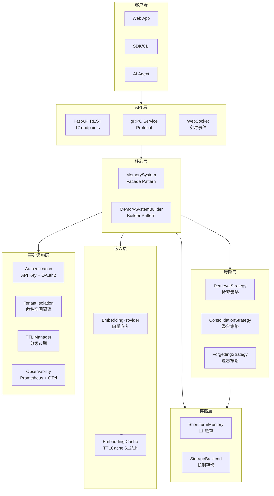
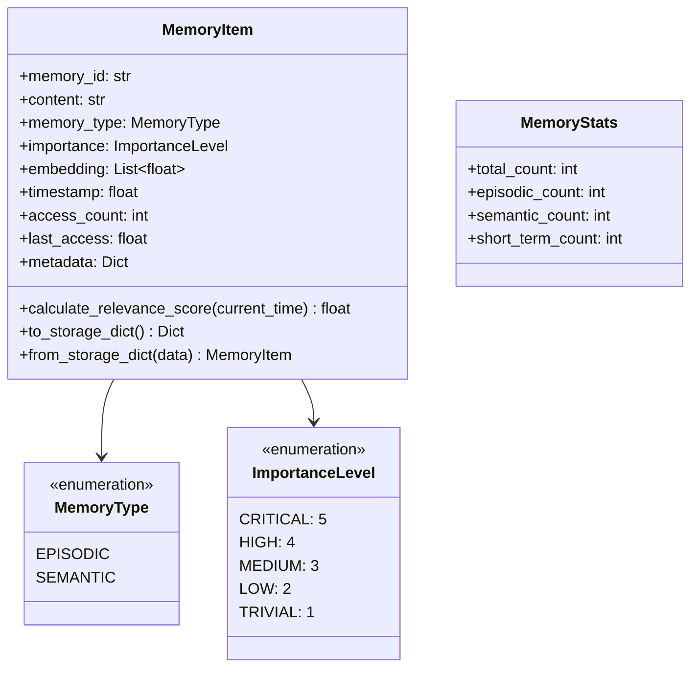
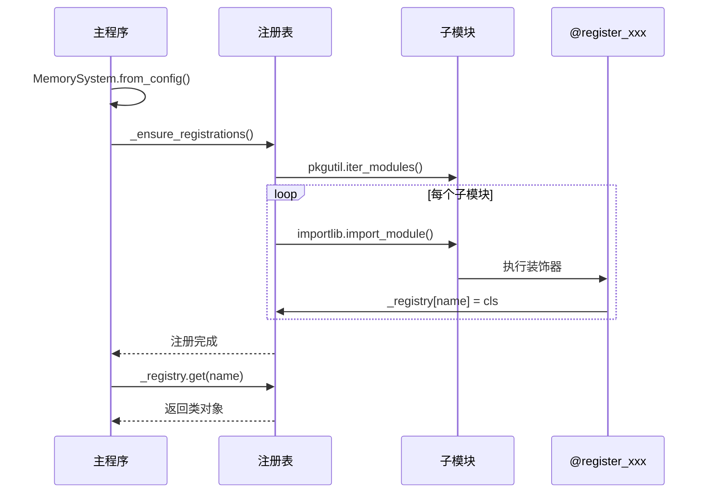
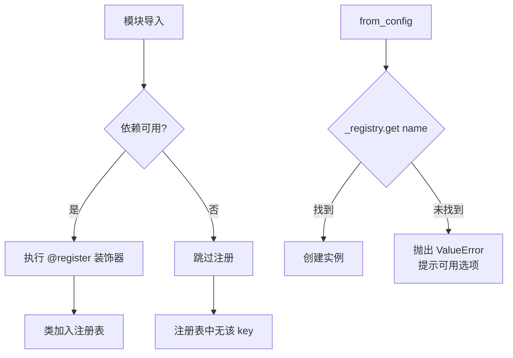
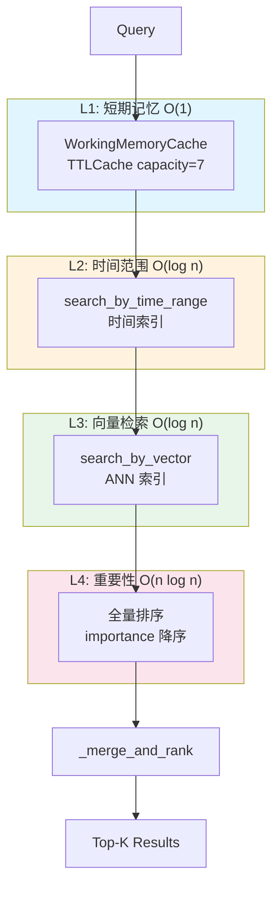

# 系统架构

本文档详细描述 Agent Memory System 的整体架构设计。

## 架构总览



---

## 核心抽象层

### 接口定义

```mermaid
classDiagram
    class StorageBackend {
        <<abstract>>
        +add(item: MemoryItem) str
        +get(memory_id: str) MemoryItem
        +search_by_vector(vector, top_k) List
        +search_by_time_range(start, end) List
        +delete(memory_id) bool
        +count() int
        +close()
    }

    class EmbeddingProvider {
        <<abstract>>
        +dimension: int
        +embed(text: str) List~float~
        +embed_batch(texts) List~List~
        +similarity(v1, v2) float
    }

    class RetrievalStrategy {
        <<abstract>>
        +retrieve(query, storage, embedding, max_results, context) Dict
    }

    class ConsolidationStrategy {
        <<abstract>>
        +should_consolidate(memories) bool
        +consolidate(storage, embedding) List
    }

    class ForgettingStrategy {
        <<abstract>>
        +select_for_forgetting(storage, max_keep) List
    }

    class ShortTermMemoryBackend {
        <<abstract>>
        +add(content, importance, metadata) MemoryItem
        +get_recent(n) List
        +get_all() List
        +clear()
        +is_full() bool
    }
```



### 数据模型



---

## 注册表模式

系统使用**装饰器 + 自动发现**实现组件注册，遵循开闭原则：



### 注册器列表

| 装饰器 | 注册表 | 用途 |
|--------|--------|------|
| `@register_storage("name")` | `_storage_registry` | 存储后端 |
| `@register_embedding("name")` | `_embedding_registry` | 嵌入模型 |
| `@register_retrieval("name")` | `_retrieval_registry` | 检索策略 |
| `@register_consolidation("name")` | `_consolidation_registry` | 整合策略 |
| `@register_forgetting("name")` | `_forgetting_registry` | 遗忘策略 |

---

## Builder 模式

解决多参数构造问题，支持链式调用：


```python
# 使用示例
system = (MemorySystemBuilder()
    .with_storage(MemoryStorage(max_memories=10000))
    .with_embedding(SentenceTransformerEmbedding(model="BAAI/bge-small-zh-v1.5"))
    .with_retrieval(HierarchicalRetrieval(strategy="adaptive"))
    .with_short_term(WorkingMemoryCache(capacity=7))
    .build())
```

---

## 条件注册机制

当依赖不可用时，组件不会被注册，避免运行时崩溃：



---

## 分层检索架构



### 检索策略对比

| 策略 | 层级 | 场景 | 复杂度 |
|------|------|------|--------|
| `fast` | L1 | 实时响应，仅短期记忆 | O(1) |
| `adaptive` | L1 + L2 + L3 | 默认策略，平衡速度与召回 | O(log n) |
| `thorough` | L1 + L2 + L3 + L4 | 高召回，包含重要性排序 | O(n log n) |
