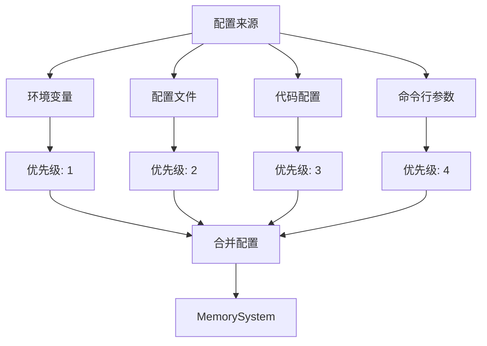
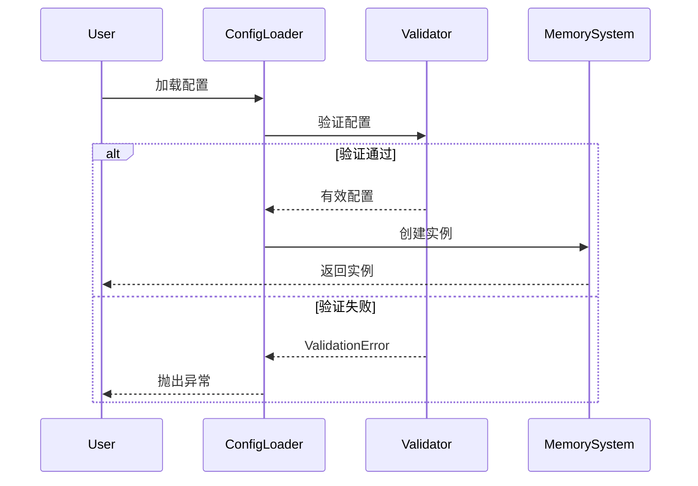
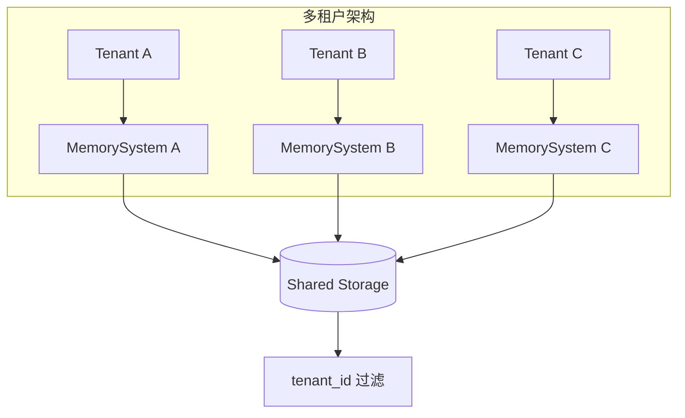

# 配置指南

Agent Memory System 支持多种配置方式，灵活适应不同场景。

## 配置方式概览



## 环境变量配置

使用 pydantic-settings 自动映射：

```bash
# 短期存储配置
MEMORY_SHORT_TERM_BACKEND=redis
MEMORY_SHORT_TERM_MAX_SIZE=1000
MEMORY_SHORT_TERM_TTL=3600

# 长期存储配置
MEMORY_LONG_TERM_BACKEND=chromadb
MEMORY_LONG_TERM_PERSIST_DIRECTORY=/data/chroma

# 嵌入服务配置
MEMORY_EMBEDDING_PROVIDER=openai
MEMORY_EMBEDDING_MODEL=text-embedding-3-small
MEMORY_EMBEDDING_API_KEY=sk-xxx

# 整合策略配置
MEMORY_CONSOLIDATION_STRATEGY=time_based
MEMORY_CONSOLIDATION_THRESHOLD=0.7

# 遗忘策略配置
MEMORY_FORGETTING_STRATEGY=score_based
MEMORY_FORGETTING_RETENTION_THRESHOLD=0.3
```

**Python 代码：**

```python
from agent_memory_system import MemorySystem

# 自动从环境变量加载
memory = MemorySystem.from_env()
```

## 配置文件

### YAML 配置

```yaml
# config.yaml
short_term:
  backend: redis
  host: localhost
  port: 6379
  max_size: 1000
  ttl: 3600

long_term:
  backend: chromadb
  persist_directory: ./data/chroma
  collection_name: memories

embedding:
  provider: openai
  model: text-embedding-3-small
  api_key: ${OPENAI_API_KEY}  # 支持环境变量引用

consolidation:
  strategy: time_based
  time_window: 3600  # 1小时
  min_items: 10

forgetting:
  strategy: score_based
  retention_threshold: 0.3
  decay_rate: 0.1

logging:
  level: INFO
  format: "%(asctime)s - %(name)s - %(levelname)s - %(message)s"
```

**加载配置：**

```python
memory = MemorySystem.from_config("config.yaml")
```

### TOML 配置

```toml
# config.toml
[short_term]
backend = "redis"
host = "localhost"
port = 6379
max_size = 1000
ttl = 3600

[long_term]
backend = "chromadb"
persist_directory = "./data/chroma"

[embedding]
provider = "openai"
model = "text-embedding-3-small"

[consolidation]
strategy = "time_based"
threshold = 0.7
```

## 代码配置

### Builder 模式

```python
from agent_memory_system import MemorySystem

memory = (MemorySystem.builder()
    .with_short_term(
        backend="redis",
        host="localhost",
        port=6379,
        max_size=1000,
        ttl=3600
    )
    .with_long_term(
        backend="chromadb",
        persist_directory="./data/chroma"
    )
    .with_embedding(
        provider="openai",
        model="text-embedding-3-small"
    )
    .with_consolidation(
        strategy="time_based",
        threshold=0.7
    )
    .with_forgetting(
        strategy="score_based",
        retention_threshold=0.3
    )
    .build())
```

### 字典配置

```python
config = {
    "short_term": {
        "backend": "redis",
        "host": "localhost",
        "port": 6379
    },
    "long_term": {
        "backend": "chromadb",
        "persist_directory": "./data/chroma"
    },
    "embedding": {
        "provider": "openai",
        "model": "text-embedding-3-small"
    }
}

memory = MemorySystem.from_dict(config)
```

## 配置验证



### 配置模型

```python
from pydantic import BaseModel, Field, validator
from pydantic_settings import BaseSettings

class ShortTermConfig(BaseModel):
    backend: str = "memory"
    max_size: int = Field(default=1000, ge=1, le=100000)
    ttl: int = Field(default=3600, ge=60)
    
    @validator('backend')
    def validate_backend(cls, v):
        valid_backends = ['memory', 'redis', 'sqlite']
        if v not in valid_backends:
            raise ValueError(f"Invalid backend: {v}")
        return v

class LongTermConfig(BaseModel):
    backend: str = "chromadb"
    persist_directory: str = "./data"
    collection_name: str = "memories"

class MemoryEnvConfig(BaseSettings):
    """环境变量配置"""
    short_term: ShortTermConfig = ShortTermConfig()
    long_term: LongTermConfig = LongTermConfig()
    
    class Config:
        env_prefix = "MEMORY_"
        env_nested_delimiter = "_"
```

## 多租户配置



**配置示例：**

```python
from agent_memory_system import MemorySystem

def create_tenant_memory(tenant_id: str) -> MemorySystem:
    return (MemorySystem.builder()
        .with_long_term(
            backend="chromadb",
            persist_directory=f"./data/{tenant_id}"
        )
        .with_metadata_filter({"tenant_id": tenant_id})
        .build())

# 创建租户实例
memory_a = create_tenant_memory("tenant_a")
memory_b = create_tenant_memory("tenant_b")
```

## 完整配置参考

| 配置项 | 类型 | 默认值 | 说明 |
|--------|------|--------|------|
| `short_term.backend` | str | "memory" | 短期存储后端 |
| `short_term.max_size` | int | 1000 | 最大条目数 |
| `short_term.ttl` | int | 3600 | 生存时间(秒) |
| `long_term.backend` | str | "chromadb" | 长期存储后端 |
| `long_term.persist_directory` | str | "./data" | 持久化目录 |
| `embedding.provider` | str | "openai" | 嵌入服务提供商 |
| `embedding.model` | str | "text-embedding-3-small" | 嵌入模型 |
| `consolidation.strategy` | str | "time_based" | 整合策略 |
| `consolidation.threshold` | float | 0.7 | 整合阈值 |
| `forgetting.strategy` | str | "score_based" | 遗忘策略 |
| `forgetting.retention_threshold` | float | 0.3 | 保留阈值 |
