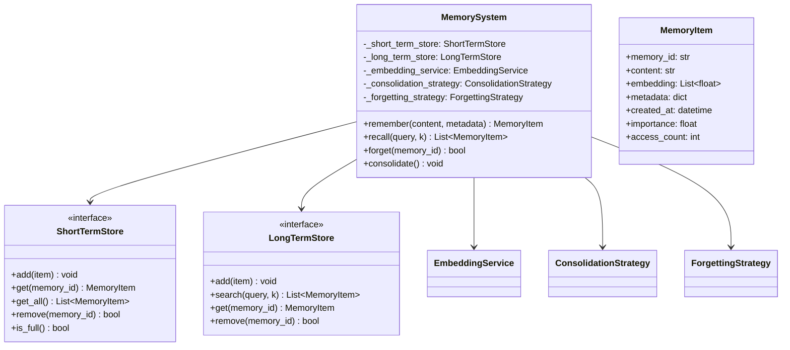
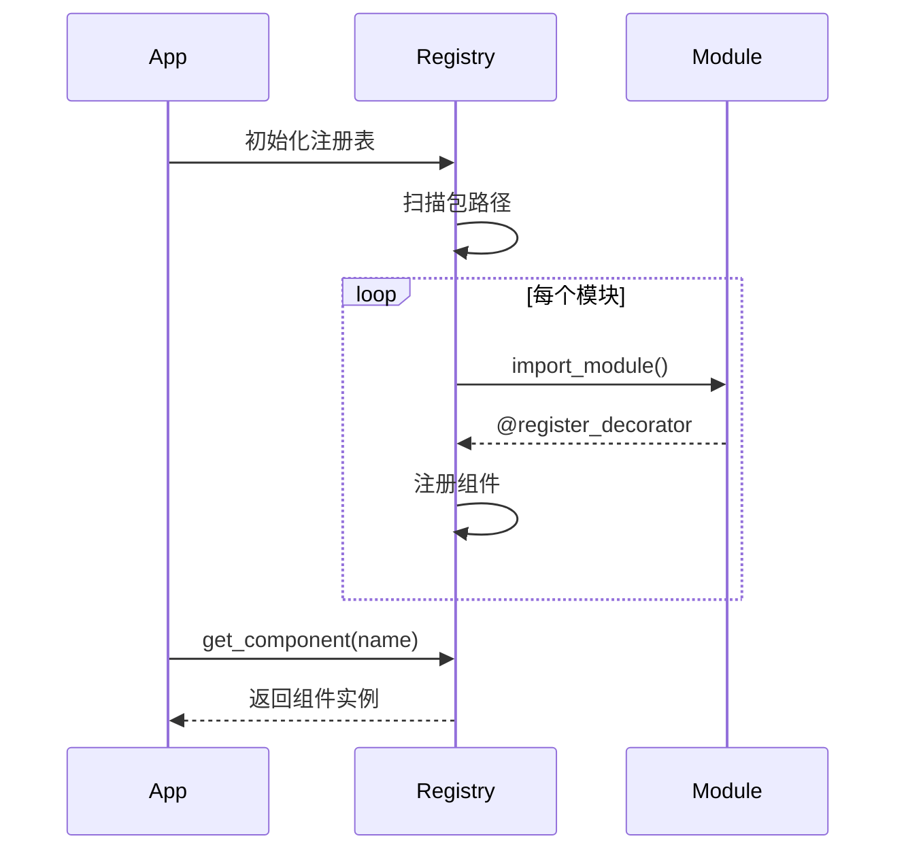
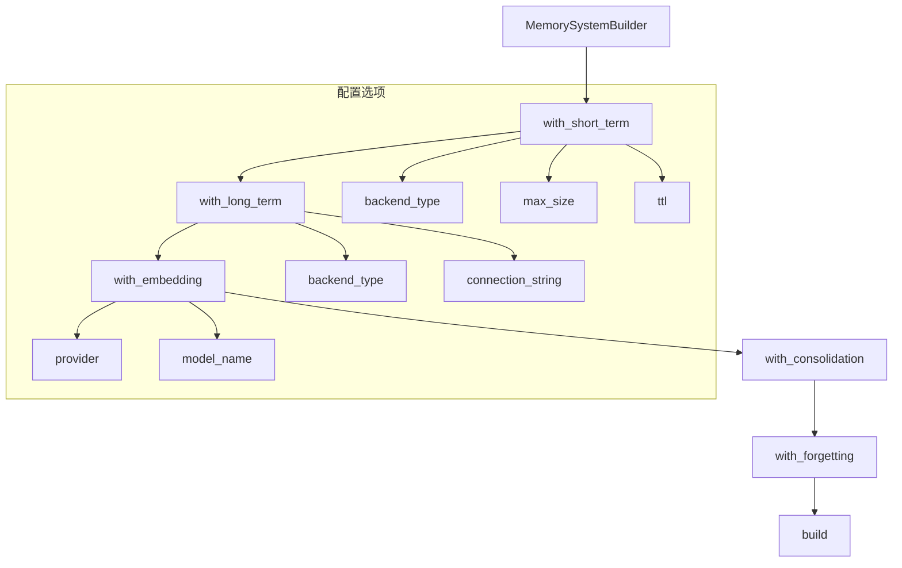
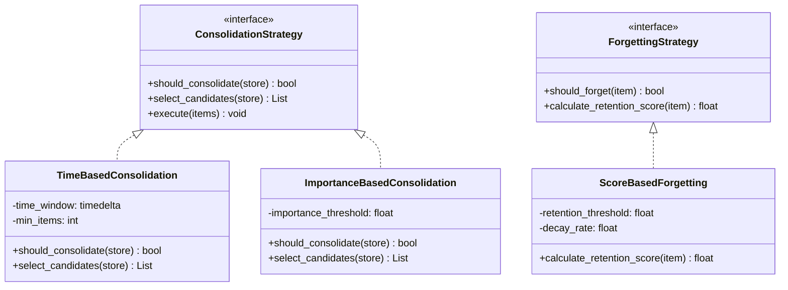
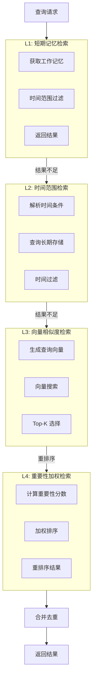
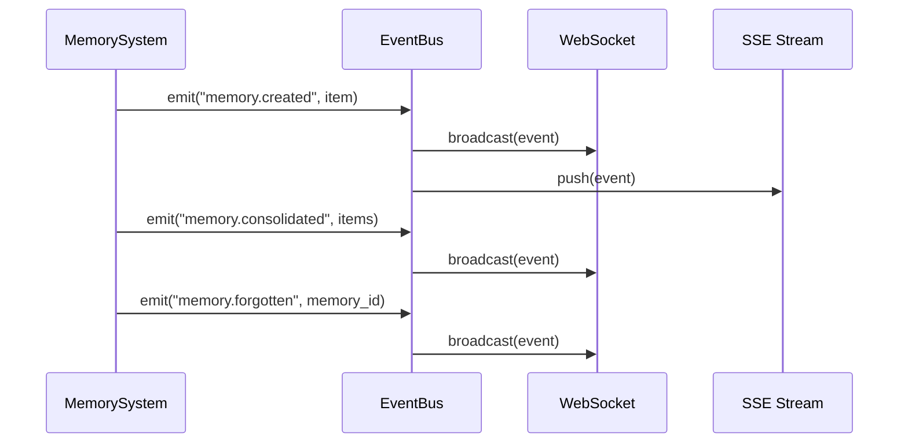

# 核心抽象

本文档详细介绍 Agent Memory System 的核心抽象概念和设计模式。

## 架构概览



## 核心接口

### MemoryItem

记忆条目的核心数据结构：

```python
@dataclass
class MemoryItem:
    """记忆条目的核心数据结构"""
    memory_id: str                    # 唯一标识符 (UUID)
    content: str                      # 记忆内容
    embedding: Optional[List[float]]  # 向量嵌入 (1536维)
    metadata: Dict[str, Any]          # 元数据
    created_at: datetime              # 创建时间
    importance: float                 # 重要性分数 [0, 1]
    access_count: int                 # 访问次数
    last_accessed: datetime           # 最后访问时间
    memory_type: MemoryType           # 记忆类型
    ttl: Optional[int]                # 生存时间 (秒)
```

### MemoryType 枚举

```python
class MemoryType(Enum):
    """记忆类型枚举"""
    EPISODIC = "episodic"      # 事件记忆 - 特定事件和经历
    SEMANTIC = "semantic"      # 语义记忆 - 事实和概念
    PROCEDURAL = "procedural"  # 程序记忆 - 技能和过程
    WORKING = "working"        # 工作记忆 - 当前任务相关
```

## 设计模式

### 1. 注册表模式 (Registry Pattern)

自动发现和注册组件：



**实现代码：**

```python
class ComponentRegistry:
    """组件注册表"""
    
    _instance = None
    _components: Dict[str, Type] = {}
    
    @classmethod
    def register(cls, name: str):
        """注册装饰器"""
        def decorator(component_class):
            cls._components[name] = component_class
            return component_class
        return decorator
    
    @classmethod
    def get(cls, name: str) -> Type:
        """获取已注册组件"""
        if name not in cls._components:
            raise ComponentNotFoundError(name)
        return cls._components[name]
    
    @classmethod
    def discover(cls, package_path: str):
        """自动发现组件"""
        package = importlib.import_module(package_path)
        for _, modname, _ in pkgutil.iter_modules(package.__path__):
            importlib.import_module(f"{package_path}.{modname}")
```

### 2. 建造者模式 (Builder Pattern)

链式调用构建 MemorySystem：



**使用示例：**

```python
# 链式构建
memory = (MemorySystemBuilder()
    .with_short_term(
        backend="memory",
        max_size=1000,
        ttl=3600
    )
    .with_long_term(
        backend="chromadb",
        persist_directory="./data"
    )
    .with_embedding(
        provider="openai",
        model="text-embedding-3-small"
    )
    .with_consolidation(
        strategy="time_based",
        threshold=0.7
    )
    .with_forgetting(
        strategy="score_based",
        retention_threshold=0.3
    )
    .build())
```

### 3. 策略模式 (Strategy Pattern)

可插拔的算法实现：



## L1-L4 分层检索



### 检索复杂度分析

| 层级 | 复杂度 | 说明 |
|------|--------|------|
| L1 | O(n) | n = 工作记忆大小 |
| L2 | O(n log n) | 时间排序 |
| L3 | O(d × log N) | d=维度, N=向量数 |
| L4 | O(k log k) | k = 候选结果数 |

## 嵌入缓存

为避免重复计算嵌入向量，系统实现了 TTL 缓存：

```python
from cachetools import TTLCache

class EmbeddingService:
    def __init__(self):
        # 512个条目，1小时TTL
        self._cache: TTLCache = TTLCache(maxsize=512, ttl=3600)
    
    def get_embedding(self, content: str) -> List[float]:
        # 计算缓存键
        cache_key = hashlib.md5(content.encode()).hexdigest()
        
        # 检查缓存
        if cache_key in self._cache:
            return self._cache[cache_key]
        
        # 计算嵌入
        embedding = self._compute_embedding(content)
        self._cache[cache_key] = embedding
        return embedding
```

## 事件系统



### 事件类型

| 事件名 | 触发时机 | 数据 |
|--------|----------|------|
| `memory.created` | 记忆创建 | MemoryItem |
| `memory.accessed` | 记忆访问 | memory_id, access_count |
| `memory.consolidated` | 记忆整合 | List[MemoryItem] |
| `memory.forgotten` | 记忆遗忘 | memory_id |
| `system.snapshot` | 快照创建 | snapshot_id |
