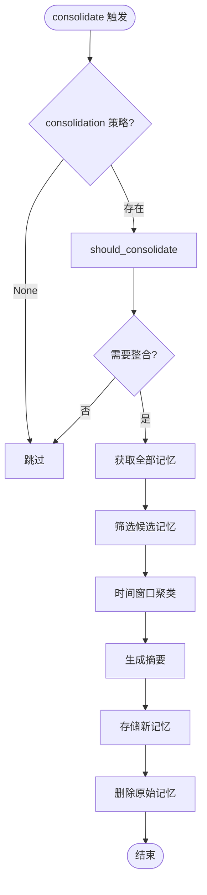
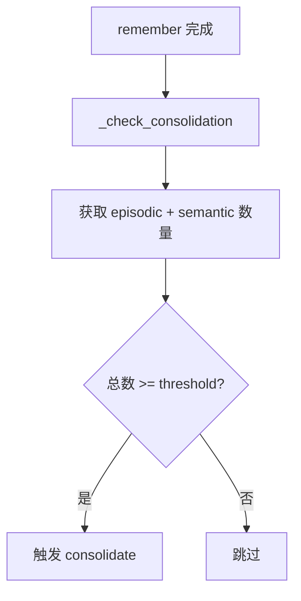
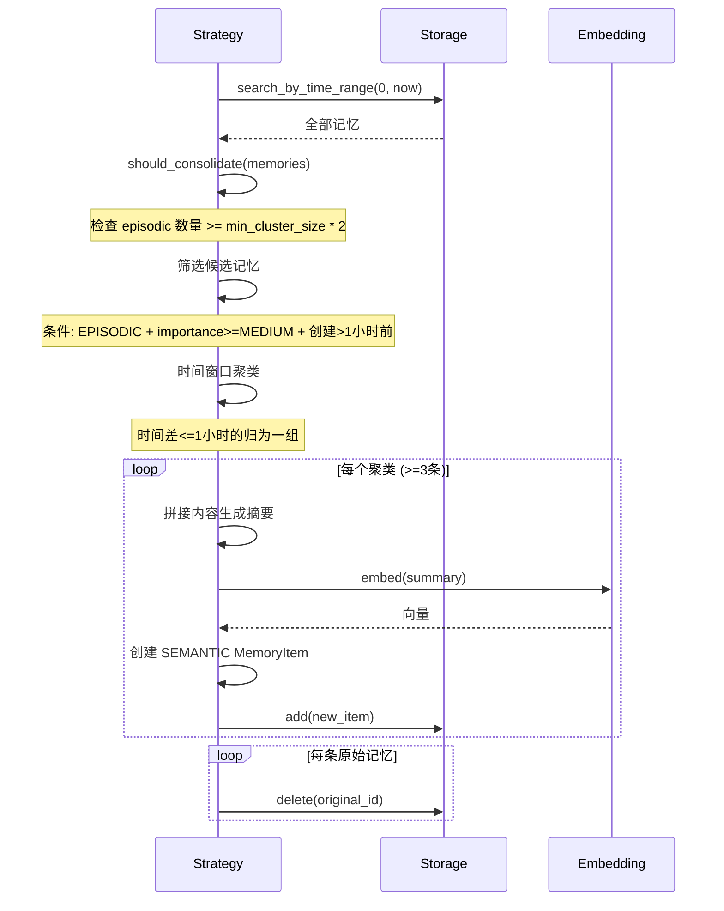
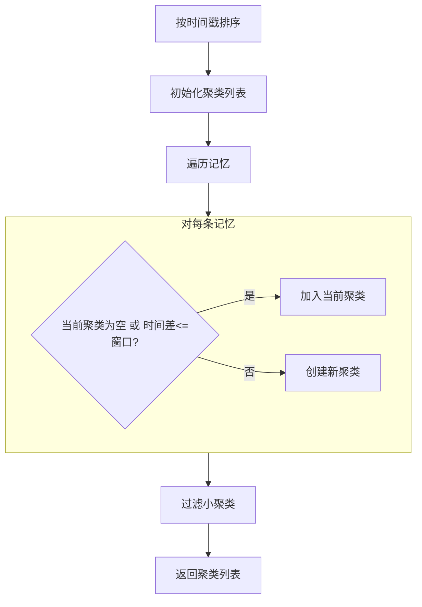
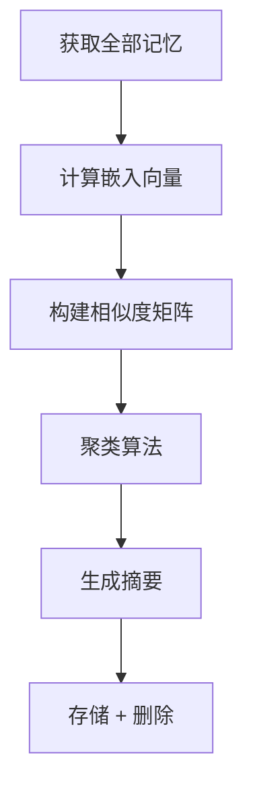

# 记忆整合流程

本文档详细描述 `consolidate()` 方法和整合策略的执行流程。

## 流程概览



---

## 触发条件

### 自动触发



| 配置项 | 默认值 | 说明 |
|--------|--------|------|
| `consolidation.enabled` | `False` | 是否启用整合 |
| `consolidation.threshold` | `100` | 触发阈值 |
| `consolidation.min_cluster_size` | `3` | 最小聚类大小 |
| `consolidation.time_window_seconds` | `3600` | 时间窗口（1小时） |

### 手动触发

```python
# 通过 API
POST /api/v1/consolidate

# 通过代码
await system.consolidate()
```

---

## TimeBasedConsolidation 策略



### 候选筛选条件

```python
def _filter_candidates(self, memories: List[MemoryItem]) -> List[MemoryItem]:
    now = time.time()
    candidates = []

    for m in memories:
        # 必须是情景记忆
        if m.memory_type != MemoryType.EPISODIC:
            continue

        # 重要性至少为 MEDIUM
        if m.importance.value < ImportanceLevel.MEDIUM.value:
            continue

        # 创建时间超过 time_window_seconds
        age = now - m.timestamp
        if age < self.time_window_seconds:
            continue

        candidates.append(m)

    return candidates
```

### 时间窗口聚类



```python
def _cluster_by_time(self, memories: List[MemoryItem]) -> List[List[MemoryItem]]:
    if not memories:
        return []

    # 按时间排序
    sorted_memories = sorted(memories, key=lambda m: m.timestamp)

    clusters = []
    current_cluster = [sorted_memories[0]]

    for i in range(1, len(sorted_memories)):
        time_diff = sorted_memories[i].timestamp - sorted_memories[i-1].timestamp

        if time_diff <= self.time_window_seconds:
            current_cluster.append(sorted_memories[i])
        else:
            if len(current_cluster) >= self.min_cluster_size:
                clusters.append(current_cluster)
            current_cluster = [sorted_memories[i]]

    # 处理最后一个聚类
    if len(current_cluster) >= self.min_cluster_size:
        clusters.append(current_cluster)

    return clusters
```

---

## SimilarityBasedConsolidation 策略

基于语义相似度聚类，而非时间窗口：



---

## 整合结果示例

```json
{
  "memory_id": "consolidated_abc123",
  "content": "用户在2024年1月进行了多次API调用，主要涉及用户认证和数据处理...",
  "memory_type": "semantic",
  "importance": "high",
  "metadata": {
    "consolidated_from": [
      "episodic_001",
      "episodic_002",
      "episodic_003"
    ],
    "cluster_time_range": ["2024-01-15T10:00:00", "2024-01-15T11:30:00"],
    "original_count": 3
  }
}
```
