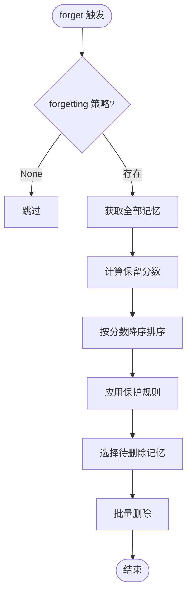
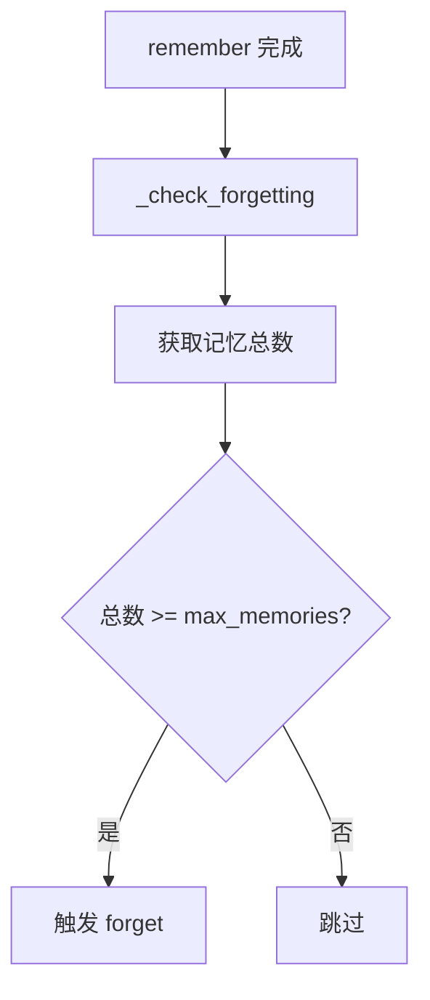
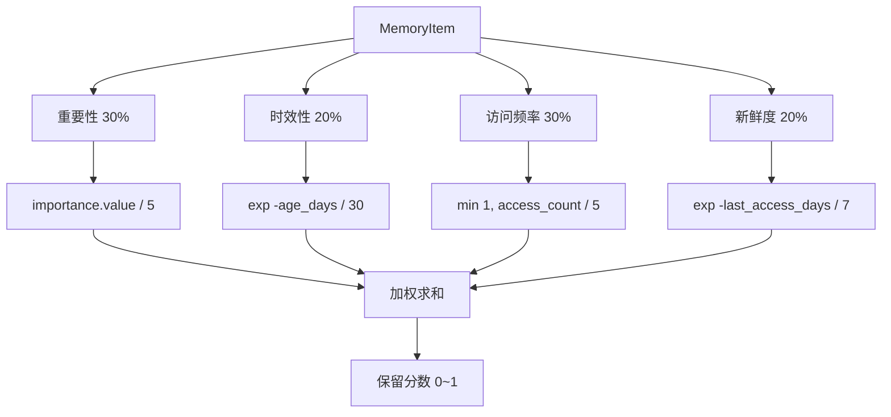
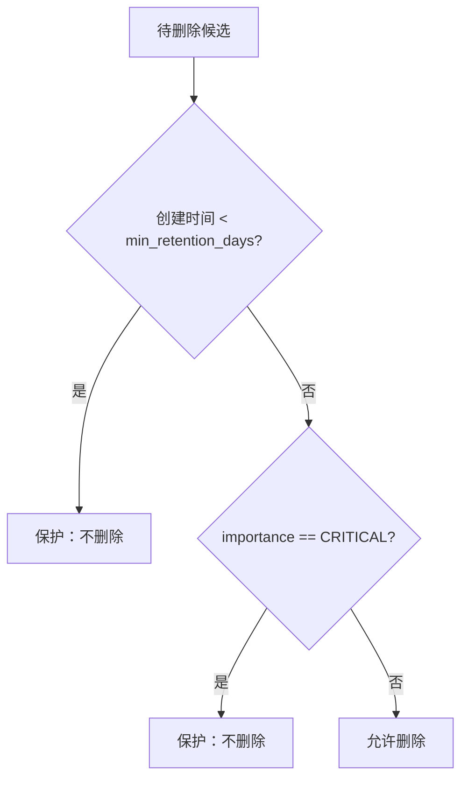
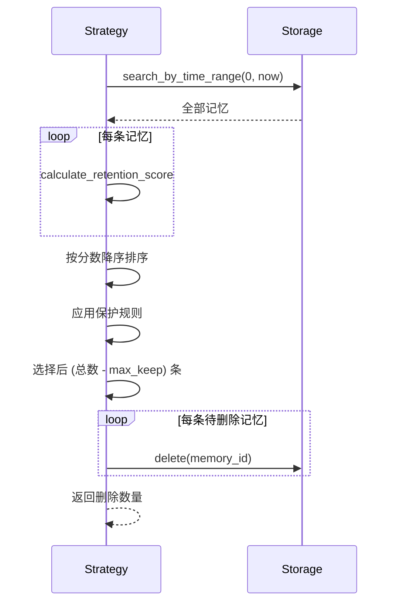
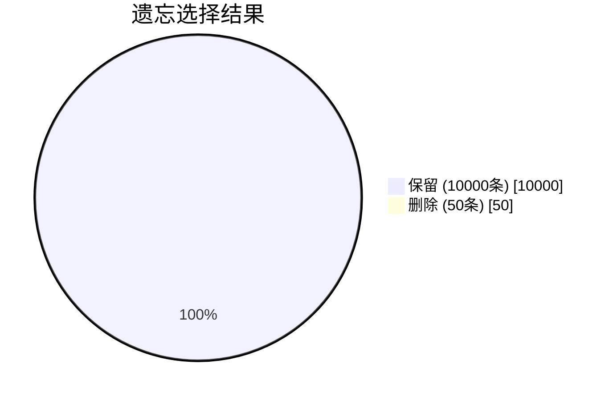

# 记忆遗忘流程

本文档详细描述 `forget()` 方法和遗忘策略的执行流程。

## 流程概览



---

## 触发条件

### 自动触发



| 配置项 | 默认值 | 说明 |
|--------|--------|------|
| `forgetting.enabled` | `True` | 是否启用遗忘 |
| `forgetting.max_memories` | `10000` | 触发阈值 |
| `forgetting.min_retention_days` | `1` | 最小保留天数 |

---

## ScoreBasedForgetting 策略

### 保留分数计算



```python
def calculate_retention_score(self, memory: MemoryItem, current_time: float) -> float:
    # 重要性贡献 (30%)
    importance_score = memory.importance.value / 5.0

    # 时效性衰减 (20%) - 30天半衰期
    age_days = (current_time - memory.timestamp) / 86400
    recency_score = math.exp(-age_days / 30)

    # 访问频率贡献 (30%)
    access_score = min(1.0, memory.access_count / 5.0)

    # 新鲜度衰减 (20%) - 7天半衰期
    last_access_days = (current_time - memory.last_access) / 86400
    freshness_score = math.exp(-last_access_days / 7)

    return (
        importance_score * 0.30 +
        recency_score * 0.20 +
        access_score * 0.30 +
        freshness_score * 0.20
    )
```

### 分数权重说明

| 因素 | 权重 | 公式 | 说明 |
|------|------|------|------|
| 重要性 | 30% | `importance.value / 5` | CRITICAL=1.0, TRIVIAL=0.2 |
| 时效性 | 20% | `exp(-age/30)` | 30天半衰期指数衰减 |
| 访问频率 | 30% | `min(1, count/5)` | 5次访问达到满分 |
| 新鲜度 | 20% | `exp(-last_access/7)` | 7天半衰期指数衰减 |

---

## 保护规则



### 保护条件

```python
def is_protected(self, memory: MemoryItem, current_time: float) -> bool:
    # 最小保留期保护
    age_days = (current_time - memory.timestamp) / 86400
    if age_days < self.min_retention_days:
        return True

    # CRITICAL 级别保护（可选）
    if memory.importance == ImportanceLevel.CRITICAL:
        return True

    return False
```

---

## 执行流程



---

## 遗忘示例

假设当前有 10050 条记忆，`max_memories = 10000`：



### 删除优先级

1. **最优先删除**：TRIVIAL + 旧 + 未访问
2. **次优先删除**：LOW + 较旧 + 少访问
3. **保护**：CRITICAL + 新 + 高频访问
