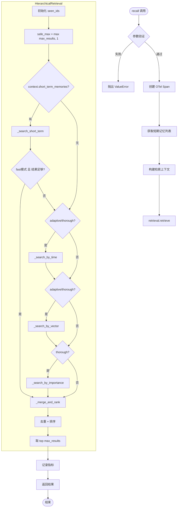
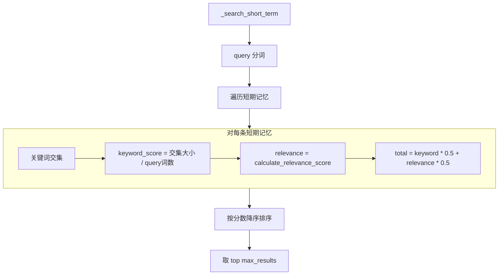
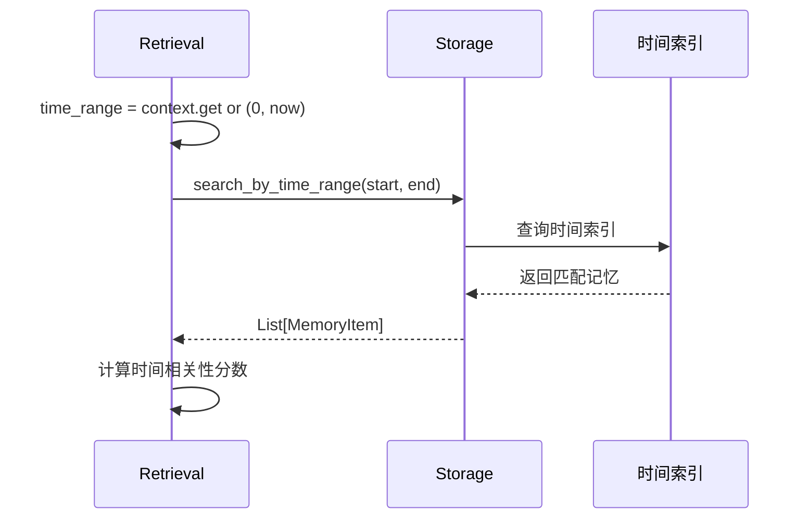
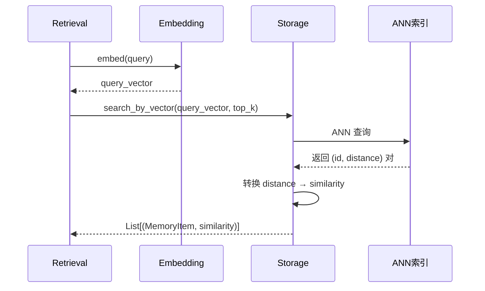
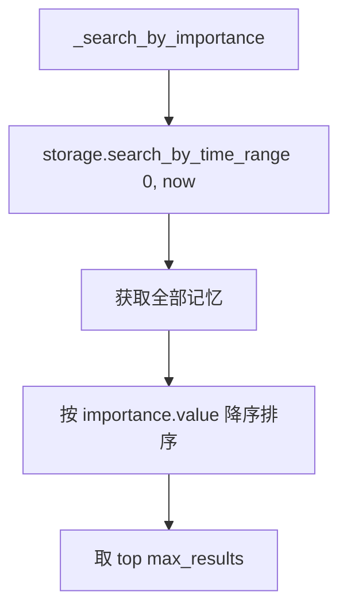
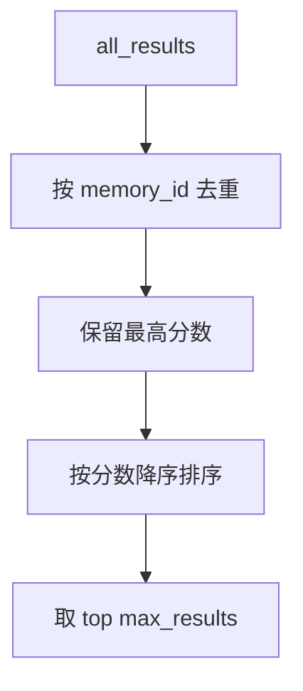

# 记忆检索流程

本文档详细描述 `recall()` 方法和 L1-L4 分层检索的完整流程。

## 流程概览



---

## L1: 短期记忆检索

**复杂度**: O(1) — 直接访问 TTLCache



### 相关性评分计算

```python
def calculate_relevance_score(self, current_time: float) -> float:
    # 重要性贡献 (30%)
    importance_score = self.importance.value / 5.0

    # 时效性衰减 (20%) - 30天半衰期
    age_days = (current_time - self.timestamp) / 86400
    recency_score = math.exp(-age_days / 30)

    # 访问频率贡献 (30%)
    access_score = min(1.0, self.access_count / 5.0)

    # 新鲜度衰减 (20%) - 7天半衰期
    last_access_days = (current_time - self.last_access) / 86400
    freshness_score = math.exp(-last_access_days / 7)

    return (importance_score * 0.3 + recency_score * 0.2 +
            access_score * 0.3 + freshness_score * 0.2)
```

---

## L2: 时间范围检索

**复杂度**: O(log n) — 时间索引



### 自动时间范围填充

```python
# 如果未提供 time_range，自动填充为全部时间
time_range = context.get("time_range")
if time_range is None:
    time_range = (0.0, time.time())  # 从 epoch 到现在
```

---

## L3: 向量相似度检索

**复杂度**: O(log n) — ANN 索引 (FAISS/HNSW)



### 向量检索实现

```python
async def search_by_vector(self, query_vector, top_k=5, filters=None):
    results = []
    async with self._lock:
        for memory in self._memories.values():
            if memory.embedding is None:
                continue  # 跳过无嵌入的记忆

            similarity = cosine_similarity(query_vector, memory.embedding)

            # 应用过滤器
            if filters and not matches_filters(memory, filters):
                continue

            results.append((memory, similarity))

    # 按相似度降序排序
    results.sort(key=lambda x: x[1], reverse=True)
    return results[:top_k]
```

---

## L4: 重要性检索

**复杂度**: O(n log n) — 全量排序



!!! warning "性能警告"
    L4 层会加载**全部记忆**到内存并排序。当记忆数量大时（默认上限 10000），可能影响性能。建议仅在 `thorough` 模式下使用。

---

## 结果合并与去重



```python
def _merge_and_rank(self, results: List, max_results: int) -> List:
    # 去重：同一记忆只保留最高分
    best_scores: Dict[str, Tuple] = {}
    for memory, score, layer in results:
        mid = memory.memory_id
        if mid not in best_scores or score > best_scores[mid][1]:
            best_scores[mid] = (memory, score, layer)

    # 排序并取 top-K
    merged = sorted(best_scores.values(), key=lambda x: x[1], reverse=True)
    return merged[:max_results]
```

---

## 检索策略对比

| 策略 | 层级 | 典型延迟 | 召回率 | 使用场景 |
|------|------|---------|--------|----------|
| `fast` | L1 | < 0.1ms | 低 | 实时响应、仅短期记忆 |
| `adaptive` | L1+L2+L3 | < 1ms | 中 | **默认**，平衡速度与召回 |
| `thorough` | L1+L2+L3+L4 | < 10ms | 高 | 高召回、重要性敏感场景 |

### 比例分配

```python
# 各层结果数量比例
short_term_ratio = 0.33   # L1 取 33%
time_ratio = 0.33         # L2 取 33%
vector_ratio = 0.50       # L3 取 50%
importance_ratio = 0.25   # L4 取 25%
```
