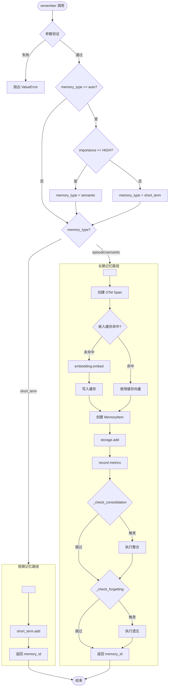
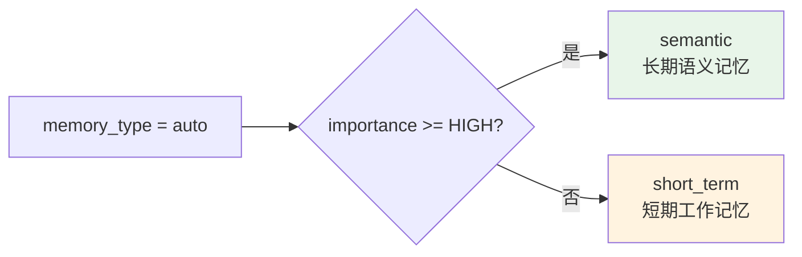
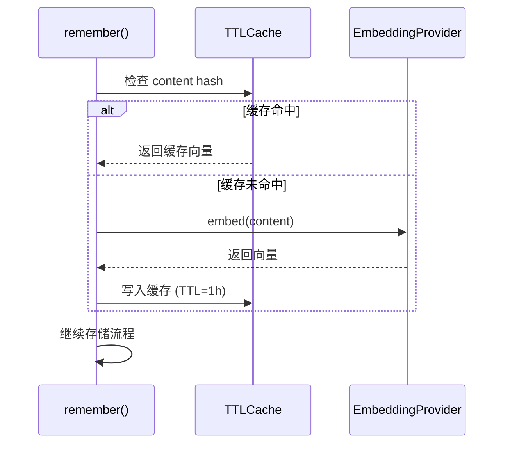
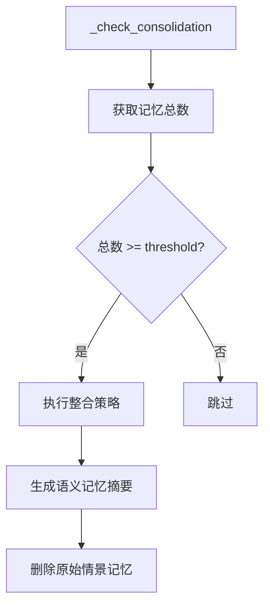
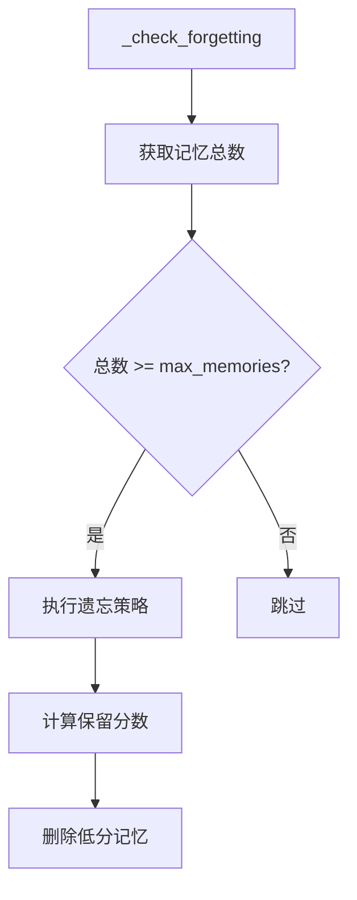
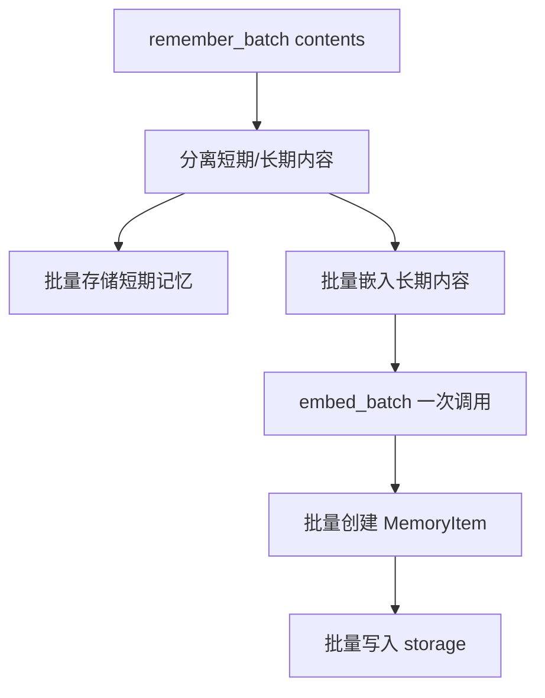

# 记忆存储流程

本文档详细描述 `remember()` 方法的完整执行流程。

## 流程概览



---

## 参数验证

```python
# 必填参数校验
if not content or not content.strip():
    raise ValueError("记忆内容不能为空")

# 枚举值校验
if memory_type not in ["auto", "short_term", "episodic", "semantic"]:
    raise ValueError(f"无效的 memory_type: {memory_type}")

if importance not in ["critical", "high", "medium", "low", "trivial"]:
    raise ValueError(f"无效的 importance: {importance}")
```

---

## 自动类型选择



| importance | 自动选择的类型 | 说明 |
|-----------|---------------|------|
| CRITICAL, HIGH | `semantic` | 重要信息存入长期记忆 |
| MEDIUM, LOW, TRIVIAL | `short_term` | 临时信息存入短期记忆 |

---

## 嵌入缓存机制



### 缓存配置

| 参数 | 值 | 说明 |
|------|-----|------|
| `maxsize` | 512 | 最多缓存 512 条嵌入 |
| `ttl` | 3600s (1小时) | 缓存有效期 |

---

## 后置检查

### 整合检查



### 遗忘检查



---

## 批量存储优化

`remember_batch()` 针对批量场景优化：



| 优化点 | 说明 |
|--------|------|
| 批量嵌入 | 一次 `embed_batch()` 调用替代多次 `embed()` |
| 减少网络往返 | OpenAI 等远程 API 批量请求更高效 |
| 嵌入缓存复用 | 已缓存内容跳过嵌入计算 |
