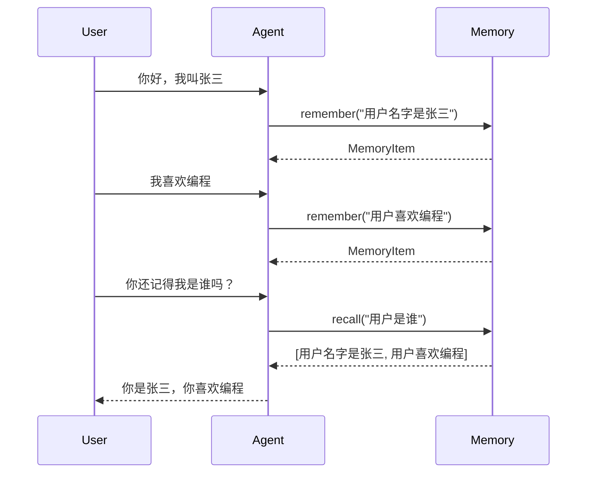
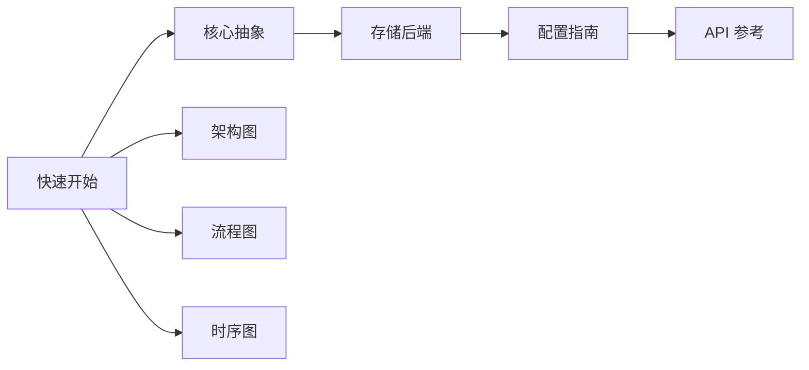

# 快速开始

本指南帮助你快速上手 Agent Memory System。

## 安装

```bash
# 使用 pip 安装
pip install agent-memory-system

# 或使用 poetry
poetry add agent-memory-system
```

## 基础用法

### 创建记忆系统

```python
from agent_memory_system import MemorySystem

# 最简单的方式 - 使用默认配置
memory = MemorySystem()

# 或使用 Builder 模式自定义配置
memory = (MemorySystem.builder()
    .with_short_term(backend="memory", max_size=1000)
    .with_long_term(backend="chromadb", persist_directory="./data")
    .build())
```

### 记忆操作

```python
# 记住信息
memory.remember("用户喜欢喝咖啡")
memory.remember("用户的生日是1990年5月15日", metadata={"category": "personal"})
memory.remember("用户使用Python编程", importance=0.8)

# 回忆信息
results = memory.recall("用户喜欢什么")
for item in results:
    print(f"- {item.content} (重要性: {item.importance})")

# 遗忘信息
memory.forget(memory_id="xxx-xxx-xxx")
```

## 完整示例



### Python 完整代码

```python
import asyncio
from agent_memory_system import MemorySystem

async def main():
    # 创建记忆系统
    memory = (MemorySystem.builder()
        .with_short_term(backend="memory", max_size=100)
        .with_long_term(backend="chromadb", persist_directory="./data")
        .with_embedding(provider="openai", model="text-embedding-3-small")
        .build())
    
    # 记住用户信息
    await memory.remember("用户名字是张三", metadata={"type": "name"})
    await memory.remember("用户喜欢Python编程", metadata={"type": "interest"})
    await memory.remember("用户是软件工程师", metadata={"type": "job"})
    
    # 回忆用户信息
    results = await memory.recall("用户是谁", k=5)
    print("用户信息:")
    for item in results:
        print(f"  - {item.content}")
    
    # 查询特定类型
    interests = await memory.recall("编程", metadata_filter={"type": "interest"})
    print(f"用户兴趣: {[item.content for item in interests]}")
    
    # 手动触发整合
    await memory.consolidate()
    
    # 获取统计信息
    stats = await memory.get_stats()
    print(f"总记忆数: {stats['total_count']}")
    print(f"平均重要性: {stats['avg_importance']}")

if __name__ == "__main__":
    asyncio.run(main())
```

## REST API 使用

### 启动服务

```bash
# 命令行启动
agent-memory-server --port 8000

# 或 Python 代码
from agent_memory_system.api import create_app
import uvicorn

app = create_app()
uvicorn.run(app, host="0.0.0.0", port=8000)
```

### API 调用

```python
import httpx

async def api_example():
    base_url = "http://localhost:8000/api/v1"
    
    async with httpx.AsyncClient() as client:
        # 创建记忆
        response = await client.post(
            f"{base_url}/memories",
            json={
                "content": "用户喜欢喝咖啡",
                "metadata": {"category": "preference"},
                "importance": 0.7
            }
        )
        memory_id = response.json()["memory_id"]
        
        # 搜索记忆
        response = await client.get(
            f"{base_url}/memories/recall",
            params={"query": "用户喜欢什么", "k": 5}
        )
        results = response.json()["results"]
        
        # 删除记忆
        await client.delete(f"{base_url}/memories/{memory_id}")
```

### cURL 示例

```bash
# 创建记忆
curl -X POST http://localhost:8000/api/v1/memories \
  -H "Content-Type: application/json" \
  -d '{"content": "用户喜欢喝咖啡", "importance": 0.7}'

# 搜索记忆
curl "http://localhost:8000/api/v1/memories/recall?query=用户喜欢什么&k=5"

# 获取所有记忆
curl http://localhost:8000/api/v1/memories

# 删除记忆
curl -X DELETE http://localhost:8000/api/v1/memories/{memory_id}
```

## WebSocket 实时事件

```python
import websockets
import json

async def websocket_example():
    uri = "ws://localhost:8000/ws"
    
    async with websockets.connect(uri) as ws:
        # 监听事件
        while True:
            message = await ws.recv()
            event = json.loads(message)
            
            if event["type"] == "memory.created":
                print(f"新记忆: {event['data']['content']}")
            elif event["type"] == "memory.forgotten":
                print(f"记忆遗忘: {event['data']['memory_id']}")
```

## 下一步



- 📖 [核心抽象](core-abstractions.md) - 深入理解系统设计
- 💾 [存储后端](storage-backends.md) - 选择合适的存储方案
- ⚙️ [配置指南](configuration.md) - 详细配置选项
- 🔌 [API 参考](api-reference.md) - REST API 文档
- 🏗️ [架构图](architecture.md) - 系统架构可视化
- 🔄 [流程图](flow-remember.md) - 核心流程详解
- 📊 [时序图](sequence-api.md) - API 交互序列

## 常见问题

### Q: 如何选择存储后端？

**A:** 取决于你的场景：
- 开发/测试 → InMemory
- 小型应用 → SQLite
- 需要向量搜索 → ChromaDB
- 大规模生产 → Qdrant

### Q: 嵌入服务如何配置？

**A:** 支持多种提供商：
```python
memory = MemorySystem.builder() \
    .with_embedding(
        provider="openai",  # 或 "azure", "huggingface", "local"
        model="text-embedding-3-small",
        api_key="sk-xxx"
    ) \
    .build()
```

### Q: 如何实现多租户？

**A:** 使用元数据过滤：
```python
# 创建时添加租户标识
memory.remember(content, metadata={"tenant_id": "tenant_a"})

# 查询时过滤
memory.recall(query, metadata_filter={"tenant_id": "tenant_a"})
```
