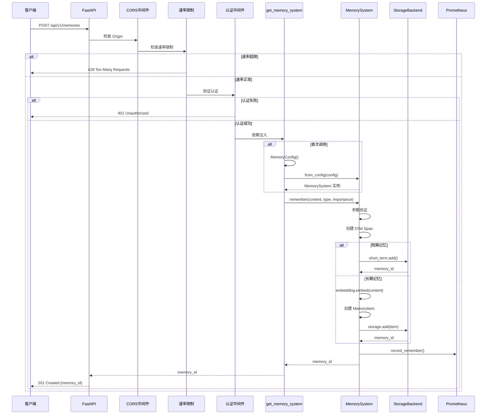
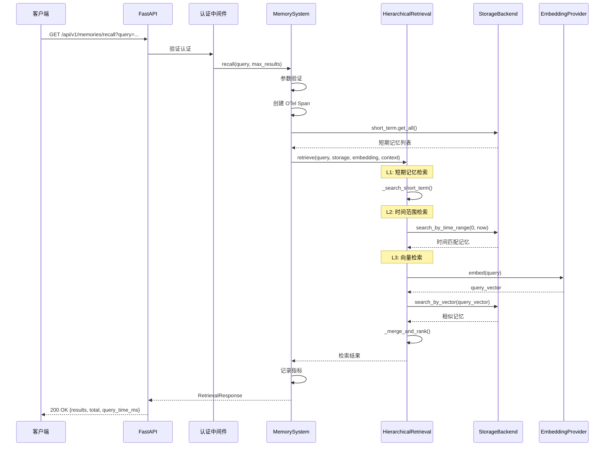
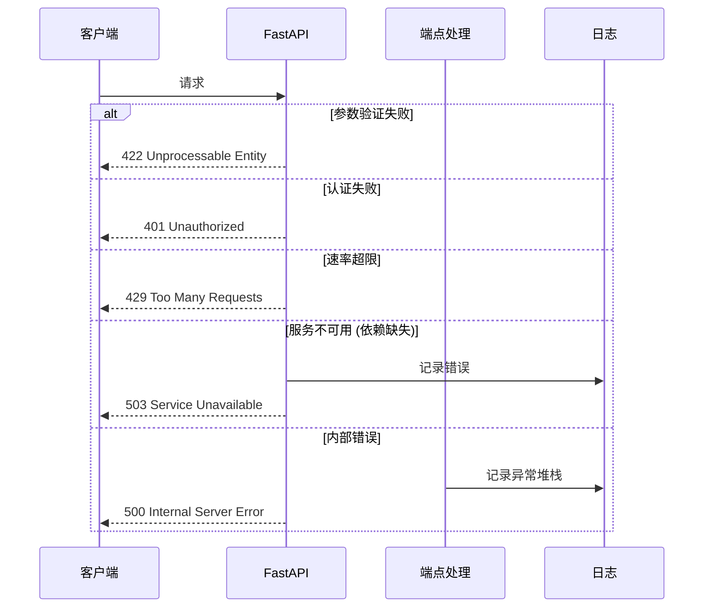
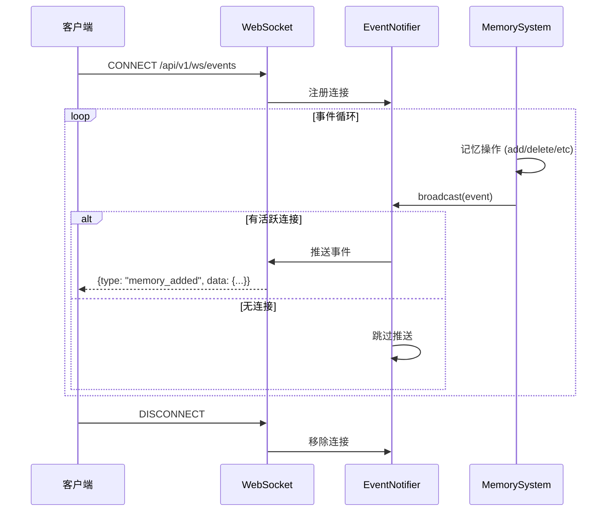
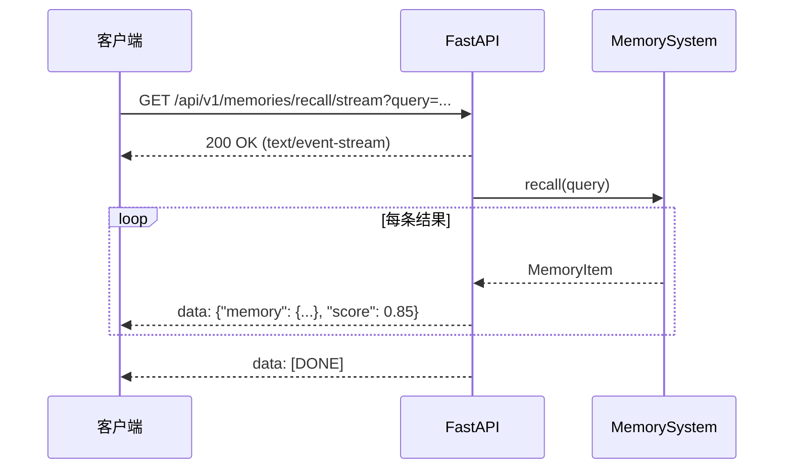

# API 生命周期时序图

本文档展示 REST API 请求的完整生命周期。

## POST /api/v1/memories (存储记忆)

---

## GET /api/v1/memories/recall (检索记忆)

---

## 错误处理时序

---

## WebSocket 事件推送

### 事件类型

| 事件类型 | 触发时机 | 数据 |
|----------|----------|------|
| `memory_added` | 记忆存储成功 | `{memory_id, memory_type}` |
| `memory_recalled` | 记忆检索成功 | `{query, result_count}` |
| `memory_deleted` | 记忆删除成功 | `{memory_id}` |
| `memory_consolidated` | 整合完成 | `{new_id, original_ids}` |
| `memory_expired` | TTL 过期 | `{memory_id}` |

---

## SSE 流式响应

