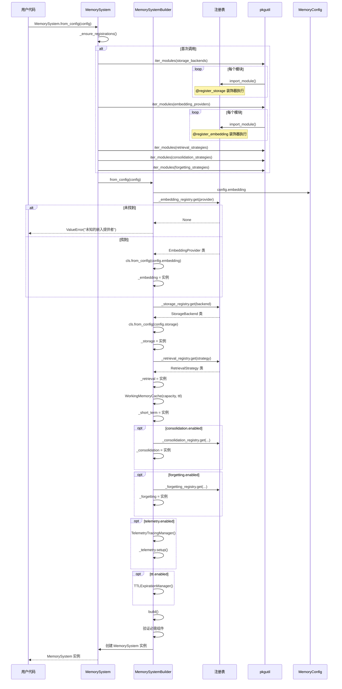
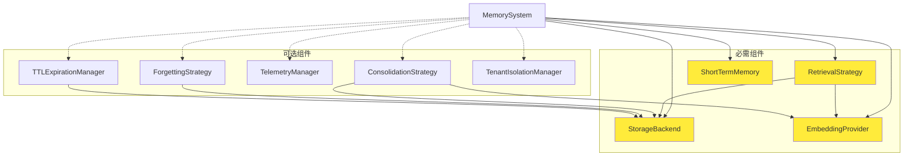
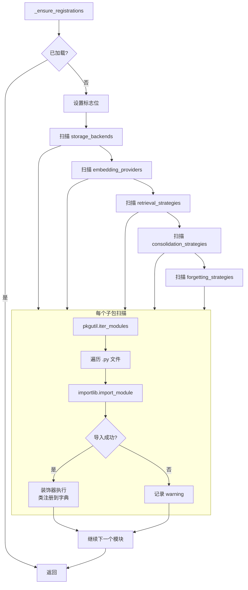
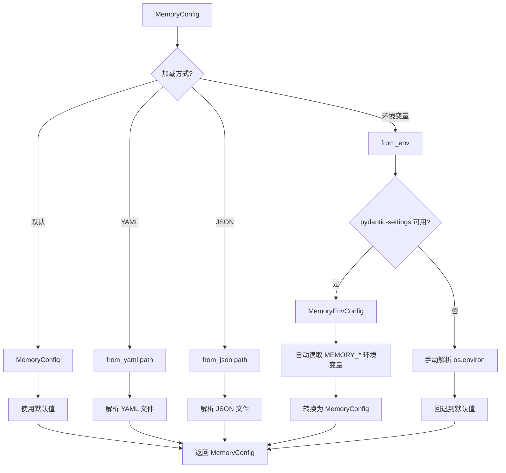

# 系统初始化时序图

本文档展示系统从配置加载到完全就绪的完整流程。

## MemorySystem.from_config() 初始化



---

## 组件依赖关系



---

## 注册表自动发现



---

## 条件注册流程

```mermaid
flowchart TD
    A[模块导入] --> B{依赖可用?}

    alt 依赖可用
        B -->|是| C[定义类]
        C --> D[执行 @register_xxx 装饰器]
        D --> E[类加入注册表]
        E --> F[可正常使用]
    else 依赖不可用
        B -->|否| G[跳过类定义]
        G --> H[注册表中无该 key]
        H --> I[from_config 时报错]
    end
```

### 示例：ChromaDB 条件注册

```python
# 条件注册：ChromaDB 不可用时不注册
_CHROMADB_AVAILABLE = False
try:
    import chromadb
    _CHROMADB_AVAILABLE = True
except ImportError:
    pass

if _CHROMADB_AVAILABLE:
    @register_storage("chroma")
    class ChromaStorage(StorageBackend):
        ...
```

---

## TTL 管理器启动

```mermaid
sequenceDiagram
    participant Builder as MemorySystemBuilder
    participant TTL as TTLExpirationManager
    participant Loop as asyncio.Task

    Builder->>TTL: TTLExpirationManager(storage, config)
    Note over TTL: 不立即启动

    alt 旧版 (已移除)
        Builder->>Loop: asyncio.create_task(ttl.start())
        Note over Loop: 在同步方法中启动<br/>可能导致无事件循环错误
    end

    Note over Builder: TTL 管理器存储在实例上<br/>可通过 start() 方法延迟启动
```

---

## 配置加载流程



### 环境变量映射

| 环境变量 | 配置字段 | 说明 |
|----------|----------|------|
| `MEMORY_STORAGE_BACKEND` | `storage.backend` | 存储后端类型 |
| `MEMORY_EMBEDDING_PROVIDER` | `embedding.provider` | 嵌入提供者 |
| `MEMORY_SHORT_TERM__CAPACITY` | `short_term.capacity` | 短期记忆容量 |
| `MEMORY_TTL__ENABLED` | `ttl.enabled` | TTL 过期开关 |
