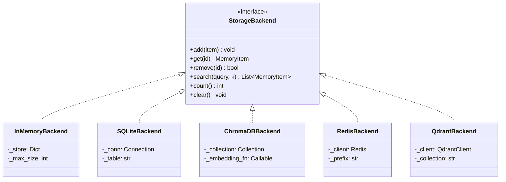
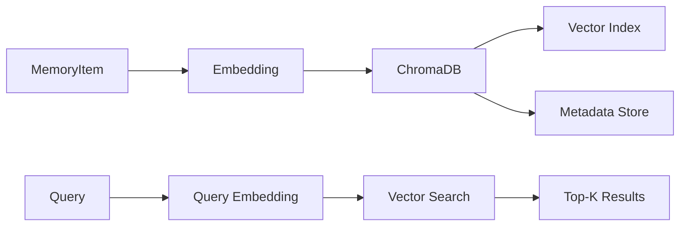
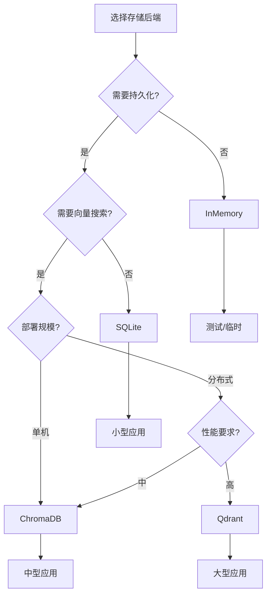
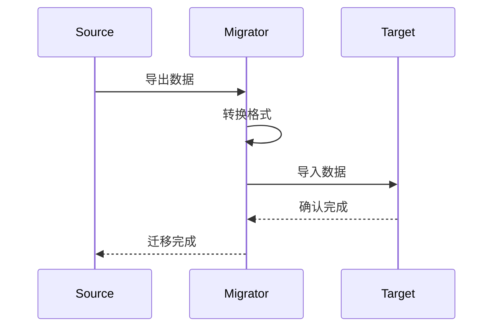

# 存储后端

Agent Memory System 支持多种存储后端，可根据需求灵活选择。

## 存储架构



## 短期存储后端

### InMemoryBackend

内存存储，适用于测试和临时场景：

```python
from agent_memory_system import MemorySystem

memory = MemorySystem.builder() \
    .with_short_term(
        backend="memory",
        max_size=1000,
        ttl=3600  # 1小时过期
    ) \
    .build()
```

**特点：**
- ✅ 零配置，开箱即用
- ✅ 极快访问速度
- ❌ 进程重启数据丢失
- ❌ 不支持持久化

### RedisBackend

Redis 存储，支持分布式场景：

```python
memory = MemorySystem.builder() \
    .with_short_term(
        backend="redis",
        host="localhost",
        port=6379,
        db=0,
        prefix="memory:",
        ttl=3600
    ) \
    .build()
```

**特点：**
- ✅ 支持分布式
- ✅ 原生 TTL 支持
- ✅ 高性能
- ❌ 需要额外部署 Redis

## 长期存储后端

### ChromaDB

向量数据库，支持语义搜索：

```python
memory = MemorySystem.builder() \
    .with_long_term(
        backend="chromadb",
        persist_directory="./data/chroma",
        collection_name="memories"
    ) \
    .build()
```

**特点：**
- ✅ 原生向量搜索
- ✅ 持久化存储
- ✅ 支持元数据过滤
- ✅ 本地运行，无需云服务



### Qdrant

高性能向量数据库：

```python
memory = MemorySystem.builder() \
    .with_long_term(
        backend="qdrant",
        url="http://localhost:6333",
        collection_name="memories",
        vector_size=1536
    ) \
    .build()
```

**特点：**
- ✅ 高性能向量搜索
- ✅ 支持分布式部署
- ✅ 丰富的过滤条件
- ✅ 支持量化压缩

### SQLite

轻量级关系数据库：

```python
memory = MemorySystem.builder() \
    .with_long_term(
        backend="sqlite",
        database="./data/memories.db",
        table="memories"
    ) \
    .build()
```

**特点：**
- ✅ 零配置，单文件存储
- ✅ 支持 SQL 查询
- ✅ 适合小型应用
- ❌ 无原生向量搜索

## 后端选择指南



## 性能对比

| 后端 | 写入 QPS | 读取 QPS | 向量搜索 | 持久化 | 分布式 |
|------|----------|----------|----------|--------|--------|
| InMemory | 100,000+ | 500,000+ | ❌ | ❌ | ❌ |
| SQLite | 10,000 | 50,000 | ❌ | ✅ | ❌ |
| Redis | 50,000 | 100,000 | ❌ | ✅ | ✅ |
| ChromaDB | 5,000 | 10,000 | ✅ | ✅ | ❌ |
| Qdrant | 20,000 | 50,000 | ✅ | ✅ | ✅ |

## 自定义后端

实现自定义存储后端：

```python
from agent_memory_system.core import StorageBackend, MemoryItem

class CustomBackend(StorageBackend):
    """自定义存储后端"""
    
    def __init__(self, **config):
        # 初始化连接
        pass
    
    def add(self, item: MemoryItem) -> None:
        """添加记忆"""
        pass
    
    def get(self, memory_id: str) -> Optional[MemoryItem]:
        """获取记忆"""
        pass
    
    def remove(self, memory_id: str) -> bool:
        """删除记忆"""
        pass
    
    def search(self, query: str, k: int = 10) -> List[MemoryItem]:
        """搜索记忆"""
        pass
    
    def count(self) -> int:
        """统计数量"""
        pass
    
    def clear(self) -> None:
        """清空存储"""
        pass

# 注册自定义后端
from agent_memory_system import StorageRegistry
StorageRegistry.register("custom", CustomBackend)

# 使用自定义后端
memory = MemorySystem.builder() \
    .with_long_term(backend="custom", **config) \
    .build()
```

## 数据迁移



**迁移示例：**

```python
from agent_memory_system.tools import migrate_storage

# 从 SQLite 迁移到 ChromaDB
migrate_storage(
    source_backend="sqlite",
    source_config={"database": "old.db"},
    target_backend="chromadb",
    target_config={"persist_directory": "./data/chroma"}
)
```
