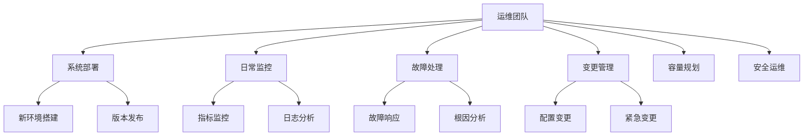
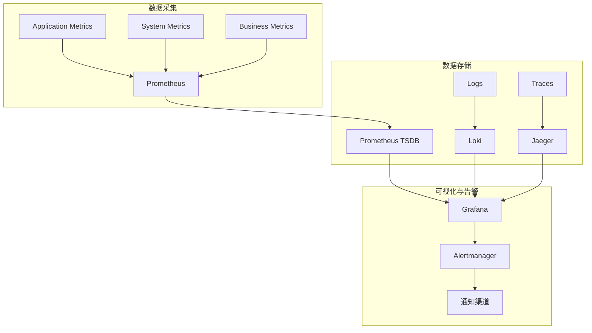
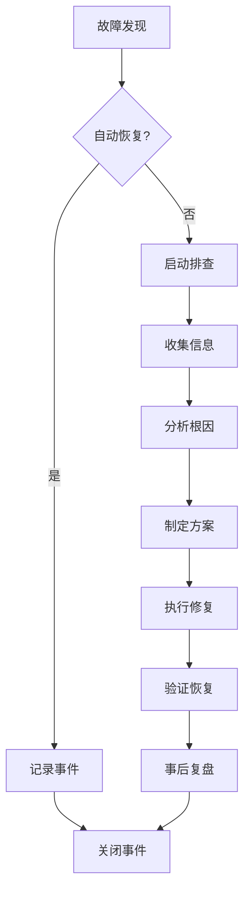
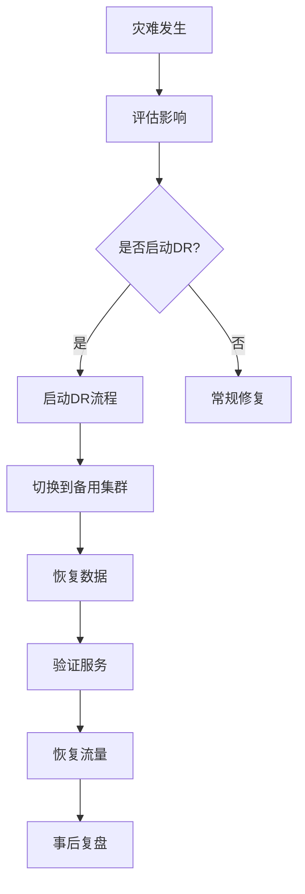
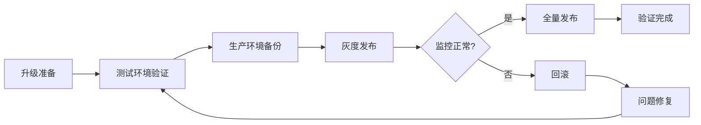
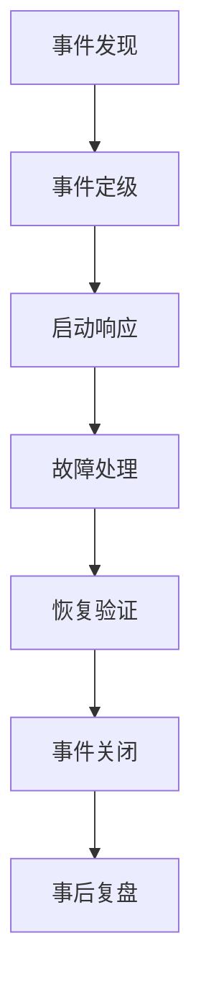

# Agent Memory System V3.0 运营维护手册

## Agent Memory System V3.0 Operations Manual

**版本号**: V1.0  
**适用版本**: V3.0.x  
**文档状态**: 正式发布  
**最后更新**: 2026-05-16  

---

## 目录

1. [概述](#1-概述)
2. [部署指南](#2-部署指南)
3. [监控配置](#3-监控配置)
4. [故障排查](#4-故障排查)
5. [备份恢复](#5-备份恢复)
6. [升级流程](#6-升级流程)
7. [安全加固](#7-安全加固)
8. [性能调优](#8-性能调优)
9. [应急响应](#9-应急响应)
10. [附录](#10-附录)

---

## 1. 概述

### 1.1 文档目的

本手册为 Agent Memory System V3.0 的运维团队提供全面的操作指南，涵盖部署、监控、故障处理、备份恢复、升级维护等各个方面。

### 1.2 适用范围

| 环境 | 适用性 | 备注 |
|------|--------|------|
| 生产环境 | 完全适用 | 严格遵循所有流程 |
| 预发布环境 | 完全适用 | 可适度简化 |
| 开发环境 | 部分适用 | 根据需求调整 |

### 1.3 运维团队职责



---

## 2. 部署指南

### 2.1 环境要求

#### 2.1.1 基础设施要求

| 组件 | 最低配置 | 推荐配置 | 生产配置 |
|------|----------|----------|----------|
| **Kubernetes** | 1.25+ | 1.28+ | 1.28+ |
| **节点数量** | 3 | 5 | 10+ |
| **CPU/节点** | 8核 | 16核 | 32核 |
| **内存/节点** | 16GB | 32GB | 64GB |
| **存储** | 100GB SSD | 500GB SSD | 2TB NVMe |
| **网络** | 1Gbps | 10Gbps | 25Gbps |

#### 2.1.2 依赖服务版本

```yaml
dependencies:
  postgresql: "15.x"
  milvus: "2.3.x"
  redis: "7.x"
  kafka: "3.5.x"
  istio: "1.19.x"
  cert_manager: "1.13.x"
```

### 2.2 部署流程

#### 2.2.1 使用Helm部署

```bash
#!/bin/bash
# deploy-production.sh

set -e

NAMESPACE="agent-memory"
RELEASE_NAME="ams"
VALUES_FILE="values-production.yaml"

# 1. 创建命名空间
echo "Creating namespace..."
kubectl create namespace ${NAMESPACE} --dry-run=client -o yaml | kubectl apply -f -

# 2. 添加Helm仓库
echo "Adding Helm repositories..."
helm repo add bitnami https://charts.bitnami.com/bitnami
helm repo add milvus https://milvus-io.github.io/milvus-helm
helm repo add jetstack https://charts.jetstack.io
helm repo update

# 3. 安装依赖
echo "Installing dependencies..."
helm upgrade --install postgresql bitnami/postgresql \
  --namespace ${NAMESPACE} \
  --values deps/postgresql-values.yaml

helm upgrade --install milvus milvus/milvus \
  --namespace ${NAMESPACE} \
  --values deps/milvus-values.yaml

helm upgrade --install redis bitnami/redis-cluster \
  --namespace ${NAMESPACE} \
  --values deps/redis-values.yaml

# 4. 安装核心服务
echo "Installing AMS core services..."
helm upgrade --install ${RELEASE_NAME} ./helm-chart \
  --namespace ${NAMESPACE} \
  --values ${VALUES_FILE} \
  --wait \
  --timeout 600s

# 5. 验证部署
echo "Verifying deployment..."
kubectl get pods -n ${NAMESPACE}
helm status ${RELEASE_NAME} -n ${NAMESPACE}

echo "Deployment completed successfully!"
```

#### 2.2.2 使用Terraform部署

```hcl
# main.tf
terraform {
  required_providers {
    kubernetes = {
      source  = "hashicorp/kubernetes"
      version = "~> 2.23"
    }
    helm = {
      source  = "hashicorp/helm"
      version = "~> 2.11"
    }
  }
}

# 变量定义
variable "environment" {
  description = "部署环境"
  type        = string
  default     = "production"
}

variable "cluster_size" {
  description = "集群规模"
  type        = string
  default     = "medium" # small, medium, large
}

# Kubernetes命名空间
resource "kubernetes_namespace" "ams" {
  metadata {
    name = "agent-memory-${var.environment}"
    labels = {
      environment = var.environment
      managed_by  = "terraform"
    }
  }
}

# Helm发布
resource "helm_release" "ams" {
  name       = "ams"
  namespace  = kubernetes_namespace.ams.metadata[0].name
  chart      = "./helm-chart"
  version    = var.chart_version
  
  values = [
    file("values-${var.environment}.yaml"),
    file("values-${var.cluster_size}.yaml")
  ]
  
  set {
    name  = "global.environment"
    value = var.environment
  }
  
  timeout = 600
  wait    = true
}
```

### 2.3 配置管理

#### 2.3.1 配置分层

```
configs/
├── base/                    # 基础配置
│   ├── configmap.yaml
│   └── secret.yaml
├── environments/            # 环境配置
│   ├── development/
│   ├── staging/
│   └── production/
└── overlays/               # 叠加配置
    ├── high-availability/
    └── cost-optimized/
```

#### 2.3.2 敏感信息管理

```yaml
# 使用External Secrets管理敏感信息
apiVersion: external-secrets.io/v1beta1
kind: ExternalSecret
metadata:
  name: ams-credentials
  namespace: agent-memory
spec:
  refreshInterval: 1h
  secretStoreRef:
    kind: ClusterSecretStore
    name: aws-secrets-manager
  target:
    name: ams-credentials
    creationPolicy: Owner
  data:
    - secretKey: database-password
      remoteRef:
        key: production/ams/database
        property: password
    - secretKey: api-key
      remoteRef:
        key: production/ams/api
        property: key
```

---

## 3. 监控配置

### 3.1 监控架构



### 3.2 关键指标

#### 3.2.1 系统指标

| 指标 | 类型 | 告警阈值 | 说明 |
|------|------|----------|------|
| `ams_memory_usage_bytes` | Gauge | >80% | 内存使用量 |
| `ams_cpu_usage_percent` | Gauge | >70% | CPU使用率 |
| `ams_disk_usage_percent` | Gauge | >85% | 磁盘使用率 |
| `ams_network_io_bytes` | Counter | - | 网络IO |

#### 3.2.2 应用指标

```yaml
# 应用关键指标
groups:
  - name: ams_application
    rules:
      - alert: HighErrorRate
        expr: |
          (
            sum(rate(ams_http_requests_total{status=~"5.."}[5m]))
            /
            sum(rate(ams_http_requests_total[5m]))
          ) > 0.01
        for: 5m
        labels:
          severity: critical
        annotations:
          summary: "High error rate detected"
          description: "Error rate is {{ $value | humanizePercentage }}"
      
      - alert: HighLatency
        expr: |
          histogram_quantile(0.99, 
            sum(rate(ams_http_request_duration_seconds_bucket[5m])) by (le)
          ) > 0.1
        for: 5m
        labels:
          severity: warning
        annotations:
          summary: "High latency detected"
          description: "P99 latency is {{ $value }}s"
      
      - alert: LowAvailability
        expr: |
          (
            sum(up{job="ams-memory-service"})
            /
            count(up{job="ams-memory-service"})
          ) < 0.99
        for: 1m
        labels:
          severity: critical
        annotations:
          summary: "Service availability is low"
```

#### 3.2.3 业务指标

| 指标 | 类型 | 用途 |
|------|------|------|
| `ams_memories_stored_total` | Counter | 记忆存储总数 |
| `ams_memories_retrieved_total` | Counter | 记忆检索总数 |
| `ams_search_latency_seconds` | Histogram | 搜索延迟分布 |
| `ams_active_agents` | Gauge | 活跃Agent数 |

### 3.3 日志管理

#### 3.3.1 日志配置

```yaml
# Fluent Bit配置
apiVersion: v1
kind: ConfigMap
metadata:
  name: fluent-bit-config
data:
  fluent-bit.conf: |
    [INPUT]
        Name              tail
        Tag               ams.*
        Path              /var/log/containers/*ams*.log
        Parser            docker
        DB                /var/log/flb_ams.db
        Mem_Buf_Limit     50MB
        Skip_Long_Lines   On
        Refresh_Interval  10
    
    [FILTER]
        Name              kubernetes
        Match             ams.*
        Kube_URL          https://kubernetes.default.svc:443
        Kube_CA_File      /var/run/secrets/kubernetes.io/serviceaccount/ca.crt
        Kube_Token_File   /var/run/secrets/kubernetes.io/serviceaccount/token
        Merge_Log         On
        Keep_Log          Off
    
    [FILTER]
        Name              parser
        Match             ams.*
        Key_Name          log
        Parser            json
        Reserve_Data      On
    
    [OUTPUT]
        Name              loki
        Match             ams.*
        Host              loki.monitoring.svc.cluster.local
        Port              3100
        Labels            job=ams,namespace=$kubernetes['namespace_name']
```

#### 3.3.2 日志查询示例

```bash
# 查询特定服务的错误日志
{job="ams", namespace="agent-memory", service="memory-service"} 
  |= "ERROR" 
  | json 
  | line_format "{{.timestamp}} [{{.level}}] {{.message}}"

# 查询特定用户的操作日志
{job="ams"} 
  | json 
  | user_id="user-123" 
  | action=~"store|retrieve"

# 查询慢查询日志
{job="ams"} 
  | json 
  | duration_ms > 1000
```

### 3.4 分布式追踪

#### 3.4.1 追踪配置

```yaml
# OpenTelemetry配置
apiVersion: opentelemetry.io/v1alpha1
kind: OpenTelemetryCollector
metadata:
  name: ams-collector
spec:
  mode: deployment
  config: |
    receivers:
      otlp:
        protocols:
          grpc:
            endpoint: 0.0.0.0:4317
          http:
            endpoint: 0.0.0.0:4318
    
    processors:
      batch:
        timeout: 1s
        send_batch_size: 1024
      
      resource:
        attributes:
          - key: service.namespace
            value: agent-memory
            action: upsert
    
    exporters:
      jaeger:
        endpoint: jaeger-collector.monitoring.svc:14250
        tls:
          insecure: true
      
      prometheus:
        endpoint: 0.0.0.0:8889
    
    service:
      pipelines:
        traces:
          receivers: [otlp]
          processors: [batch, resource]
          exporters: [jaeger]
        metrics:
          receivers: [otlp]
          processors: [batch]
          exporters: [prometheus]
```

---

## 4. 故障排查

### 4.1 故障排查流程



### 4.2 常见故障

#### 4.2.1 服务不可用

**症状**: 服务返回503错误，健康检查失败

**排查步骤**:

```bash
# 1. 检查Pod状态
kubectl get pods -n agent-memory -l app=memory-service

# 2. 查看Pod事件
kubectl describe pod <pod-name> -n agent-memory

# 3. 查看日志
kubectl logs <pod-name> -n agent-memory --tail=100

# 4. 检查资源使用
kubectl top pod <pod-name> -n agent-memory

# 5. 检查依赖服务
kubectl get svc -n agent-memory
```

**常见原因与解决方案**:

| 原因 | 症状 | 解决方案 |
|------|------|----------|
| 资源不足 | OOMKilled | 增加内存限制 |
| 依赖故障 | Connection refused | 检查依赖服务状态 |
| 配置错误 | CrashLoopBackOff | 检查ConfigMap/Secret |
| 存储问题 | Pending | 检查PVC和存储类 |

#### 4.2.2 性能下降

**症状**: 响应时间增加，吞吐量下降

**排查步骤**:

```bash
# 1. 检查当前性能指标
kubectl exec -it <pod-name> -n agent-memory -- curl localhost:8080/metrics

# 2. 分析慢查询
kubectl logs <pod-name> -n agent-memory | grep "slow_query"

# 3. 检查数据库连接池
kubectl logs <pod-name> -n agent-memory | grep "connection_pool"

# 4. 检查缓存命中率
kubectl logs <pod-name> -n agent-memory | grep "cache_hit_rate"
```

**性能优化清单**:

- [ ] 检查数据库索引
- [ ] 优化查询语句
- [ ] 调整连接池大小
- [ ] 增加缓存容量
- [ ] 扩容服务实例

#### 4.2.3 数据不一致

**症状**: 检索结果与预期不符

**排查步骤**:

```bash
# 1. 检查向量索引状态
kubectl exec -it <milvus-pod> -n agent-memory -- curl localhost:9091/metrics

# 2. 验证数据同步
kubectl exec -it <memory-pod> -n agent-memory -- ams-cli verify-sync

# 3. 检查消息队列积压
kubectl exec -it <kafka-pod> -n agent-memory -- kafka-consumer-groups.sh \
  --bootstrap-server localhost:9092 --describe --group ams-memory
```

### 4.3 诊断工具

#### 4.3.1 AMS诊断CLI

```bash
# 系统健康检查
ams-ops health-check --namespace agent-memory

# 性能分析
ams-ops profile --service memory-service --duration 60s

# 网络诊断
ams-ops network-test --source memory-service --target milvus

# 数据一致性检查
ams-ops data-verify --entity memory --sample-size 1000
```

#### 4.3.2 诊断脚本

```bash
#!/bin/bash
# diagnose.sh - 综合诊断脚本

echo "=== AMS System Diagnostic ==="
echo "Time: $(date)"
echo ""

# 1. 检查K8s集群状态
echo "1. Checking Kubernetes cluster..."
kubectl cluster-info
kubectl get nodes

# 2. 检查命名空间状态
echo ""
echo "2. Checking namespace status..."
kubectl get all -n agent-memory

# 3. 检查Pod状态
echo ""
echo "3. Checking pod status..."
kubectl get pods -n agent-memory -o wide

# 4. 检查事件
echo ""
echo "4. Recent events..."
kubectl get events -n agent-memory --sort-by='.lastTimestamp' | tail -20

# 5. 检查资源使用
echo ""
echo "5. Resource usage..."
kubectl top nodes
kubectl top pods -n agent-memory

# 6. 检查日志
echo ""
echo "6. Recent errors..."
kubectl logs -n agent-memory --all-containers --since=1h | grep -i error | tail -20

echo ""
echo "=== Diagnostic Complete ==="
```

---

## 5. 备份恢复

### 5.1 备份策略

```mermaid
gantt
    title 备份计划
    dateFormat  HH:mm
    section 每日
    增量备份           :d1, 00:00, 30m
    
    section 每周
    全量备份           :w1, 00:00, 2h
    
    section 每月
    归档备份           :m1, 00:00, 4h
```



### 5.2 备份配置

#### 5.2.1 PostgreSQL备份

```yaml
# pg-backup-cronjob.yaml
apiVersion: batch/v1
kind: CronJob
metadata:
  name: postgres-backup
  namespace: agent-memory
spec:
  schedule: "0 2 * * *"  # 每天凌晨2点
  concurrencyPolicy: Forbid
  jobTemplate:
    spec:
      template:
        spec:
          containers:
          - name: backup
            image: postgres:15-alpine
            command:
            - /bin/sh
            - -c
            - |
              pg_dump \
                --host=postgresql \
                --username=postgres \
                --dbname=ams \
                --format=custom \
                --file=/backup/ams-$(date +%Y%m%d-%H%M%S).dump
              
              # 上传到对象存储
              aws s3 cp /backup/ s3://ams-backups/postgres/ --recursive
              
              # 清理旧备份（保留30天）
              find /backup -name "*.dump" -mtime +30 -delete
            env:
            - name: PGPASSWORD
              valueFrom:
                secretKeyRef:
                  name: postgresql
                  key: postgres-password
            volumeMounts:
            - name: backup
              mountPath: /backup
          volumes:
          - name: backup
            emptyDir: {}
          restartPolicy: OnFailure
```

#### 5.2.2 Milvus备份

```bash
#!/bin/bash
# milvus-backup.sh

BACKUP_BUCKET="s3://ams-backups/milvus"
BACKUP_NAME="milvus-$(date +%Y%m%d-%H%M%S)"

# 创建备份
milvus-backup create \
  --host milvus-proxy \
  --port 19530 \
  --name ${BACKUP_NAME}

# 上传到S3
aws s3 cp /var/lib/milvus/backup/${BACKUP_NAME} ${BACKUP_BUCKET}/${BACKUP_NAME} --recursive

# 验证备份
aws s3 ls ${BACKUP_BUCKET}/${BACKUP_NAME}

# 清理本地备份
rm -rf /var/lib/milvus/backup/${BACKUP_NAME}

echo "Backup completed: ${BACKUP_NAME}"
```

### 5.3 恢复流程

#### 5.3.1 灾难恢复计划



#### 5.3.2 数据恢复脚本

```bash
#!/bin/bash
# restore.sh - 数据恢复脚本

set -e

RESTORE_DATE=${1:-"latest"}
ENVIRONMENT=${2:-"production"}

echo "Restoring AMS to ${ENVIRONMENT} from ${RESTORE_DATE}"

# 1. 停止服务
echo "Stopping services..."
kubectl scale deployment --all --replicas=0 -n agent-memory

# 2. 恢复PostgreSQL
echo "Restoring PostgreSQL..."
if [ "${RESTORE_DATE}" == "latest" ]; then
  BACKUP_FILE=$(aws s3 ls s3://ams-backups/postgres/ | sort | tail -1 | awk '{print $4}')
else
  BACKUP_FILE="ams-${RESTORE_DATE}.dump"
fi

aws s3 cp s3://ams-backups/postgres/${BACKUP_FILE} /tmp/restore.dump

kubectl exec -it postgresql-0 -n agent-memory -- pg_restore \
  --username=postgres \
  --dbname=ams \
  --clean \
  --if-exists \
  /tmp/restore.dump

# 3. 恢复Milvus
echo "Restoring Milvus..."
# Milvus恢复逻辑

# 4. 重启服务
echo "Restarting services..."
kubectl scale deployment --all --replicas=3 -n agent-memory

# 5. 验证恢复
echo "Verifying restoration..."
kubectl exec -it memory-service-xxx -n agent-memory -- ams-cli health-check

echo "Restoration completed!"
```

### 5.4 备份验证

```bash
#!/bin/bash
# verify-backup.sh - 备份验证脚本

BACKUP_DIR=${1:-"/backup"}

echo "Verifying backups in ${BACKUP_DIR}"

# 检查备份文件完整性
for file in ${BACKUP_DIR}/*.dump; do
  echo "Checking ${file}..."
  
  # 检查文件大小
  size=$(stat -f%z "${file}" 2>/dev/null || stat -c%s "${file}")
  if [ ${size} -lt 1024 ]; then
    echo "ERROR: ${file} is too small (${size} bytes)"
    continue
  fi
  
  # 验证PostgreSQL备份
  if [[ ${file} == *"postgres"* ]]; then
    pg_restore --list "${file}" > /dev/null 2>&1
    if [ $? -eq 0 ]; then
      echo "OK: ${file} is valid"
    else
      echo "ERROR: ${file} is corrupted"
    fi
  fi
done

echo "Backup verification completed"
```

---

## 6. 升级流程

### 6.1 升级策略

| 升级类型 | 频率 | 影响 | 策略 |
|----------|------|------|------|
| **补丁升级** | 每周 | 无 | 滚动更新 |
| **小版本升级** | 每月 | 低 | 蓝绿部署 |
| **大版本升级** | 每季度 | 中 | 金丝雀发布 |
| **重大升级** | 每年 | 高 | 维护窗口 |

### 6.2 升级流程



### 6.3 滚动升级

```bash
#!/bin/bash
# rolling-upgrade.sh

VERSION=${1}
SERVICE=${2:-"memory-service"}

echo "Starting rolling upgrade of ${SERVICE} to ${VERSION}"

# 1. 更新镜像
kubectl set image deployment/${SERVICE} \
  ${SERVICE}=agent-memory/${SERVICE}:${VERSION} \
  -n agent-memory

# 2. 监控滚动更新
kubectl rollout status deployment/${SERVICE} -n agent-memory --timeout=600s

# 3. 验证新版本
kubectl get pods -n agent-memory -l app=${SERVICE}

# 4. 健康检查
sleep 30
kubectl exec -it deployment/${SERVICE} -n agent-memory -- /app/health-check

echo "Rolling upgrade completed"
```

### 6.4 蓝绿部署

```yaml
# blue-green-deployment.yaml
apiVersion: argoproj.io/v1alpha1
kind: Rollout
metadata:
  name: memory-service
  namespace: agent-memory
spec:
  replicas: 3
  strategy:
    blueGreen:
      activeService: memory-service-active
      previewService: memory-service-preview
      autoPromotionEnabled: false
      scaleDownDelaySeconds: 600
  selector:
    matchLabels:
      app: memory-service
  template:
    metadata:
      labels:
        app: memory-service
    spec:
      containers:
      - name: memory-service
        image: agent-memory/memory-service:v3.1.0
        ports:
        - containerPort: 8080
```

### 6.5 回滚流程

```bash
#!/bin/bash
# rollback.sh

SERVICE=${1:-"memory-service"}
REVISION=${2:-"0"}  # 0表示上一个版本

echo "Rolling back ${SERVICE} to revision ${REVISION}"

# 1. 执行回滚
kubectl rollout undo deployment/${SERVICE} -n agent-memory --to-revision=${REVISION}

# 2. 监控回滚
kubectl rollout status deployment/${SERVICE} -n agent-memory

# 3. 验证回滚
kubectl get pods -n agent-memory -l app=${SERVICE}

# 4. 检查服务健康
kubectl exec -it deployment/${SERVICE} -n agent-memory -- /app/health-check

echo "Rollback completed"
```

---

## 7. 安全加固

### 7.1 安全基线

#### 7.1.1 Pod安全策略

```yaml
apiVersion: policy/v1beta1
kind: PodSecurityPolicy
metadata:
  name: ams-restricted
spec:
  privileged: false
  allowPrivilegeEscalation: false
  requiredDropCapabilities:
    - ALL
  volumes:
    - 'configMap'
    - 'emptyDir'
    - 'projected'
    - 'secret'
    - 'downwardAPI'
    - 'persistentVolumeClaim'
  runAsUser:
    rule: 'MustRunAsNonRoot'
  seLinux:
    rule: 'RunAsAny'
  fsGroup:
    rule: 'RunAsAny'
```

#### 7.1.2 网络安全策略

```yaml
apiVersion: networking.k8s.io/v1
kind: NetworkPolicy
metadata:
  name: ams-default-deny
  namespace: agent-memory
spec:
  podSelector: {}
  policyTypes:
  - Ingress
  - Egress
---
apiVersion: networking.k8s.io/v1
kind: NetworkPolicy
metadata:
  name: allow-memory-service
  namespace: agent-memory
spec:
  podSelector:
    matchLabels:
      app: memory-service
  policyTypes:
  - Ingress
  ingress:
  - from:
    - namespaceSelector:
        matchLabels:
          name: ingress-nginx
    ports:
    - protocol: TCP
      port: 8080
  - from:
    - podSelector:
        matchLabels:
          app: monitoring
    ports:
    - protocol: TCP
      port: 9090
```

### 7.2 密钥管理

#### 7.2.1 Vault集成

```hcl
# vault-policy.hcl
path "secret/data/ams/production/*" {
  capabilities = ["read"]
}

path "secret/data/ams/shared/*" {
  capabilities = ["read"]
}
```

#### 7.2.2 证书管理

```yaml
apiVersion: cert-manager.io/v1
kind: Certificate
metadata:
  name: ams-tls
  namespace: agent-memory
spec:
  secretName: ams-tls-secret
  issuerRef:
    name: letsencrypt-prod
    kind: ClusterIssuer
  dnsNames:
  - api.agent-memory.io
  - '*.agent-memory.io'
```

### 7.3 安全审计

```bash
#!/bin/bash
# security-audit.sh

echo "=== AMS Security Audit ==="

# 1. 检查Pod安全
echo "1. Checking pod security..."
kubectl get pods -n agent-memory -o json | jq '.items[] | 
  select(.spec.containers[].securityContext.privileged == true) | 
  .metadata.name'

# 2. 检查RBAC
echo ""
echo "2. Checking RBAC..."
kubectl auth can-i --list -n agent-memory

# 3. 检查网络策略
echo ""
echo "3. Checking network policies..."
kubectl get networkpolicies -n agent-memory

# 4. 检查Secret
echo ""
echo "4. Checking secrets..."
kubectl get secrets -n agent-memory | grep -v "kubernetes.io/service-account-token"

# 5. 检查镜像漏洞
echo ""
echo "5. Checking image vulnerabilities..."
trivy image agent-memory/memory-service:latest

echo "=== Audit Complete ==="
```

---

## 8. 性能调优

### 8.1 性能基准

| 指标 | 目标值 | 警告阈值 | 严重阈值 |
|------|--------|----------|----------|
| P99延迟 | <10ms | 20ms | 50ms |
| 吞吐量 | >10K RPS | 5K RPS | 2K RPS |
| 错误率 | <0.1% | 0.5% | 1% |
| CPU使用率 | <70% | 80% | 90% |
| 内存使用率 | <80% | 90% | 95% |

### 8.2 调优指南

#### 8.2.1 JVM调优（AI Service）

```yaml
resources:
  jvm:
    heap:
      min: "4g"
      max: "8g"
    gc:
      type: "G1GC"
      maxPauseMillis: 200
    options:
      - "-XX:+UseStringDeduplication"
      - "-XX:+OptimizeStringConcat"
      - "-XX:MaxRAMPercentage=75.0"
```

#### 8.2.2 Go运行时调优

```yaml
resources:
  go:
    gc:
      targetPercent: 100
    maxProcs: 8
    memoryLimit: "4Gi"
```

#### 8.2.3 数据库连接池

```yaml
database:
  pool:
    maxOpenConns: 100
    maxIdleConns: 20
    connMaxLifetime: "1h"
    connMaxIdleTime: "10m"
```

### 8.3 缓存优化

```yaml
cache:
  redis:
    cluster:
      enabled: true
      nodes: 6
    settings:
      maxmemory: "4gb"
      maxmemoryPolicy: "allkeys-lru"
      tcpKeepalive: 300
  
  local:
    enabled: true
    size: 10000
    ttl: "5m"
```

---

## 9. 应急响应

### 9.1 应急响应流程



### 9.2 事件分级

| 级别 | 定义 | 响应时间 | 升级路径 |
|------|------|----------|----------|
| **P0** | 系统完全不可用 | 5分钟 | 立即升级CTO |
| **P1** | 核心功能受损 | 15分钟 | 升级VP Engineering |
| **P2** | 非核心功能问题 | 1小时 | 升级工程经理 |
| **P3** | 轻微问题 | 4小时 | 团队内部处理 |

### 9.3 应急联系

```yaml
escalation:
  p0:
    - role: "On-call Engineer"
      contact: "+1-xxx-xxx-xxxx"
      slack: "@oncall"
    - role: "Engineering Manager"
      contact: "+1-xxx-xxx-xxxx"
      slack: "@eng-manager"
    - role: "CTO"
      contact: "+1-xxx-xxx-xxxx"
      slack: "@cto"
  
  channels:
    slack: "#incidents"
    pagerduty: "ams-production"
    email: "oncall@agent-memory.io"
```

### 9.4 灾难恢复

#### 9.4.1 RTO/RPO目标

| 场景 | RTO | RPO | 策略 |
|------|-----|-----|------|
| 单点故障 | <5分钟 | 0 | 高可用架构 |
| 可用区故障 | <15分钟 | <1分钟 | 跨AZ复制 |
| 区域故障 | <1小时 | <5分钟 | 跨区域备份 |
| 数据损坏 | <4小时 | <1小时 | 时间点恢复 |

#### 9.4.2 灾难恢复演练

```bash
#!/bin/bash
# dr-drill.sh

SCENARIO=${1:-"zone-failure"}

echo "Starting DR drill: ${SCENARIO}"

case ${SCENARIO} in
  "zone-failure")
    # 模拟可用区故障
    kubectl cordon $(kubectl get nodes -l topology.kubernetes.io/zone=zone-a -o name)
    ;;
  "service-failure")
    # 模拟服务故障
    kubectl scale deployment memory-service --replicas=0 -n agent-memory
    ;;
  "database-failure")
    # 模拟数据库故障
    kubectl delete pod postgresql-0 -n agent-memory
    ;;
esac

echo "DR drill scenario initiated. Monitor recovery..."
```

---

## 10. 附录

### 10.1 常用命令速查

```bash
# 查看Pod状态
kubectl get pods -n agent-memory

# 查看日志
kubectl logs -f <pod-name> -n agent-memory

# 进入容器
kubectl exec -it <pod-name> -n agent-memory -- /bin/sh

# 端口转发
kubectl port-forward svc/memory-service 8080:8080 -n agent-memory

# 查看资源使用
kubectl top pods -n agent-memory

# 查看事件
kubectl get events -n agent-memory --sort-by='.lastTimestamp'

# Helm操作
helm list -n agent-memory
helm upgrade --install ams ./chart -n agent-memory
helm rollback ams <revision> -n agent-memory
```

### 10.2 配置文件模板

#### 10.2.1 生产环境配置

```yaml
# values-production.yaml
global:
  environment: production
  replicaCount: 5
  
resources:
  limits:
    cpu: 4000m
    memory: 8Gi
  requests:
    cpu: 2000m
    memory: 4Gi

autoscaling:
  enabled: true
  minReplicas: 5
  maxReplicas: 50
  targetCPUUtilizationPercentage: 70
  targetMemoryUtilizationPercentage: 80

persistence:
  enabled: true
  storageClass: "premium-rwo"
  size: 100Gi

monitoring:
  enabled: true
  serviceMonitor:
    enabled: true
```

### 10.3 术语表

| 中文 | English | 定义 |
|------|---------|------|
| RTO | Recovery Time Objective | 恢复时间目标 |
| RPO | Recovery Point Objective | 恢复点目标 |
| HPA | Horizontal Pod Autoscaler | 水平Pod自动伸缩 |
| PDB | Pod Disruption Budget | Pod中断预算 |
| PVC | Persistent Volume Claim | 持久卷声明 |

### 10.4 参考资源

1. [Kubernetes官方文档](https://kubernetes.io/docs/)
2. [Helm官方文档](https://helm.sh/docs/)
3. [Prometheus操作指南](https://prometheus.io/docs/practices/)
4. [Istio运维手册](https://istio.io/latest/docs/ops/)

### 10.5 变更记录

| 版本 | 日期 | 作者 | 变更说明 |
|------|------|------|----------|
| 1.0 | 2026-05-16 | 运维团队 | 初始版本 |

---

**文档版本历史**

| 版本 | 日期 | 作者 | 变更说明 |
|------|------|------|----------|
| 1.0 | 2026-05-16 | 运维团队 | 初始版本 |

---

*本文档由 Agent Memory System 运维团队编写，版权归属于项目所有方。*
