# Agent Memory System V3.0 长期计划（6-12个月）

## Agent Memory System V3.0 Long-Term Roadmap (6-12 Months)

**版本号**: V1.0  
**规划周期**: 2027年 (1月-12月)  
**文档状态**: 正式发布  
**最后更新**: 2026-05-16  

---

## 目录

1. [执行摘要](#1-执行摘要)
2. [技术愿景](#2-技术愿景)
3. [产品路线图](#3-产品路线图)
4. [行业标准制定](#4-行业标准制定)
5. [开源战略](#5-开源战略)
6. [商业模式](#6-商业模式)
7. [全球化规划](#7-全球化规划)
8. [组织能力建设](#8-组织能力建设)
9. [风险与机遇](#9-风险与机遇)
10. [附录](#10-附录)

---

## 1. 执行摘要

### 1.1 规划概述

长期计划是 Agent Memory System 从**成功产品**走向**行业平台**的战略蓝图。本阶段将聚焦于技术突破、标准制定、生态繁荣和全球扩张，致力于成为AI记忆基础设施的领导者。

### 1.2 愿景与使命

> **愿景**: 成为AI时代的基础设施，让每一款AI Agent都拥有无限记忆
> 
> **使命**: 构建开放、智能、安全的记忆平台，赋能全球AI创新

### 1.3 核心目标

| 维度 | 1年目标 | 3年目标 |
|------|---------|---------|
| **市场份额** | 10% | 30% |
| **企业客户** | 500+ | 5,000+ |
| **开发者** | 50,000+ | 500,000+ |
| **年收入** | $10M | $100M |
| **全球覆盖** | 20国家 | 50国家 |

---

## 2. 技术愿景

### 2.1 技术演进路线图

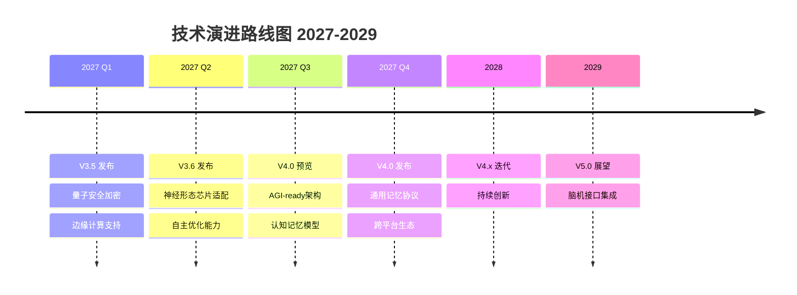

### 2.2 前沿技术探索

#### 2.2.1 量子计算集成

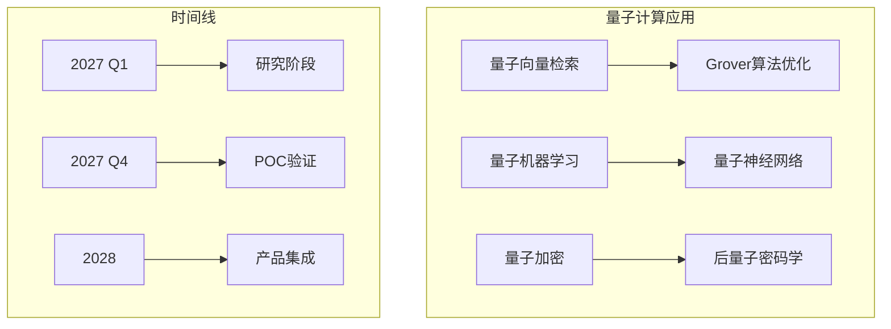

**技术目标**:
- 利用量子计算加速高维向量检索
- 实现量子安全的记忆加密
- 探索量子机器学习在记忆优化中的应用

#### 2.2.2 神经形态芯片适配

| 芯片平台 | 合作厂商 | 应用场景 | 时间 |
|----------|----------|----------|------|
| Loihi 2 | Intel | 边缘推理 | 2027 Q2 |
| TrueNorth | IBM | 低功耗设备 | 2027 Q3 |
| Akida | BrainChip | 实时处理 | 2027 Q4 |

**技术方案**:
```python
# 神经形态芯片适配层
class NeuromorphicAdapter:
    def __init__(self, chip_type: str):
        self.chip = self._initialize_chip(chip_type)
        self.encoder = SNNEncoder()  # 脉冲神经网络编码器
    
    def encode_memory(self, memory: Memory) -> Spikes:
        # 将记忆编码为脉冲序列
        return self.encoder.encode(memory.vector)
    
    def process(self, spikes: Spikes) -> Embedding:
        # 在神经形态芯片上处理
        return self.chip.infer(spikes)
```

#### 2.2.3 AGI-ready记忆系统

**核心能力**:

| 能力 | 描述 | 技术方案 |
|------|------|----------|
| 元认知 | 自我反思和优化 | 元学习 + 强化学习 |
| 因果推理 | 理解因果关系 | 因果图模型 |
| 常识推理 | 利用世界知识 | 知识图谱 + LLM |
| 终身学习 | 持续学习能力 | 渐进式学习 |
| 迁移学习 | 跨领域知识迁移 | 领域适应 |

### 2.3 技术投资方向

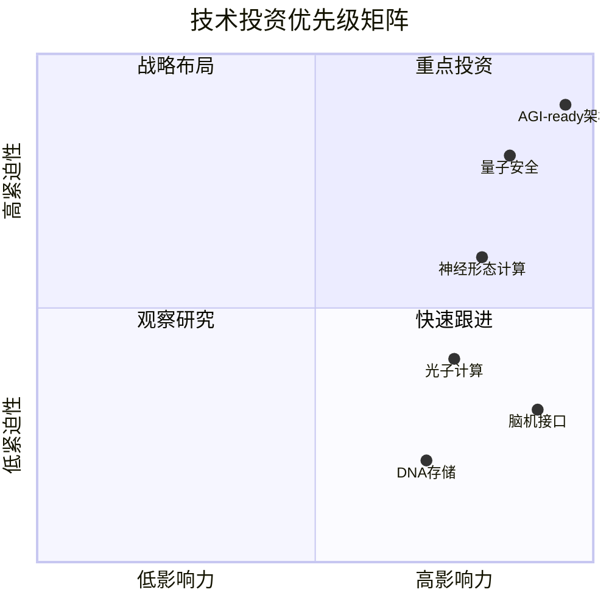

---

## 3. 产品路线图

### 3.1 产品版本规划

#### 3.1.1 V3.5 (2027 Q1)

**主题**: 安全与边缘

| 功能 | 描述 | 价值 |
|------|------|------|
| 量子安全加密 | 抗量子计算攻击 | 长期数据安全 |
| 边缘计算支持 | 边缘节点部署 | 低延迟、隐私保护 |
| 联邦学习增强 | 跨组织协作 | 数据不出域 |
| 自动优化 | AI驱动的系统优化 | 降低运维成本 |

#### 3.1.2 V3.6 (2027 Q2)

**主题**: 智能与自适应

| 功能 | 描述 | 价值 |
|------|------|------|
| 自适应索引 | 根据查询模式自动优化 | 性能提升 |
| 智能压缩 | AI驱动的数据压缩 | 存储成本降低 |
| 预测性维护 | 预测系统问题 | 可用性提升 |
| 个性化推荐 | 基于记忆的用户推荐 | 用户体验 |

#### 3.1.3 V4.0 (2027 Q4)

**主题**: AGI-ready平台

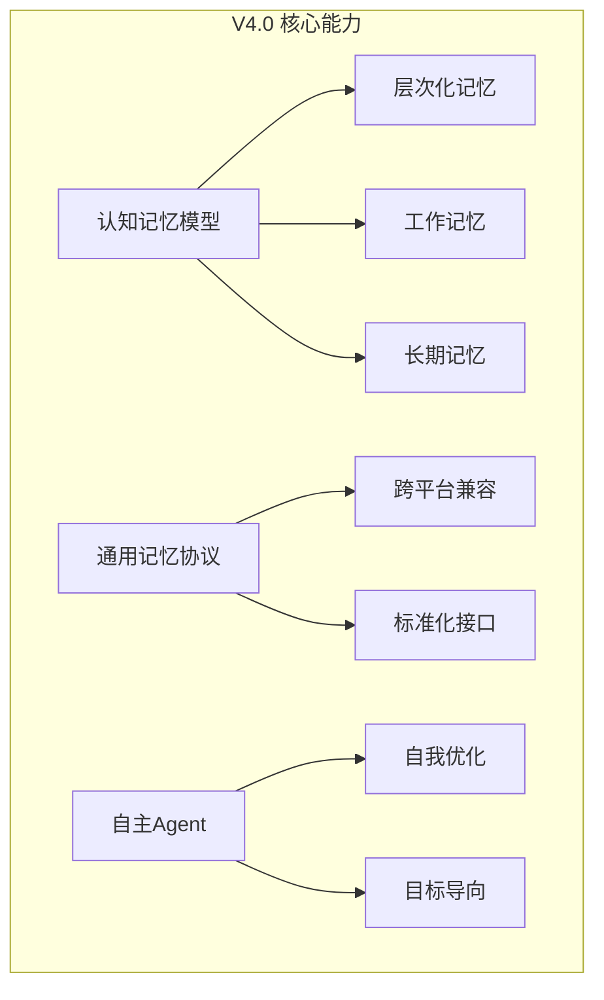

### 3.2 产品矩阵

| 产品 | 定位 | 目标客户 | 价格策略 |
|------|------|----------|----------|
| **Community** | 开源免费 | 个人开发者 | 免费 |
| **Pro** | 专业版 | 中小团队 | $99/月 |
| **Enterprise** | 企业版 | 大型企业 | 定制报价 |
| **Edge** | 边缘版 | IoT/嵌入式 | $49/设备 |

### 3.3 垂直解决方案

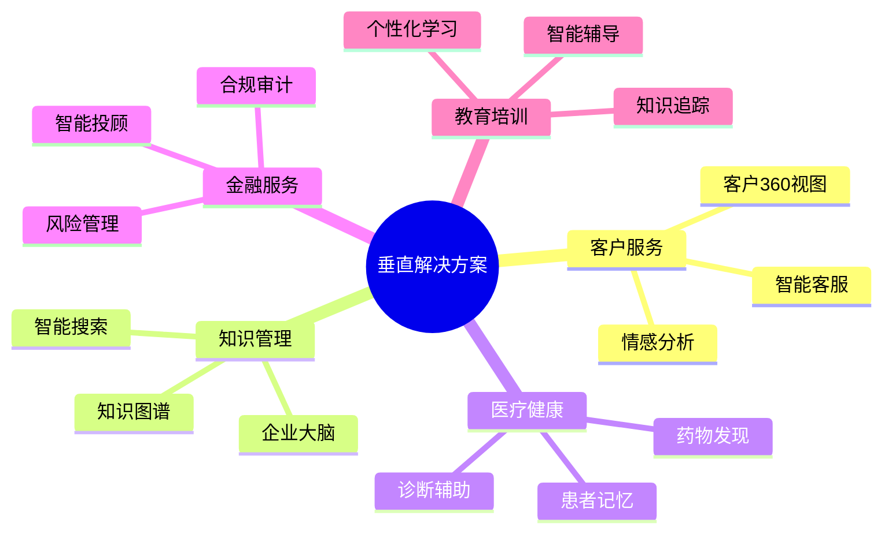

---

## 4. 行业标准制定

### 4.1 标准战略

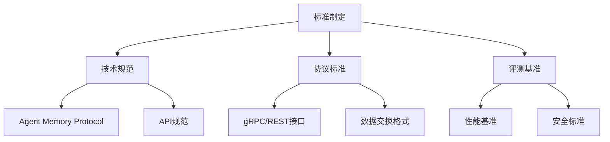

### 4.2 Agent Memory Protocol (AMP)

#### 4.2.1 协议架构

```protobuf
// Agent Memory Protocol 定义
syntax = "proto3";
package amp.v1;

// 核心记忆接口
service AgentMemory {
  // 记忆存储
  rpc Store(StoreRequest) returns (StoreResponse);
  
  // 记忆检索
  rpc Retrieve(RetrieveRequest) returns (RetrieveResponse);
  
  // 记忆遗忘
  rpc Forget(ForgetRequest) returns (ForgetResponse);
  
  // 上下文管理
  rpc GetContext(ContextRequest) returns (ContextResponse);
  
  // 记忆同步
  rpc Sync(SyncRequest) returns (stream SyncResponse);
}

// 记忆实体
message Memory {
  string id = 1;
  string agent_id = 2;
  MemoryType type = 3;
  bytes content = 4;
  Embedding embedding = 5;
  Metadata metadata = 6;
  int64 timestamp = 7;
  float importance = 8;
}

enum MemoryType {
  EPISODIC = 0;    // 情景记忆
  SEMANTIC = 1;    // 语义记忆
  PROCEDURAL = 2;  // 程序记忆
  WORKING = 3;     // 工作记忆
}
```

#### 4.2.2 标准化路线图

| 阶段 | 时间 | 目标 | 参与方 |
|------|------|------|--------|
| 草案 | 2027 Q1 | 发布AMP v0.1 | 核心团队 |
| 评审 | 2027 Q2 | 行业专家评审 | 技术委员会 |
| 试点 | 2027 Q3 | 3+厂商试点 | 合作伙伴 |
| 发布 | 2027 Q4 | AMP v1.0正式发布 | 标准化组织 |
| 推广 | 2028 | 行业广泛采用 | 生态伙伴 |

### 4.3 评测基准

#### 4.3.1 MemoryBench

**评测维度**:

| 维度 | 指标 | 测试方法 |
|------|------|----------|
| 存储性能 | 吞吐量、延迟 | 标准数据集 |
| 检索质量 | 准确率、召回率 | 标注数据集 |
| 可扩展性 | 水平扩展能力 | 压力测试 |
| 可靠性 | 可用性、一致性 | 混沌测试 |
| 安全性 | 加密、访问控制 | 渗透测试 |

#### 4.3.2 评测数据集

```python
# MemoryBench 数据集结构
class MemoryBenchDataset:
    def __init__(self):
        self.episodic_memories = []  # 情景记忆
        self.semantic_memories = []  # 语义记忆
        self.procedural_memories = [] # 程序记忆
        self.queries = []            # 查询集
        self.ground_truth = []       # 标准答案
    
    def evaluate(self, system: MemorySystem) -> BenchmarkResult:
        results = {
            'storage_performance': self._test_storage(system),
            'retrieval_quality': self._test_retrieval(system),
            'scalability': self._test_scalability(system),
            'reliability': self._test_reliability(system),
        }
        return BenchmarkResult(results)
```

---

## 5. 开源战略

### 5.1 开源治理模型

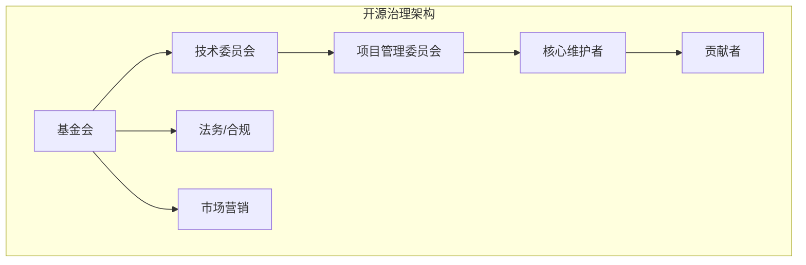

### 5.2 开源路线图

| 阶段 | 时间 | 内容 | 许可证 |
|------|------|------|--------|
| **Phase 1** | 2027 Q1 | SDK开源 | MIT |
| **Phase 2** | 2027 Q2 | 工具链开源 | Apache 2.0 |
| **Phase 3** | 2027 Q3 | 核心协议开源 | Apache 2.0 |
| **Phase 4** | 2027 Q4 | 参考实现开源 | Apache 2.0 |
| **Phase 5** | 2028 | 完整平台开源 | Apache 2.0 |

### 5.3 社区治理

#### 5.3.1 贡献者等级

| 等级 | 要求 | 权益 |
|------|------|------|
| **Observer** | 关注项目 | 获取更新 |
| **Contributor** | 提交PR | 代码审查 |
| **Committer** | 持续贡献 | 合并权限 |
| **Maintainer** | 核心贡献 | 技术决策 |
| **PMC Member** | 战略贡献 | 项目治理 |

#### 5.3.2 贡献激励

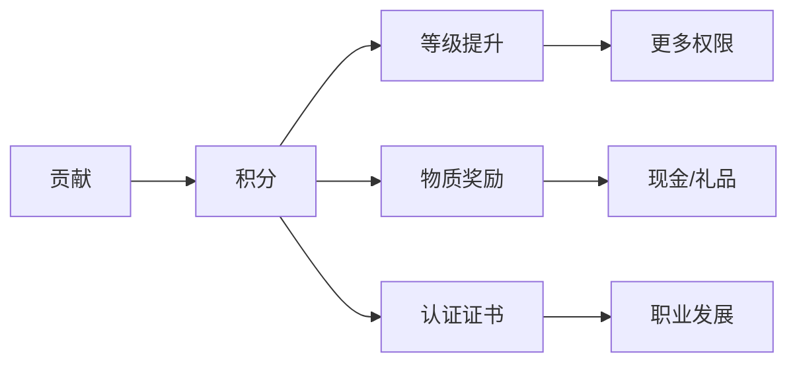

---

## 6. 商业模式

### 6.1 收入模式

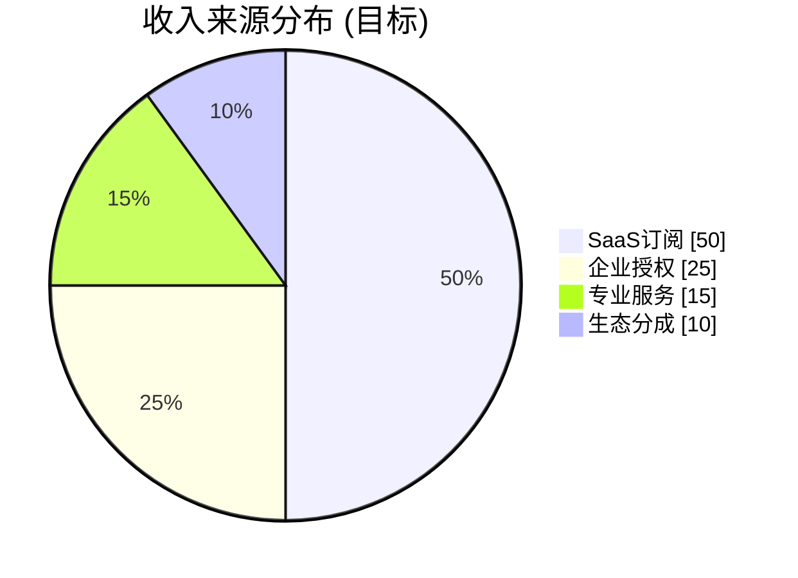

### 6.2 定价策略

#### 6.2.1 SaaS定价

| 版本 | 价格 | 包含内容 |
|------|------|----------|
| **Free** | $0 | 10K memories, 基础API |
| **Starter** | $49/月 | 100K memories, 高级API |
| **Pro** | $199/月 | 1M memories, 优先支持 |
| **Business** | $499/月 | 5M memories, SLA保障 |
| **Enterprise** | 定制 | 无限量, 专属服务 |

#### 6.2.2 用量定价

```yaml
pricing:
  storage:
    base: $0.001 per 1000 memories/month
    tiers:
      - tier: 0-1M
        price: $0.001
      - tier: 1M-10M
        price: $0.0008
      - tier: 10M+
        price: $0.0005
  
  api_calls:
    base: $0.0001 per call
    tiers:
      - tier: 0-1M
        price: $0.0001
      - tier: 1M-10M
        price: $0.00008
      - tier: 10M+
        price: $0.00005
```

### 6.3 合作伙伴生态

| 合作类型 | 分成比例 | 合作要求 |
|----------|----------|----------|
| **技术集成** | 15% | 深度技术集成 |
| **渠道销售** | 20% | 年度销售额>$100K |
| **解决方案** | 25% | 行业解决方案 |
| **OEM** | 30% | 产品嵌入 |

---

## 7. 全球化规划

### 7.1 区域扩张路线图

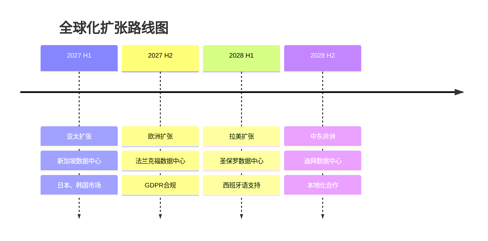

### 7.2 区域策略

| 区域 | 优先级 | 策略 | 投资 |
|------|--------|------|------|
| **北美** | P0 | 直销+渠道 | $2M |
| **欧洲** | P0 | 合作伙伴 | $1.5M |
| **亚太** | P1 | 本地化 | $1M |
| **拉美** | P2 | 线上+伙伴 | $500K |
| **中东非洲** | P2 | 战略合作 | $300K |

### 7.3 本地化策略

#### 7.3.1 数据主权

| 国家/地区 | 数据中心 | 合规要求 |
|-----------|----------|----------|
| 中国 | 北京/上海 | 网络安全法 |
| 欧盟 | 法兰克福 | GDPR |
| 美国 | 多区域 | 州级隐私法 |
| 新加坡 | 新加坡 | PDPA |

#### 7.3.2 语言支持

```yaml
localization:
  tier1:  # 完全支持
    - zh-CN
    - en-US
    - ja-JP
  
  tier2:  # 部分支持
    - ko-KR
    - de-DE
    - fr-FR
    - es-ES
  
  tier3:  # 基础支持
    - pt-BR
    - ar-SA
    - hi-IN
```

---

## 8. 组织能力建设

### 8.1 团队扩张计划

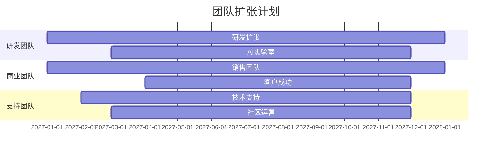

### 8.2 组织架构演进

| 阶段 | 时间 | 团队规模 | 组织形式 |
|------|------|----------|----------|
| 当前 | 2026 | 16人 | 扁平化 |
| 阶段1 | 2027 Q1 | 30人 | 职能型 |
| 阶段2 | 2027 Q3 | 50人 | 事业部制 |
| 阶段3 | 2028 | 100人 | 矩阵式 |

### 8.3 人才战略

#### 8.3.1 关键岗位

| 岗位 | 数量 | 要求 | 时间 |
|------|------|------|------|
| 首席架构师 | 2 | 10年+经验 | 2027 Q1 |
| AI研究科学家 | 5 | PhD学历 | 2027 Q2 |
| 区域销售总监 | 3 | 企业销售经验 | 2027 Q1 |
| 开发者布道师 | 3 | 技术社区经验 | 2027 Q2 |

#### 8.3.2 培养体系

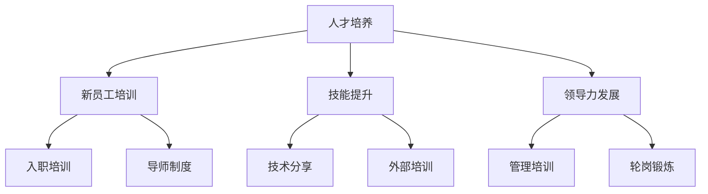

---

## 9. 风险与机遇

### 9.1 战略风险

| 风险 | 概率 | 影响 | 应对策略 |
|------|------|------|----------|
| **技术颠覆** | 中 | 极高 | 持续研发、技术雷达 |
| **竞争加剧** | 高 | 高 | 差异化、生态锁定 |
| **监管变化** | 中 | 高 | 合规优先、政策跟踪 |
| **经济下行** | 中 | 中 | 成本控制、多元化 |
| **人才短缺** | 高 | 中 | 股权激励、远程工作 |

### 9.2 战略机遇

| 机遇 | 把握策略 | 预期收益 |
|------|----------|----------|
| **AGI发展** | 提前布局 | 技术领先 |
| **企业数字化** | 垂直方案 | 市场扩张 |
| **开源趋势** | 开放生态 | 品牌影响 |
| **全球化** | 本地化 | 收入增长 |
| **标准制定** | 主导协议 | 行业地位 |

### 9.3 情景规划

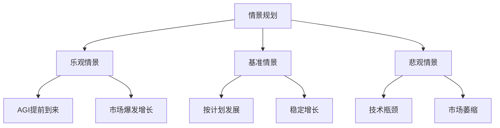

**各情景收入预测**:

| 情景 | 2027 | 2028 | 2029 |
|------|------|------|------|
| 乐观 | $20M | $80M | $200M |
| 基准 | $10M | $40M | $100M |
| 悲观 | $5M | $15M | $40M |

---

## 10. 附录

### 10.1 术语表

| 中文 | English | 定义 |
|------|---------|------|
| AGI | Artificial General Intelligence | 通用人工智能 |
| AMP | Agent Memory Protocol | 智能体记忆协议 |
| SNN | Spiking Neural Network | 脉冲神经网络 |
| GDPR | General Data Protection Regulation | 通用数据保护条例 |
| PMC | Project Management Committee | 项目管理委员会 |

### 10.2 参考文档

1. [短期计划](./roadmap_short_term.md)
2. [中期计划](./roadmap_medium_term.md)
3. [架构白皮书](./v30_architecture_whitepaper.md)
4. [综合实施报告](./v30_implementation_report.md)

### 10.3 变更记录

| 版本 | 日期 | 作者 | 变更说明 |
|------|------|------|----------|
| 1.0 | 2026-05-16 | 战略团队 | 初始版本 |

---

**文档版本历史**

| 版本 | 日期 | 作者 | 变更说明 |
|------|------|------|----------|
| 1.0 | 2026-05-16 | 战略团队 | 初始版本 |

---

*本文档由 Agent Memory System 战略团队编写，版权归属于项目所有方。*
