# Agent Memory System V3.0 中期计划（3-6个月）

## Agent Memory System V3.0 Medium-Term Roadmap (3-6 Months)

**版本号**: V1.0  
**规划周期**: 2026年Q4 (10月-12月)  
**文档状态**: 正式发布  
**最后更新**: 2026-05-16  

---

## 目录

1. [执行摘要](#1-执行摘要)
2. [战略方向](#2-战略方向)
3. [功能扩展计划](#3-功能扩展计划)
4. [性能优化目标](#4-性能优化目标)
5. [生态建设计划](#5-生态建设计划)
6. [社区发展](#6-社区发展)
7. [合作伙伴集成](#7-合作伙伴集成)
8. [市场拓展](#8-市场拓展)
9. [资源规划](#9-资源规划)
10. [风险与机遇](#10-风险与机遇)

---

## 1. 执行摘要

### 1.1 规划概述

中期计划是 Agent Memory System V3.0 从**产品验证**走向**市场扩张**的关键阶段。本阶段将聚焦于功能完善、生态建设和市场拓展，为产品的规模化增长奠定基础。

### 1.2 核心主题

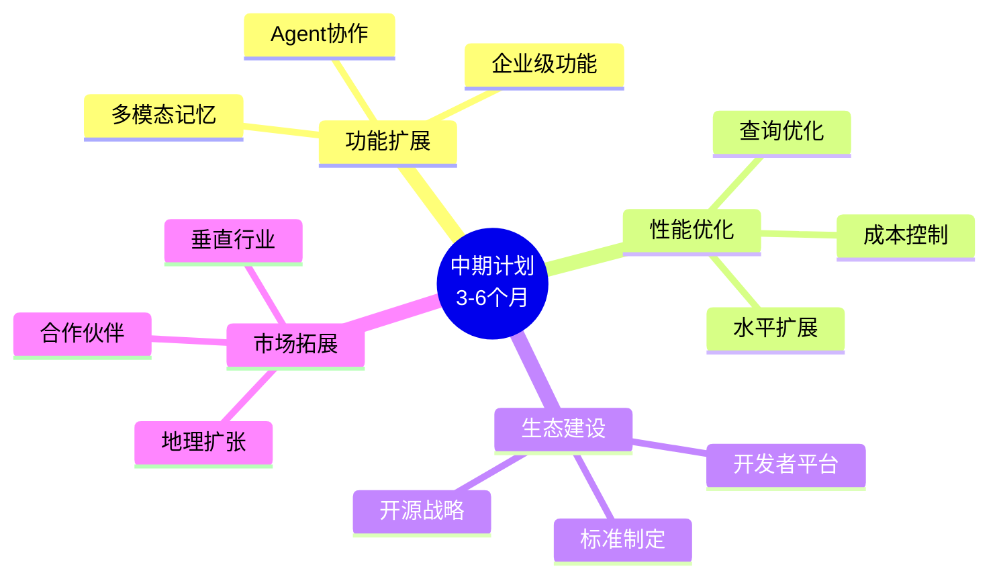

### 1.3 关键里程碑

| 里程碑 | 目标日期 | 关键成果 |
|--------|----------|----------|
| M1 | 2026-10-31 | 多模态记忆Beta |
| M2 | 2026-11-30 | 开发者平台上线 |
| M3 | 2026-12-31 | 企业版发布 |

---

## 2. 战略方向

### 2.1 战略定位

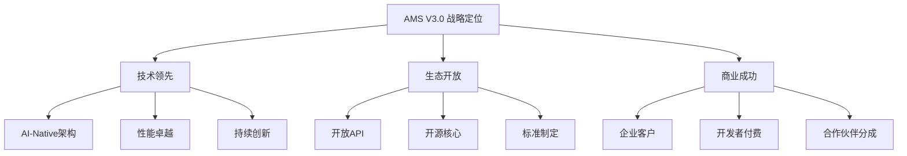

### 2.2 竞争策略

| 维度 | 我们的策略 | 竞争优势 |
|------|-----------|----------|
| **技术** | AI原生设计 | 更智能的记忆管理 |
| **性能** | 极致优化 | 更低的延迟和成本 |
| **生态** | 开放合作 | 更丰富的集成 |
| **服务** | 企业级支持 | 更专业的服务 |

### 2.3 战略目标

#### 2.3.1 业务目标

| 目标 | 目标值 | 当前值 | 增长 |
|------|--------|--------|------|
| 付费客户数 | 50+ | 5 | 900% |
| API调用量 | 10M/月 | 1M/月 | 900% |
| 开发者数量 | 1,000+ | 100 | 900% |
| 合作伙伴 | 20+ | 2 | 900% |

#### 2.3.2 技术目标

| 目标 | 目标值 | 当前值 | 提升 |
|------|--------|--------|------|
| 系统容量 | 1B memories | 100M | 900% |
| 检索QPS | 100K | 15K | 567% |
| 多语言SDK | 5个 | 2个 | 150% |
| 开源Star数 | 5,000 | 0 | - |

---

## 3. 功能扩展计划

### 3.1 多模态记忆 (Multimodal Memory)

#### 3.1.1 功能概述

支持文本、图像、音频、视频的统一存储和跨模态检索。

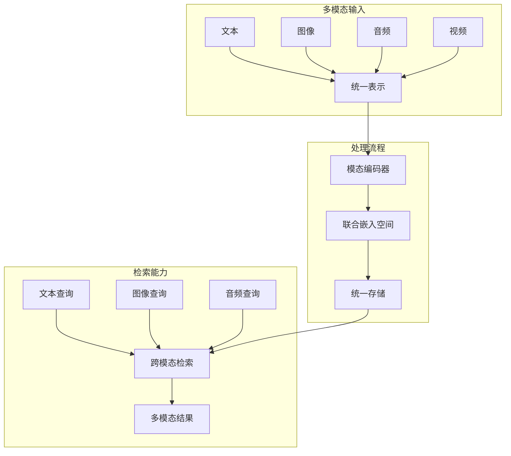

#### 3.1.2 技术实现

| 模态 | 编码器 | 嵌入维度 | 存储方案 |
|------|--------|----------|----------|
| 文本 | text-embedding-3-large | 3072 | Milvus |
| 图像 | CLIP ViT-L/14 | 512 | Milvus |
| 音频 | Whisper + Custom | 768 | Milvus |
| 视频 | Video-LLaMA | 1024 | Milvus |

#### 3.1.3 开发计划

| 阶段 | 时间 | 内容 | 交付物 |
|------|------|------|--------|
| Phase 1 | 10月 | 图像记忆支持 | 图像存储与检索 |
| Phase 2 | 11月 | 音频记忆支持 | 音频存储与检索 |
| Phase 3 | 12月 | 视频记忆支持 | 视频存储与检索 |

### 3.2 Agent协作 (Agent Collaboration)

#### 3.2.1 功能概述

支持多Agent之间的记忆共享、协作学习和集体智慧。

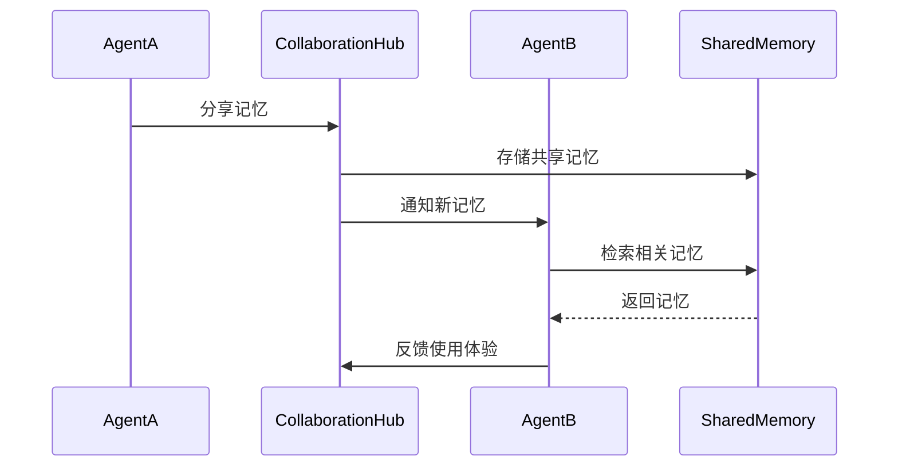

#### 3.2.2 核心能力

| 能力 | 描述 | 技术方案 |
|------|------|----------|
| 记忆共享 | Agent间选择性共享记忆 | 权限控制 + 联邦学习 |
| 协作学习 | 多Agent联合训练 | 联邦学习框架 |
| 集体智慧 | 汇聚多Agent知识 | 知识图谱 + 共识机制 |
| 冲突解决 | 处理记忆冲突 | 版本控制 + 仲裁机制 |

#### 3.2.3 应用场景

1. **企业知识管理**: 多部门Agent共享企业知识
2. **客服协作**: 多个客服Agent共享客户历史
3. **研发团队**: 开发Agent共享代码知识

### 3.3 企业级功能

#### 3.3.1 功能清单

| 功能 | 描述 | 优先级 |
|------|------|--------|
| SSO集成 | 企业单点登录 | P0 |
| 审计日志 | 完整操作审计 | P0 |
| 数据保留策略 | 自动数据清理 | P1 |
| 合规报告 | SOC2/GDPR合规 | P1 |
| 私有部署 | 私有化部署支持 | P1 |
| 高级分析 | 使用分析报告 | P2 |

#### 3.3.2 SSO集成架构

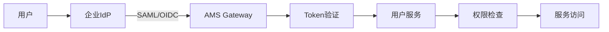

**支持的IdP**:
- Okta
- Azure AD
- Google Workspace
- OneLogin
- 自定义SAML/OIDC

---

## 4. 性能优化目标

### 4.1 性能目标

| 指标 | 当前值 | 目标值 | 优化策略 |
|------|--------|--------|----------|
| 写入吞吐量 | 5,800 TPS | 20,000 TPS | 批量写入优化 |
| 检索延迟P99 | 12ms | 5ms | 索引优化 + 缓存 |
| 向量检索QPS | 15,000 | 50,000 | GPU加速 |
| 并发连接数 | 10,000 | 50,000 | 连接池优化 |
| 存储成本 | $0.01/1K | $0.005/1K | 压缩算法优化 |

### 4.2 优化路线图

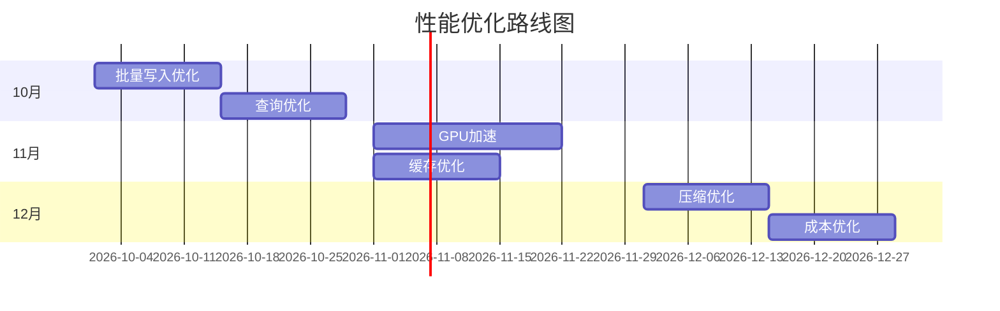

### 4.3 技术优化方案

#### 4.3.1 批量写入优化

```go
// 批量写入优化
type BatchWriter struct {
    buffer    chan *Memory
    batchSize int
    flushInterval time.Duration
}

func (bw *BatchWriter) Start() {
    ticker := time.NewTicker(bw.flushInterval)
    batch := make([]*Memory, 0, bw.batchSize)
    
    for {
        select {
        case mem := <-bw.buffer:
            batch = append(batch, mem)
            if len(batch) >= bw.batchSize {
                bw.flush(batch)
                batch = batch[:0]
            }
        case <-ticker.C:
            if len(batch) > 0 {
                bw.flush(batch)
                batch = batch[:0]
            }
        }
    }
}
```

**预期提升**: 写入吞吐量提升 3-5 倍

#### 4.3.2 GPU加速向量检索

```yaml
# Milvus GPU配置
gpu:
  enabled: true
  devices: [0, 1]  # 使用GPU 0和1
  cache_size: 8GB  # GPU缓存大小
  
index:
  type: GPU_IVF_FLAT
  nlist: 4096
  nprobe: 128
```

**预期提升**: 向量检索QPS提升 5-10 倍

---

## 5. 生态建设计划

### 5.1 开发者平台

#### 5.1.1 平台架构

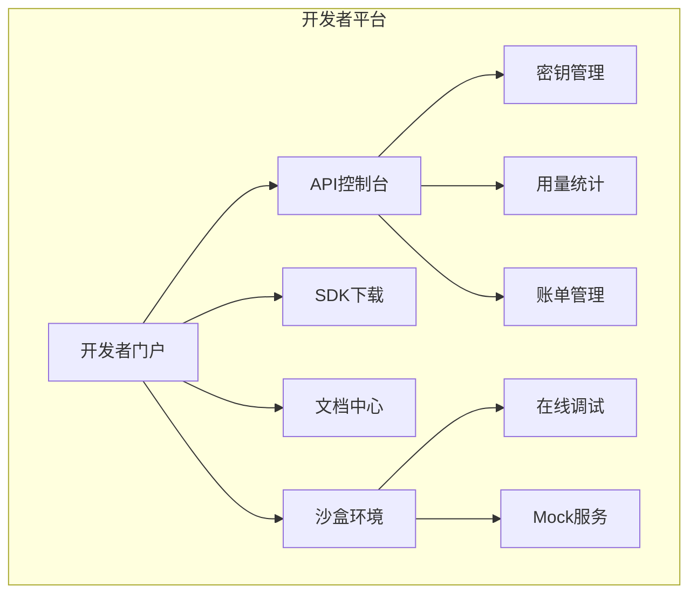

#### 5.1.2 功能规划

| 功能 | 描述 | 优先级 | 时间 |
|------|------|--------|------|
| 开发者注册 | 自助注册与认证 | P0 | 10月 |
| API密钥管理 | 密钥生成与轮换 | P0 | 10月 |
| 用量仪表板 | 实时用量监控 | P0 | 11月 |
| 沙盒环境 | 测试环境提供 | P1 | 11月 |
| 在线调试 | API调试工具 | P1 | 12月 |
| 计费系统 | 按量计费 | P1 | 12月 |

### 5.2 SDK扩展

#### 5.2.1 SDK路线图

| SDK | 语言 | 状态 | 发布时间 |
|-----|------|------|----------|
| Python SDK | Python | 已有 | - |
| TypeScript SDK | TypeScript | 已有 | - |
| Go SDK | Go | 开发中 | 10月 |
| Java SDK | Java | 计划中 | 11月 |
| Rust SDK | Rust | 计划中 | 12月 |

#### 5.2.2 SDK功能矩阵

| 功能 | Python | TypeScript | Go | Java | Rust |
|------|--------|-----------|-----|------|------|
| 同步API | 支持 | 支持 | 支持 | 支持 | 支持 |
| 异步API | 支持 | 支持 | 支持 | 支持 | 支持 |
| 流式处理 | 支持 | 支持 | 支持 | 计划中 | 计划中 |
| 本地缓存 | 支持 | 支持 | 计划中 | 计划中 | 计划中 |
| 重试机制 | 支持 | 支持 | 支持 | 支持 | 支持 |

### 5.3 开源战略

#### 5.3.1 开源路线图

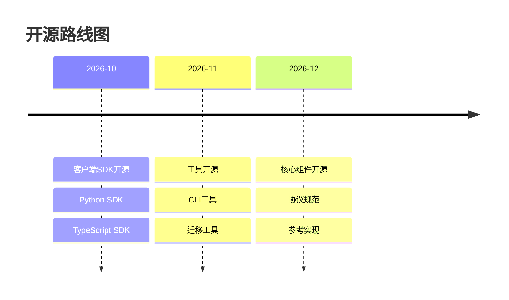

#### 5.3.2 开源治理

| 方面 | 策略 |
|------|------|
| **许可证** | Apache 2.0 / MIT |
| **治理模式** | 基金会治理 |
| **贡献指南** | 详细的CONTRIBUTING.md |
| **行为准则** | 社区行为准则 |
| **安全策略** | 安全漏洞响应流程 |

---

## 6. 社区发展

### 6.1 社区战略

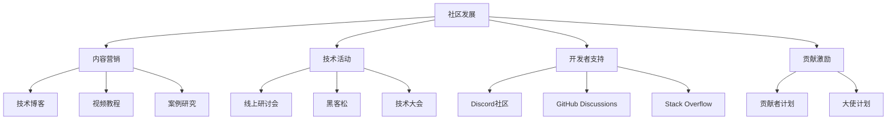

### 6.2 社区目标

| 指标 | 目标值 | 当前值 |
|------|--------|--------|
| GitHub Stars | 5,000 | 0 |
| Discord成员 | 2,000 | 0 |
| 活跃贡献者 | 50 | 0 |
| 技术博客文章 | 20篇 | 0 |
| 线上活动 | 6场 | 0 |

### 6.3 活动计划

| 活动 | 时间 | 形式 | 目标 |
|------|------|------|------|
| 产品发布会 | 10月 | 线上直播 | 品牌曝光 |
| 开发者工作坊 | 11月 | 线上培训 | 开发者教育 |
| 黑客松 | 12月 | 线上竞赛 | 生态建设 |
| 年终技术峰会 | 12月 | 混合形式 | 社区凝聚 |

---

## 7. 合作伙伴集成

### 7.1 集成策略

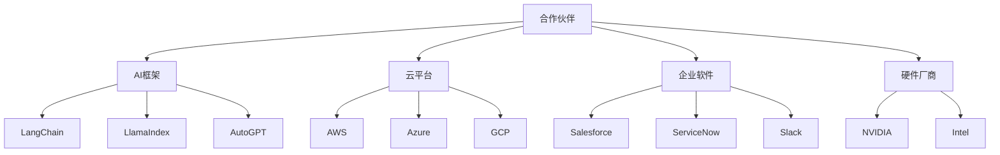

### 7.2 重点集成项目

#### 7.2.1 AI框架集成

| 框架 | 集成内容 | 时间 | 状态 |
|------|----------|------|------|
| LangChain | Memory组件 | 10月 | 计划中 |
| LlamaIndex | 检索增强 | 11月 | 计划中 |
| AutoGPT | 记忆后端 | 11月 | 计划中 |
| CrewAI | 协作记忆 | 12月 | 计划中 |

#### 7.2.2 LangChain集成示例

```python
# LangChain AMS Memory集成
from langchain.memory import AMSMemory
from langchain.chains import ConversationChain
from langchain.llms import OpenAI

# 初始化AMS记忆
memory = AMSMemory(
    api_key="your-api-key",
    agent_id="my-agent",
    session_id="session-123"
)

# 创建对话链
llm = OpenAI()
chain = ConversationChain(
    llm=llm,
    memory=memory,
    verbose=True
)

# 使用
response = chain.predict(input="你好")
```

### 7.3 合作伙伴计划

| 级别 | 要求 | 权益 |
|------|------|------|
| **战略伙伴** | 联合开发、共同推广 | API免费额度、技术支持、联合营销 |
| **技术伙伴** | 技术集成 | API折扣、技术文档、测试支持 |
| **渠道伙伴** | 转售/推荐 | 佣金分成、销售培训 |

---

## 8. 市场拓展

### 8.1 垂直行业拓展

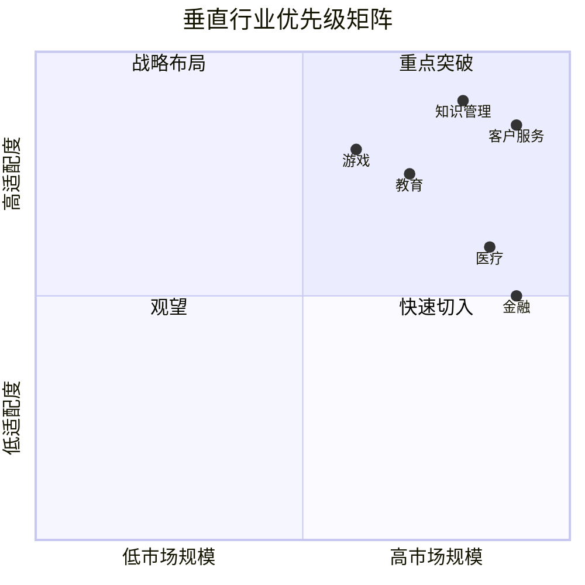

### 8.2 行业解决方案

#### 8.2.1 客户服务行业

| 痛点 | 解决方案 | 价值 |
|------|----------|------|
| 客服记忆不连贯 | 客户记忆持久化 | 提升客户体验 |
| 知识检索慢 | 语义检索 | 缩短响应时间 |
| 培训成本高 | 知识共享 | 降低培训成本 |

#### 8.2.2 知识管理行业

| 痛点 | 解决方案 | 价值 |
|------|----------|------|
| 信息孤岛 | 统一记忆平台 | 知识整合 |
| 检索困难 | 语义搜索 | 快速定位 |
| 知识流失 | 长期记忆 | 知识保留 |

### 8.3 地理扩张

| 区域 | 优先级 | 策略 | 时间 |
|------|--------|------|------|
| 北美 | P0 | 直销 + 合作伙伴 | 10月 |
| 欧洲 | P1 | 合作伙伴为主 | 11月 |
| 亚太 | P1 | 本地化 + 合作伙伴 | 12月 |
| 其他 | P2 | 线上销售 | 2027 |

---

## 9. 资源规划

### 9.1 人力资源扩展

| 角色 | 当前 | 目标 | 新增 | 时间 |
|------|------|------|------|------|
| 后端工程师 | 4 | 6 | +2 | 10月 |
| 前端工程师 | 2 | 3 | +1 | 10月 |
| AI工程师 | 2 | 4 | +2 | 11月 |
| SRE工程师 | 2 | 3 | +1 | 10月 |
| 产品经理 | 1 | 2 | +1 | 10月 |
| 开发者关系 | 0 | 2 | +2 | 10月 |
| 销售 | 0 | 3 | +3 | 11月 |
| **总计** | **16** | **28** | **+12** | - |

### 9.2 预算规划

| 类别 | Q4预算 | 说明 |
|------|--------|------|
| 人力成本 | $720,000 | 团队扩张 |
| 基础设施 | $150,000 | 容量扩展 |
| 市场推广 | $200,000 | 品牌建设 |
| 合作伙伴 | $50,000 | 联合营销 |
| 活动 | $30,000 | 社区活动 |
| 其他 | $50,000 | 杂项 |
| **总计** | **$1,200,000** | - |

### 9.3 基础设施扩展

| 资源 | 当前 | 目标 | 扩展方式 |
|------|------|------|----------|
| K8s节点 | 10 | 30 | 自动扩缩容 |
| 存储容量 | 10TB | 50TB | 按需扩展 |
| CDN带宽 | 100Mbps | 1Gbps | 升级套餐 |
| 数据库 | 单集群 | 多区域 | 区域部署 |

---

## 10. 风险与机遇

### 10.1 主要风险

| 风险 | 概率 | 影响 | 应对策略 |
|------|------|------|----------|
| 竞争加剧 | 高 | 高 | 差异化定位、快速迭代 |
| 技术债务 | 中 | 高 | 预留重构时间 |
| 人才竞争 | 高 | 中 | 股权激励、远程工作 |
| 市场接受度 | 中 | 高 | 早期客户共创 |
| 合规风险 | 低 | 高 | 法务审查、合规认证 |

### 10.2 战略机遇

| 机遇 | 把握策略 | 预期收益 |
|------|----------|----------|
| AI市场爆发 | 快速占领市场 | 品牌领先 |
| 开源趋势 | 开源核心组件 | 生态繁荣 |
| 企业数字化 | 企业级功能 | 高价值客户 |
| 标准制定 | 主导行业标准 | 话语权 |

### 10.3 风险监控机制

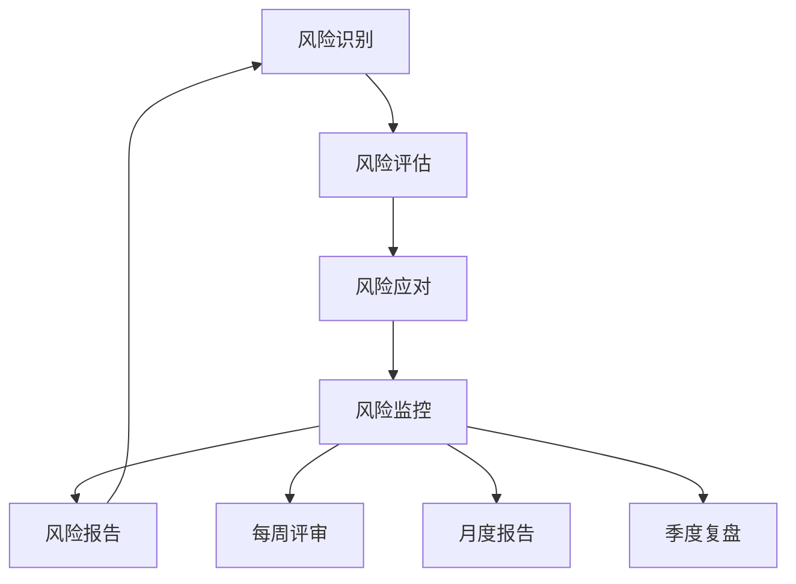

---

## 附录

### A. 术语表

| 中文 | English | 定义 |
|------|---------|------|
| 多模态 | Multimodal | 支持多种数据类型的能力 |
| 联邦学习 | Federated Learning | 分布式机器学习 |
| SSO | Single Sign-On | 单点登录 |
| IdP | Identity Provider | 身份提供商 |
| GPU加速 | GPU Acceleration | 使用GPU进行计算加速 |

### B. 参考文档

1. [短期计划](./roadmap_short_term.md)
2. [长期计划](./roadmap_long_term.md)
3. [架构白皮书](./v30_architecture_whitepaper.md)

### C. 变更记录

| 版本 | 日期 | 作者 | 变更说明 |
|------|------|------|----------|
| 1.0 | 2026-05-16 | 战略团队 | 初始版本 |

---

**文档版本历史**

| 版本 | 日期 | 作者 | 变更说明 |
|------|------|------|----------|
| 1.0 | 2026-05-16 | 战略团队 | 初始版本 |

---

*本文档由 Agent Memory System 战略团队编写，版权归属于项目所有方。*
