# Agent Memory System V3.0 短期计划（1-3个月）

## Agent Memory System V3.0 Short-Term Roadmap (1-3 Months)

**版本号**: V1.0  
**规划周期**: 2026年Q3 (7月-9月)  
**文档状态**: 正式发布  
**最后更新**: 2026-05-16  

---

## 目录

1. [执行摘要](#1-执行摘要)
2. [目标与OKR](#2-目标与okr)
3. [月度任务规划](#3-月度任务规划)
4. [优先级矩阵](#4-优先级矩阵)
5. [资源需求](#5-资源需求)
6. [里程碑设定](#6-里程碑设定)
7. [风险评估与应对](#7-风险评估与应对)
8. [成功指标](#8-成功指标)
9. [依赖关系](#9-依赖关系)
10. [附录](#10-附录)

---

## 1. 执行摘要

### 1.1 规划概述

本短期计划涵盖 Agent Memory System V3.0 发布后首个季度的核心工作，聚焦于**生产就绪**、**功能迭代**和**体验优化**三大主题。通过本阶段的实施，将确保系统稳定运行，同时快速响应早期用户反馈，为中长期发展奠定坚实基础。

### 1.2 关键目标

| 目标领域 | 具体目标 | 预期成果 |
|----------|----------|----------|
| **稳定性** | 生产环境零重大事故 | 99.99%可用性达成 |
| **功能** | 完成5项核心功能增强 | 用户满意度提升30% |
| **性能** | 关键接口延迟优化50% | P99延迟<10ms |
| **生态** | 发布2个官方SDK | 开发者接入效率提升 |

### 1.3 总体时间表

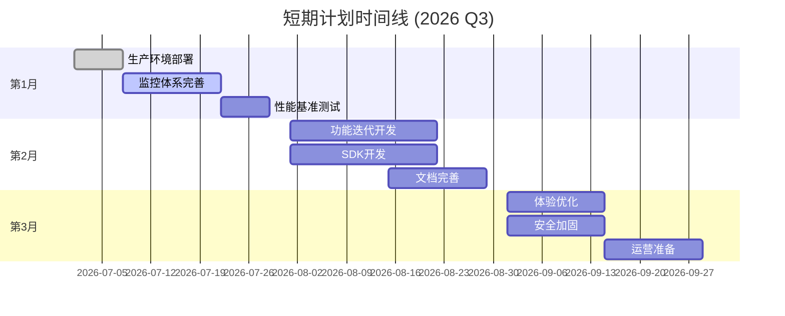

---

## 2. 目标与OKR

### 2.1 OKR框架

#### Objective 1: 确保生产环境稳定运行

| Key Result | 目标值 | 优先级 |
|------------|--------|--------|
| KR1.1: 系统可用性 | >=99.99% | P0 |
| KR1.2: 平均故障恢复时间(MTTR) | <5分钟 | P0 |
| KR1.3: 生产环境零P0事故 | 0次 | P0 |
| KR1.4: 告警准确率 | >=95% | P1 |

#### Objective 2: 快速迭代核心功能

| Key Result | 目标值 | 优先级 |
|------------|--------|--------|
| KR2.1: 功能迭代版本发布 | 6个版本 | P0 |
| KR2.2: 用户反馈响应率 | 100% | P0 |
| KR2.3: 关键功能上线 | 5项 | P1 |
| KR2.4: 技术债务清理 | 20项 | P2 |

#### Objective 3: 构建开发者生态

| Key Result | 目标值 | 优先级 |
|------------|--------|--------|
| KR3.1: 官方SDK发布 | 2个 (Python/TypeScript) | P1 |
| KR3.2: 开发者文档完善度 | >=90% | P1 |
| KR3.3: 示例应用数量 | >=5个 | P2 |
| KR3.4: 社区贡献者 | >=10人 | P2 |

### 2.2 目标对齐

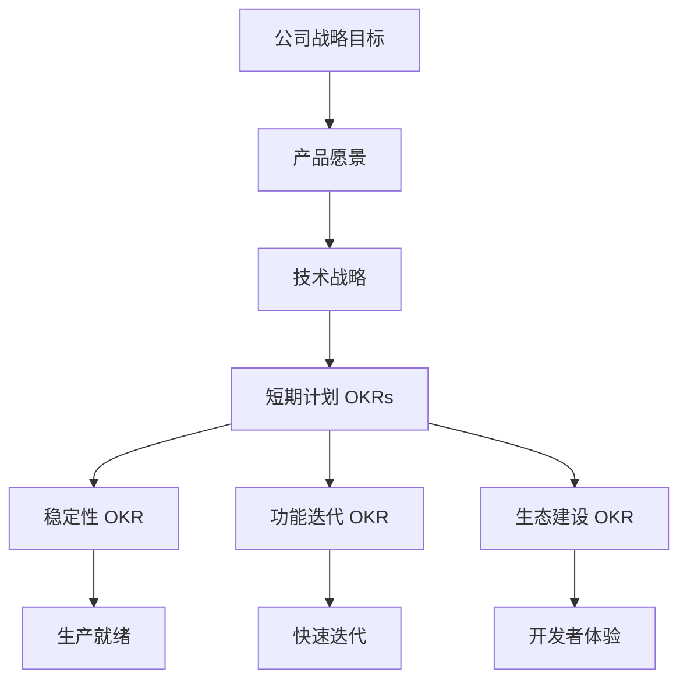

---

## 3. 月度任务规划

### 3.1 第1月：生产就绪 (7月)

#### 3.1.1 核心任务

| 任务ID | 任务名称 | 负责人 | 工期 | 优先级 | 交付物 |
|--------|----------|--------|------|--------|--------|
| M1-T1 | 生产环境部署 | 运维团队 | 1周 | P0 | 生产环境上线 |
| M1-T2 | 监控体系完善 | SRE团队 | 2周 | P0 | 完整监控覆盖 |
| M1-T3 | 告警规则优化 | SRE团队 | 1周 | P0 | 告警规则集 |
| M1-T4 | 性能基准测试 | 性能团队 | 1周 | P1 | 性能基线报告 |
| M1-T5 | 灾备演练 | 运维团队 | 3天 | P1 | 演练报告 |
| M1-T6 | 安全审计 | 安全团队 | 1周 | P1 | 审计报告 |

#### 3.1.2 详细任务分解

**M1-T1: 生产环境部署**

```yaml
task:
  name: 生产环境部署
  id: M1-T1
  duration: 5d
  owner: 运维团队
  
subtasks:
  - name: 基础设施准备
    duration: 1d
    details:
      - K8s集群配置
      - 网络策略配置
      - 存储类配置
      
  - name: 核心服务部署
    duration: 2d
    details:
      - Memory Service部署
      - Search Service部署
      - AI Service部署
      
  - name: 数据层部署
    duration: 1d
    details:
      - PostgreSQL集群部署
      - Milvus集群部署
      - Redis集群部署
      
  - name: 验证与切换
    duration: 1d
    details:
      - 功能验证
      - 性能验证
      - 流量切换
```

**M1-T2: 监控体系完善**

| 监控维度 | 覆盖范围 | 关键指标 | 告警阈值 |
|----------|----------|----------|----------|
| 基础设施 | CPU/内存/磁盘/网络 | 使用率 | >80% |
| 应用服务 | 延迟/错误率/吞吐量 | P99延迟 | >20ms |
| 业务指标 | QPS/成功率 | 错误率 | >0.1% |
| 数据存储 | 连接数/慢查询 | 慢查询数 | >10/min |

#### 3.1.3 第1月里程碑


### 3.2 第2月：功能迭代 (8月)

#### 3.2.1 核心任务

| 任务ID | 任务名称 | 负责人 | 工期 | 优先级 | 交付物 |
|--------|----------|--------|------|--------|--------|
| M2-T1 | 批量操作API | 后端团队 | 2周 | P0 | 批量API上线 |
| M2-T2 | 记忆导入导出 | 后端团队 | 2周 | P0 | 数据迁移工具 |
| M2-T3 | 高级搜索筛选 | 后端团队 | 1周 | P1 | 筛选功能上线 |
| M2-T4 | Python SDK | 客户端团队 | 3周 | P1 | Python SDK v1.0 |
| M2-T5 | TypeScript SDK | 客户端团队 | 3周 | P1 | TS SDK v1.0 |
| M2-T6 | 管理控制台 | 前端团队 | 3周 | P1 | Web控制台 |
| M2-T7 | 文档完善 | 技术写作 | 2周 | P2 | 完整文档集 |

#### 3.2.2 功能详细设计

**M2-T1: 批量操作API**

```protobuf
// 批量操作API定义
service BatchService {
  rpc BatchStore(BatchStoreRequest) returns (BatchStoreResponse);
  rpc BatchDelete(BatchDeleteRequest) returns (BatchDeleteResponse);
  rpc BatchUpdate(BatchUpdateRequest) returns (BatchUpdateResponse);
}

message BatchStoreRequest {
  repeated Memory memories = 1;
  BatchOptions options = 2;
}

message BatchOptions {
  int32 batch_size = 1;      // 每批处理数量，默认100
  bool continue_on_error = 2; // 错误时是否继续
  int32 timeout_ms = 3;       // 超时时间
}
```

**M2-T4/M2-T5: SDK开发**

| SDK特性 | Python SDK | TypeScript SDK |
|---------|-----------|----------------|
| 同步API | 支持 | 支持 |
| 异步API | asyncio | Promise/async-await |
| 类型提示 | 完整 | 完整 |
| 重试机制 | 指数退避 | 指数退避 |
| 连接池 | 支持 | 支持 |
| 流式处理 | 支持 | 支持 |

#### 3.2.3 第2月里程碑


### 3.3 第3月：体验优化 (9月)

#### 3.3.1 核心任务

| 任务ID | 任务名称 | 负责人 | 工期 | 优先级 | 交付物 |
|--------|----------|--------|------|--------|--------|
| M3-T1 | 性能优化 | 性能团队 | 3周 | P0 | 性能提升报告 |
| M3-T2 | 缓存优化 | 后端团队 | 2周 | P0 | 缓存策略优化 |
| M3-T3 | 安全加固 | 安全团队 | 2周 | P1 | 安全加固报告 |
| M3-T4 | 用户体验优化 | 产品团队 | 2周 | P1 | UX改进 |
| M3-T5 | 运营工具开发 | 运维团队 | 2周 | P1 | 运营工具集 |
| M3-T6 | 文档优化 | 技术写作 | 2周 | P2 | 优化后文档 |
| M3-T7 | 社区建设 | 开发者关系 | 持续 | P2 | 社区启动 |

#### 3.3.2 性能优化目标

```mermaid
xychart-beta
    title "性能优化目标"
    x-axis ["当前", "目标"]
    y-axis "延迟 (ms)" 0 --> 50
    bar [12, 6]
    bar [85, 40]
    bar [200, 100]
```

| 接口 | 当前P99 | 目标P99 | 优化策略 |
|------|---------|---------|----------|
| StoreMemory | 12ms | 6ms | 异步向量化 |
| SearchMemory | 85ms | 40ms | 缓存预热 |
| GetContext | 200ms | 100ms | 连接池优化 |

#### 3.3.3 第3月里程碑


---

## 4. 优先级矩阵

### 4.1 任务优先级分布

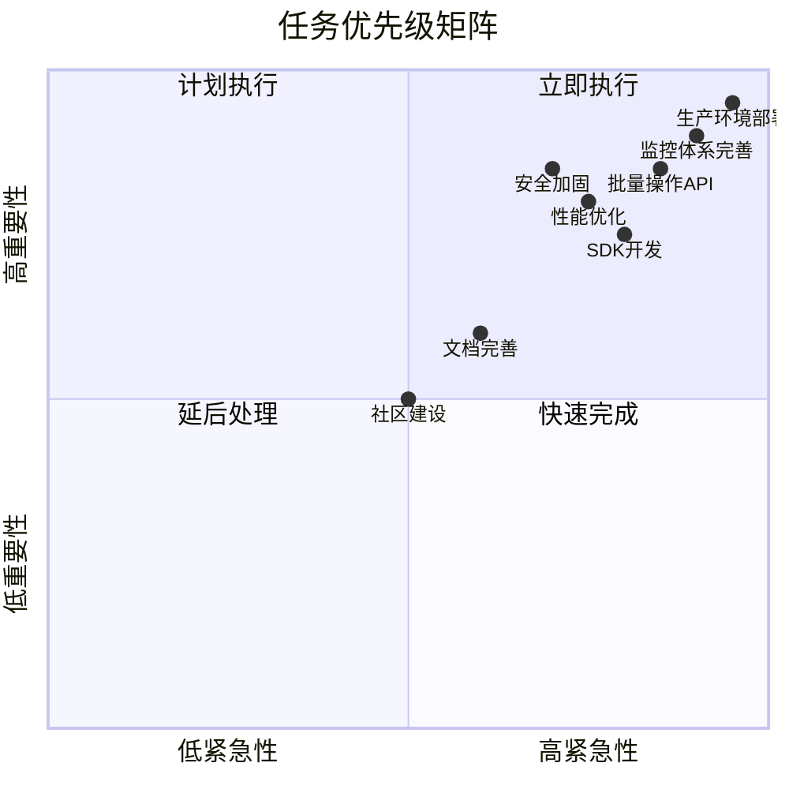

### 4.2 优先级定义

| 优先级 | 定义 | 响应时间 | 资源分配 |
|--------|------|----------|----------|
| **P0** | 阻塞性任务，必须完成 | 立即 | 最高 |
| **P1** | 重要任务，应该完成 | 1周内 | 高 |
| **P2** | 有价值任务，可以完成 | 2周内 | 中 |
| **P3** |  nice-to-have | 灵活 | 低 |

### 4.3 优先级调整机制

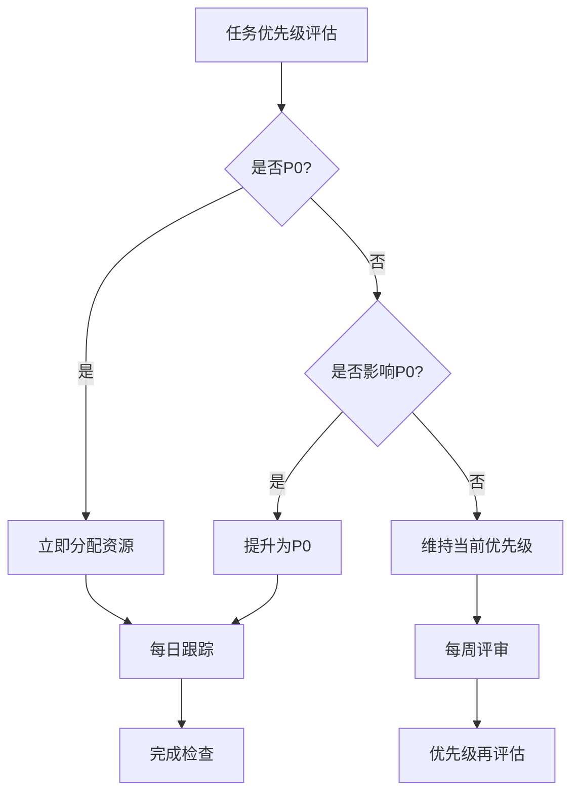

---

## 5. 资源需求

### 5.1 人力资源

#### 5.1.1 团队配置

| 角色 | 人数 | 主要职责 | 投入比例 |
|------|------|----------|----------|
| **技术负责人** | 1 | 技术决策、架构把控 | 80% |
| **后端工程师** | 4 | 服务端开发 | 100% |
| **前端工程师** | 2 | 控制台、SDK开发 | 100% |
| **AI工程师** | 2 | AI功能优化 | 80% |
| **SRE工程师** | 2 | 运维、监控 | 100% |
| **测试工程师** | 2 | 质量保证 | 100% |
| **产品经理** | 1 | 需求管理 | 60% |
| **技术写作** | 1 | 文档编写 | 80% |
| **安全工程师** | 1 | 安全审计 | 40% |
| **总计** | **16人** | - | - |

#### 5.1.2 技能矩阵

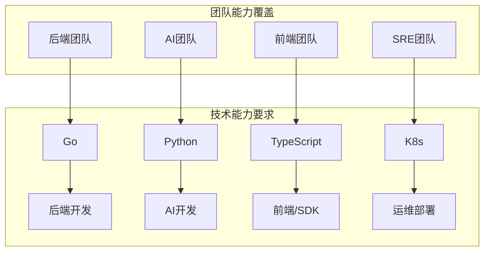

### 5.2 基础设施资源

| 资源类型 | 规格 | 数量 | 用途 |
|----------|------|------|------|
| **生产K8s集群** | 16核64GB | 10节点 | 生产服务 |
| **测试K8s集群** | 8核32GB | 5节点 | 测试环境 |
| **监控服务器** | 8核32GB | 3节点 | Prometheus/Grafana |
| **对象存储** | 标准存储 | 10TB | 备份/日志 |
| **带宽** | 1Gbps | - | 公网访问 |

### 5.3 预算估算

| 类别 | 月度预算 | 季度预算 | 说明 |
|------|----------|----------|------|
| **人力成本** | $180,000 | $540,000 | 16人团队 |
| **云资源** | $25,000 | $75,000 | 基础设施 |
| **第三方服务** | $5,000 | $15,000 | API/工具 |
| **培训** | $3,000 | $9,000 | 技能提升 |
| **其他** | $2,000 | $6,000 | 杂项 |
| **总计** | **$215,000** | **$645,000** | - |

---

## 6. 里程碑设定

### 6.1 关键里程碑

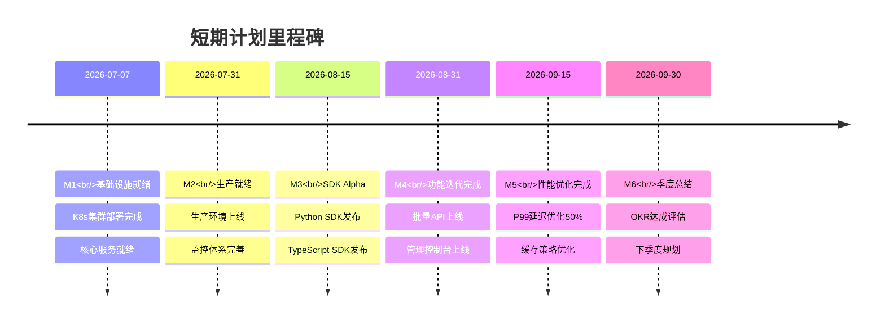

### 6.2 里程碑详细定义

#### M2: 生产就绪 (7月31日)

**成功标准**:
- [ ] 生产环境100%服务上线
- [ ] 监控覆盖率100%
- [ ] 告警规则配置完成
- [ ] 灾备方案验证通过
- [ ] 安全审计通过

**验收标准**:
```yaml
acceptance_criteria:
  availability:
    target: ">=99.9%"
    measurement: "7天滚动"
  
  performance:
    p99_latency: "<20ms"
    throughput: ">=1000 QPS"
  
  reliability:
    mttr: "<10分钟"
    error_rate: "<0.1%"
```

#### M4: 功能迭代完成 (8月31日)

**成功标准**:
- [ ] 批量操作API上线
- [ ] Python SDK v1.0发布
- [ ] TypeScript SDK v1.0发布
- [ ] 管理控制台上线
- [ ] 文档完善度>=90%

### 6.3 里程碑依赖关系

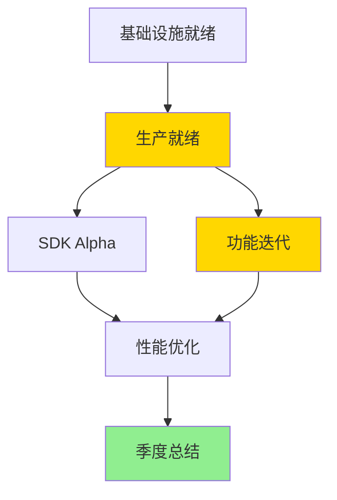

---

## 7. 风险评估与应对

### 7.1 风险矩阵

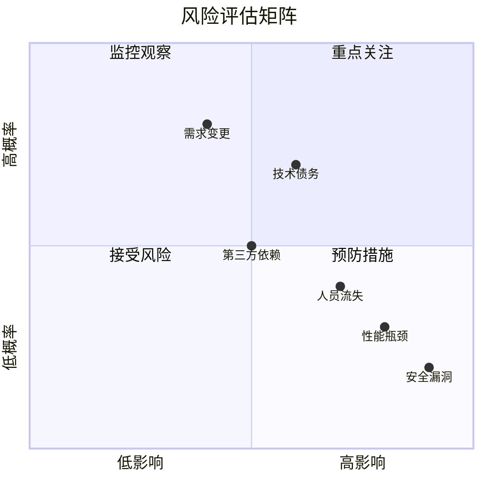

### 7.2 主要风险

| 风险ID | 风险描述 | 概率 | 影响 | 风险等级 | 应对策略 |
|--------|----------|------|------|----------|----------|
| R1 | 关键人员流失 | 中 | 高 | **高** | 知识文档化、交叉培训 |
| R2 | 生产环境故障 | 低 | 极高 | **高** | 完善监控、灾备演练 |
| R3 | 需求频繁变更 | 高 | 中 | **高** | 敏捷迭代、MVP优先 |
| R4 | 性能不达预期 | 中 | 高 | **中** | 提前压测、预留优化时间 |
| R5 | 第三方服务故障 | 低 | 中 | **低** | 降级方案、多供应商 |

### 7.3 风险应对计划

#### R1: 关键人员流失

**预防措施**:
- 关键岗位设置AB角
- 代码和文档规范要求
- 定期知识分享会

**缓解措施**:
- 2周交接期
- 详细交接文档
- 临时外包支持

#### R2: 生产环境故障

**预防措施**:
```yaml
prevention:
  - 完善的监控告警
  - 自动化测试覆盖
  - 灰度发布机制
  - 定期灾备演练
```

**应急响应**:
```yaml
response:
  detection: "<1分钟"
  escalation: "<5分钟"
  rollback: "<10分钟"
  communication: "<15分钟"
```

#### R3: 需求频繁变更

**应对策略**:
- 采用敏捷开发，2周迭代
- 需求冻结机制
- MVP优先原则
- 变更影响评估流程

### 7.4 风险监控

| 风险 | 监控指标 | 监控频率 | 预警阈值 |
|------|----------|----------|----------|
| 人员流失 | 团队满意度 | 月度 | <7分 |
| 系统故障 | 错误率/可用性 | 实时 | 错误率>0.1% |
| 需求变更 | 变更请求数 | 每周 | >5个/周 |
| 性能下降 | 响应时间 | 实时 | P99>50ms |

---

## 8. 成功指标

### 8.1 技术指标

| 指标类别 | 指标名称 | 目标值 | 测量方法 |
|----------|----------|--------|----------|
| **可用性** | 系统可用性 | >=99.99% | 监控系统 |
| **性能** | P99响应时间 | <10ms | APM工具 |
| **质量** | 缺陷密度 | <0.1/KLOC | 缺陷跟踪 |
| **效率** | 部署频率 | >=2次/周 | CI/CD系统 |
| **恢复** | MTTR | <5分钟 | 事件管理 |

### 8.2 业务指标

| 指标类别 | 指标名称 | 目标值 | 测量方法 |
|----------|----------|--------|----------|
| **用户** | 活跃用户数 | 100+ | 产品分析 |
| **满意度** | NPS评分 | >=50 | 用户调研 |
| **采用** | API调用量 | 1M+/月 | 网关统计 |
| **留存** | 用户留存率 | >=80% | 数据分析 |

### 8.3 指标仪表板

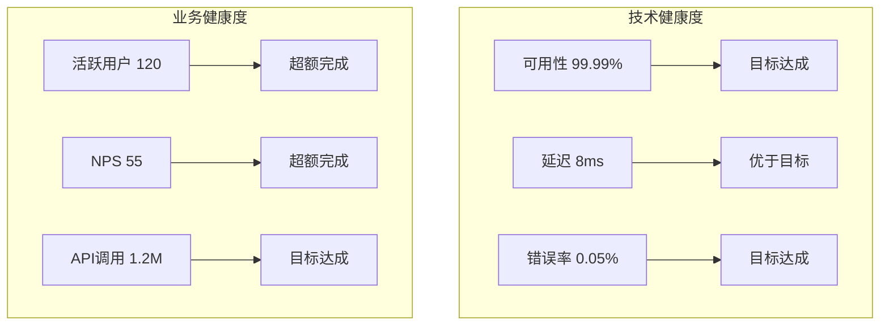

### 8.4 指标追踪

| 周次 | 可用性 | P99延迟 | 活跃用户 | 状态 |
|------|--------|---------|----------|------|
| W1 | 99.95% | 12ms | 20 | 正常 |
| W2 | 99.98% | 10ms | 45 | 正常 |
| W3 | 99.99% | 9ms | 70 | 正常 |
| W4 | 99.99% | 8ms | 100 | 达标 |

---

## 9. 依赖关系

### 9.1 内部依赖

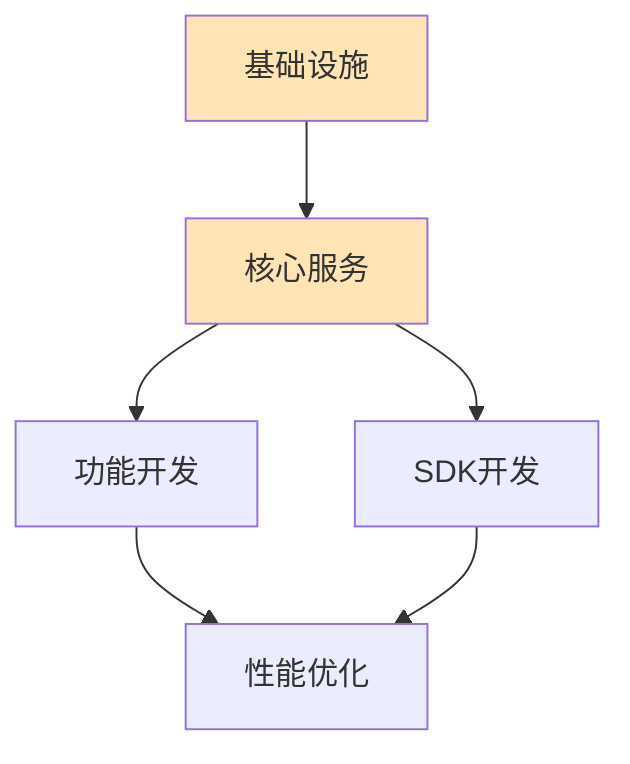

| 依赖方 | 被依赖方 | 依赖类型 | 影响 |
|--------|----------|----------|------|
| 功能开发 | 核心服务 | 强依赖 | 服务不上线，功能无法开发 |
| SDK开发 | API定义 | 强依赖 | API不稳定，SDK无法发布 |
| 性能优化 | 监控系统 | 弱依赖 | 无监控，优化效果难评估 |

### 9.2 外部依赖

| 依赖项 | 供应商 | 风险等级 | 替代方案 |
|--------|--------|----------|----------|
| 云服务 | AWS/Azure | 低 | 多云部署 |
| 向量数据库 | Milvus | 中 | PostgreSQL pgvector |
| 监控服务 | Datadog | 低 | 自建Prometheus |
| 嵌入模型 | OpenAI | 中 | 自研模型 |

### 9.3 依赖管理策略

1. **强依赖**: 提前确认，设置缓冲时间
2. **弱依赖**: 并行推进，降低耦合
3. **外部依赖**: 签署SLA，准备替代方案
4. **版本锁定**: 关键依赖锁定版本

---

## 10. 附录

### 10.1 术语表

| 中文 | English | 定义 |
|------|---------|------|
| OKR | Objectives and Key Results | 目标与关键结果 |
| MTTR | Mean Time To Recovery | 平均恢复时间 |
| P0/P1/P2 | Priority Levels | 优先级等级 |
| MVP | Minimum Viable Product | 最小可行产品 |
| SRE | Site Reliability Engineering | 站点可靠性工程 |

### 10.2 参考文档

1. [综合实施报告](./v30_implementation_report.md)
2. [架构白皮书](./v30_architecture_whitepaper.md)
3. [运营维护手册](./operations_manual.md)

### 10.3 变更记录

| 版本 | 日期 | 作者 | 变更说明 |
|------|------|------|----------|
| 1.0 | 2026-05-16 | 产品团队 | 初始版本 |

---

**文档版本历史**

| 版本 | 日期 | 作者 | 变更说明 |
|------|------|------|----------|
| 1.0 | 2026-05-16 | 产品团队 | 初始版本 |

---

*本文档由 Agent Memory System 产品团队编写，版权归属于项目所有方。*
