# Agent Memory System V3.0 架构白皮书

## Agent Memory System V3.0 Architecture Whitepaper

**版本号**: V3.0.0  
**发布日期**: 2026-05-16  
**文档分类**: 技术架构  
**密级**: 公开  

---

## 目录

1. [执行摘要](#1-执行摘要)
2. [架构愿景与目标](#2-架构愿景与目标)
3. [系统架构总览](#3-系统架构总览)
4. [分层架构设计](#4-分层架构设计)
5. [领域驱动设计](#5-领域驱动设计)
6. [核心组件详细设计](#6-核心组件详细设计)
7. [数据流与交互](#7-数据流与交互)
8. [技术选型说明](#8-技术选型说明)
9. [扩展性设计](#9-扩展性设计)
10. [安全性设计](#10-安全性设计)
11. [部署架构](#11-部署架构)

---

## 1. 执行摘要

### 1.1 文档目的

本白皮书详细阐述 Agent Memory System V3.0（以下简称 AMS V3.0）的技术架构设计，为开发团队、运维团队、技术决策者提供全面的架构参考。

### 1.2 关键架构特性

| 特性 | 描述 | 价值 |
|------|------|------|
| **云原生** | 基于 Kubernetes 的容器化部署 | 弹性伸缩、高可用 |
| **微服务** | 领域驱动的服务拆分 | 独立演进、团队自治 |
| **事件驱动** | 异步消息传递架构 | 松耦合、高吞吐 |
| **AI原生** | 深度集成AI能力 | 智能化、自适应 |
| **多租户** | 企业级数据隔离 | 安全合规、成本优化 |

### 1.3 架构演进

AMS V3.0 是在 V2.0 基础上的全面重构，主要改进包括：

- 从单体架构演进为微服务架构
- 引入向量数据库支持语义检索
- 增加联邦学习能力
- 完善多模态存储支持
- 实现云原生部署能力

---

## 2. 架构愿景与目标

### 2.1 架构愿景

> **构建AI时代的基础设施，让每一款AI Agent都拥有无限记忆。**

### 2.2 架构目标

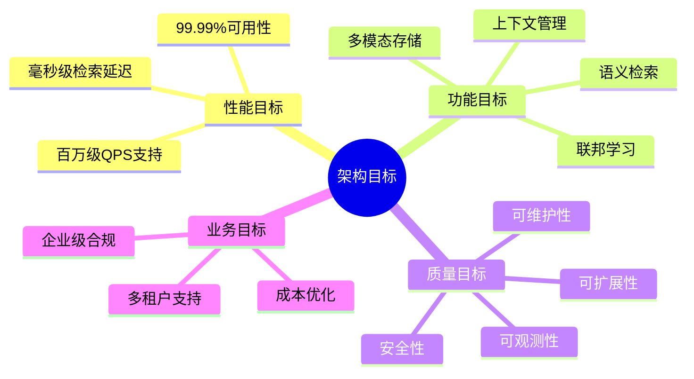

### 2.3 设计原则

| 原则 | 说明 | 实践 |
|------|------|------|
| **单一职责** | 每个服务只负责一个业务领域 | 领域驱动设计 |
| **开闭原则** | 对扩展开放，对修改关闭 | 插件化架构 |
| **依赖倒置** | 依赖抽象而非具体实现 | 接口隔离 |
| **最少知识** | 减少服务间耦合 | 事件驱动通信 |
| **容错设计** | 假设故障必然发生 | 熔断、降级、重试 |

---

## 3. 系统架构总览

### 3.1 整体架构图

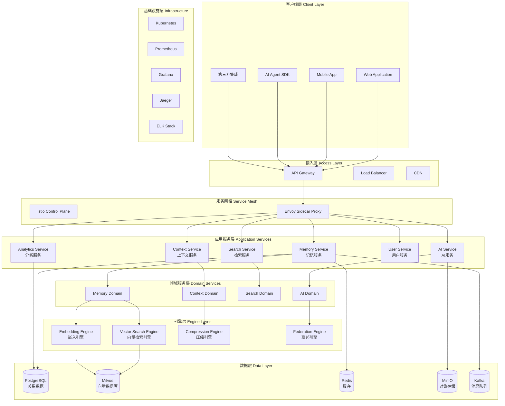

### 3.2 架构分层说明

| 层级 | 职责 | 主要组件 |
|------|------|----------|
| **客户端层** | 用户交互入口 | Web、Mobile、SDK |
| **接入层** | 流量接入与路由 | Gateway、LB、CDN |
| **服务网格** | 服务间通信治理 | Istio、Envoy |
| **应用服务层** | 业务逻辑实现 | 各业务服务 |
| **领域服务层** | 领域模型封装 | Domain Services |
| **引擎层** | 核心算法实现 | Search/AI Engines |
| **数据层** | 数据持久化 | 各类存储系统 |
| **基础设施层** | 运维支撑 | K8s、监控、日志 |

### 3.3 架构风格

AMS V3.0 采用**混合架构风格**，融合了多种架构模式的优势：

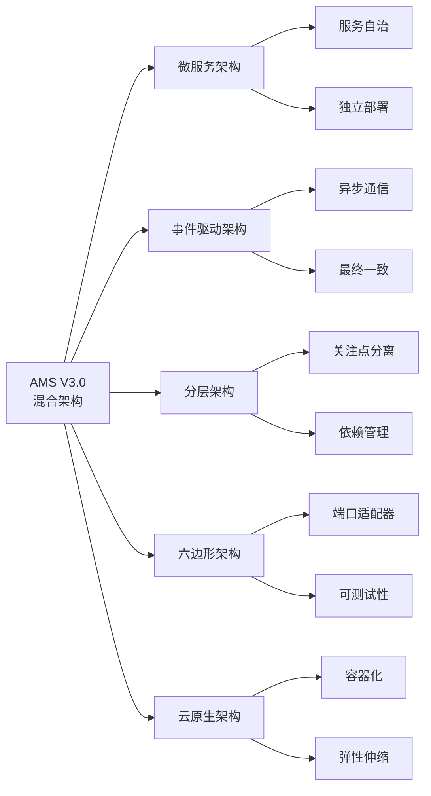

---

## 4. 分层架构设计

### 4.1 分层架构图

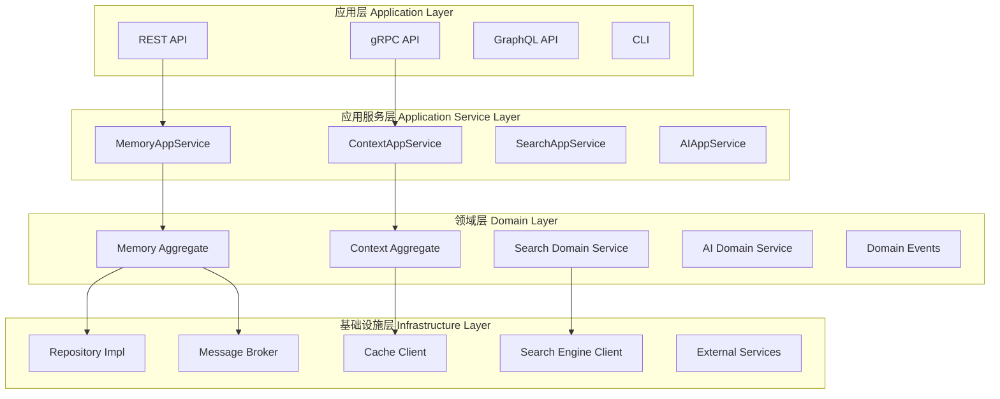

### 4.2 各层职责

#### 4.2.1 应用层 (Application Layer)

- **职责**: 处理用户请求，协调应用服务
- **组件**: Controllers、Handlers、DTOs
- **设计要点**:
  - 薄层设计，不包含业务逻辑
  - 负责输入验证和输出格式化
  - 处理横切关注点（认证、日志）

#### 4.2.2 应用服务层 (Application Service Layer)

- **职责**: 编排领域对象完成用例
- **组件**: Application Services、Use Cases
- **设计要点**:
  - 一个用例对应一个应用服务方法
  - 协调多个领域对象
  - 管理事务边界

#### 4.2.3 领域层 (Domain Layer)

- **职责**: 核心业务逻辑
- **组件**: Entities、Value Objects、Aggregates、Domain Services、Domain Events
- **设计要点**:
  - 纯业务逻辑，不依赖外部框架
  - 富领域模型
  - 通过领域事件实现解耦

#### 4.2.4 基础设施层 (Infrastructure Layer)

- **职责**: 技术实现细节
- **组件**: Repositories、Message Brokers、Cache、External Clients
- **设计要点**:
  - 实现领域层定义的接口
  - 处理数据持久化
  - 集成外部系统

### 4.3 依赖关系

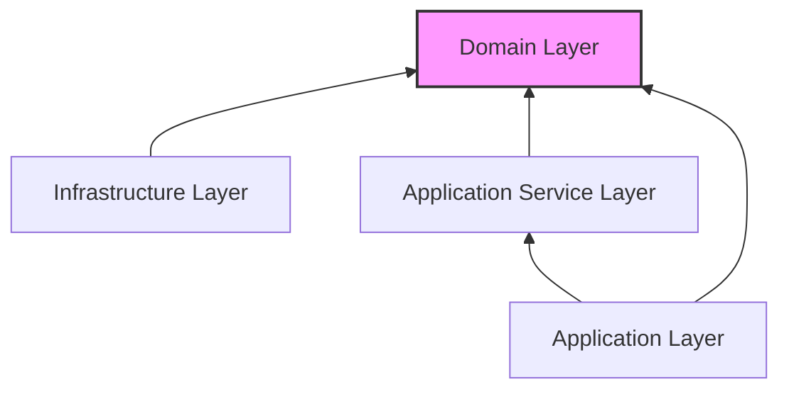

**依赖规则**:
- 上层依赖下层
- 领域层不依赖其他层
- 通过依赖注入解耦

---

## 5. 领域驱动设计

### 5.1 领域划分

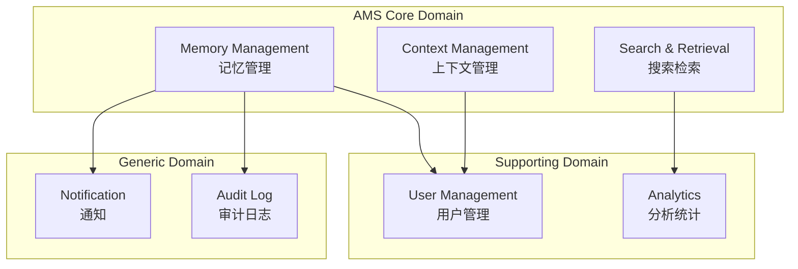

### 5.2 核心领域模型

#### 5.2.1 记忆聚合 (Memory Aggregate)

```go
// Memory 记忆实体
type Memory struct {
    ID          MemoryID
    AgentID     AgentID
    TenantID    TenantID
    Content     Content
    Vector      Embedding
    Metadata    Metadata
    Importance  ImportanceScore
    CreatedAt   time.Time
    ExpiresAt   *time.Time
    Version     Version
    
    events []DomainEvent
}

// 领域方法
func (m *Memory) UpdateContent(newContent Content) error {
    if newContent.IsEmpty() {
        return errors.New("content cannot be empty")
    }
    
    oldContent := m.Content
    m.Content = newContent
    m.Version = m.Version.Next()
    
    m.events = append(m.events, MemoryUpdatedEvent{
        MemoryID:    m.ID,
        OldContent:  oldContent,
        NewContent:  newContent,
        UpdatedAt:   time.Now(),
    })
    
    return nil
}

func (m *Memory) MarkAsImportant() {
    m.Importance = HighImportance
    m.events = append(m.events, MemoryMarkedImportantEvent{
        MemoryID:   m.ID,
        MarkedAt:   time.Now(),
    })
}
```

#### 5.2.2 上下文聚合 (Context Aggregate)

```go
// Context 上下文实体
type Context struct {
    ID           ContextID
    AgentID      AgentID
    SessionID    SessionID
    WindowSize   int
    Memories     []MemoryReference
    Summary      *ContextSummary
    CreatedAt    time.Time
    LastAccessed time.Time
}

// 上下文管理方法
func (c *Context) AddMemory(mem MemoryReference) error {
    if len(c.Memories) >= c.WindowSize {
        // 移除最旧的记忆
        c.Memories = c.Memories[1:]
    }
    c.Memories = append(c.Memories, mem)
    c.LastAccessed = time.Now()
    return nil
}

func (c *Context) Compress() (*ContextSummary, error) {
    // 调用AI服务进行上下文压缩
    summary := &ContextSummary{
        Content:   generateSummary(c.Memories),
        Tokens:    estimateTokens(c.Memories),
        CompressedAt: time.Now(),
    }
    c.Summary = summary
    return summary, nil
}
```

### 5.3 领域事件

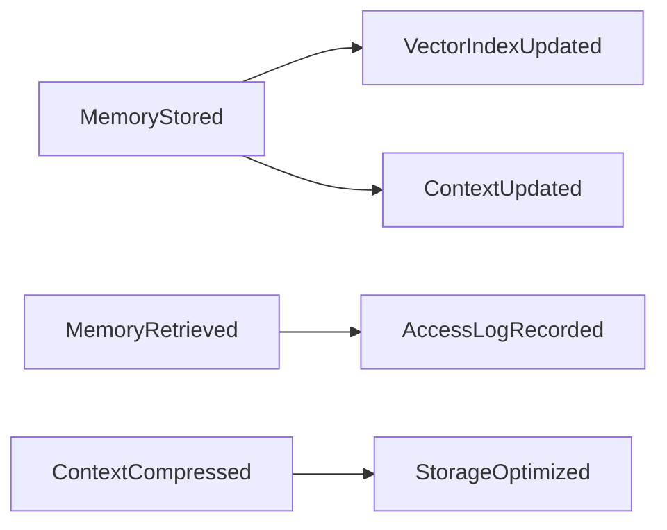

**核心领域事件列表**:

| 事件名称 | 触发条件 | 消费者 |
|----------|----------|--------|
| MemoryStored | 新记忆存储 | VectorIndexService, ContextService |
| MemoryUpdated | 记忆更新 | VectorIndexService, CacheService |
| MemoryDeleted | 记忆删除 | VectorIndexService, AnalyticsService |
| ContextWindowShifted | 上下文窗口滑动 | CompressionService |
| ImportanceScored | 重要性评分完成 | RetentionPolicyService |

---

## 6. 核心组件详细设计

### 6.1 记忆服务 (Memory Service)

#### 6.1.1 功能职责

- 记忆的CRUD操作
- 记忆生命周期管理
- 版本控制
- 软删除与恢复

#### 6.1.2 架构图

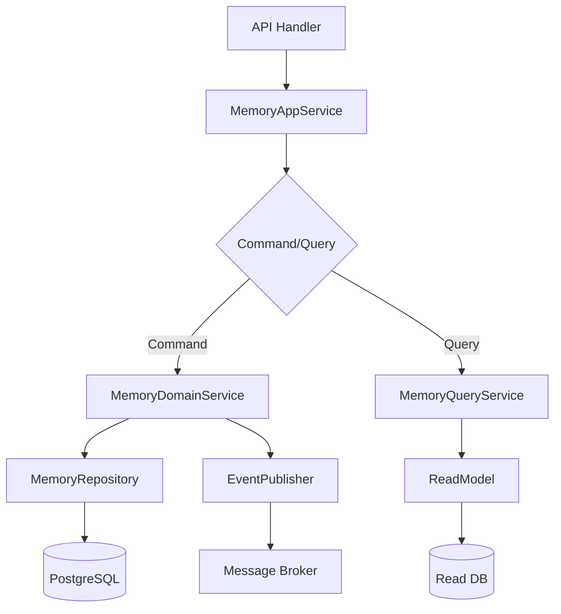

#### 6.1.3 关键接口

```go
// 应用服务接口
type MemoryAppService interface {
    StoreMemory(ctx context.Context, cmd StoreMemoryCommand) (*MemoryDTO, error)
    UpdateMemory(ctx context.Context, cmd UpdateMemoryCommand) (*MemoryDTO, error)
    DeleteMemory(ctx context.Context, cmd DeleteMemoryCommand) error
    GetMemory(ctx context.Context, query GetMemoryQuery) (*MemoryDTO, error)
    ListMemories(ctx context.Context, query ListMemoriesQuery) (*ListResult, error)
}

// 领域服务接口
type MemoryDomainService interface {
    CreateMemory(ctx context.Context, content Content, metadata Metadata) (*Memory, error)
    UpdateMemoryContent(ctx context.Context, id MemoryID, newContent Content) error
    DeleteMemory(ctx context.Context, id MemoryID) error
    ApplyRetentionPolicy(ctx context.Context, agentID AgentID) error
}
```

### 6.2 检索服务 (Search Service)

#### 6.2.1 功能职责

- 向量相似度检索
- 关键词检索
- 混合检索
- 检索结果重排序

#### 6.2.2 混合检索架构

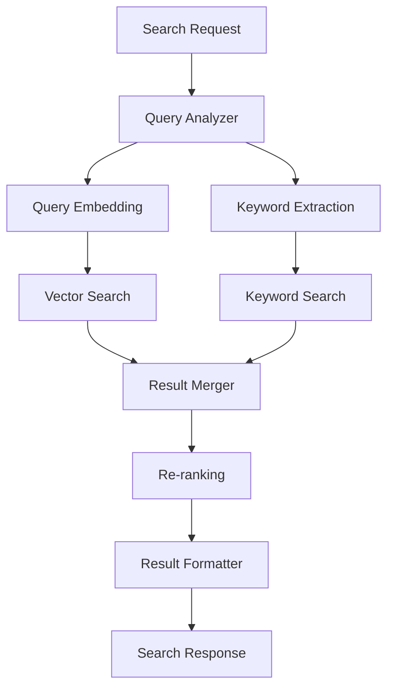

#### 6.2.3 检索算法

```go
// 混合检索器
type HybridSearcher struct {
    vectorSearcher VectorSearcher
    keywordSearcher KeywordSearcher
    merger ResultMerger
    reranker Reranker
}

func (h *HybridSearcher) Search(ctx context.Context, query SearchQuery) (*SearchResult, error) {
    // 1. 并行执行向量检索和关键词检索
    vectorResultsCh := h.vectorSearcher.SearchAsync(ctx, query.Vector, query.TopK)
    keywordResultsCh := h.keywordSearcher.SearchAsync(ctx, query.Keywords, query.TopK)
    
    // 2. 合并结果
    merged := h.merger.Merge(
        <-vectorResultsCh,
        <-keywordResultsCh,
        query.VectorWeight,
        query.KeywordWeight,
    )
    
    // 3. 重排序
    reranked := h.reranker.Rerank(merged, query.Context)
    
    // 4. 返回结果
    return &SearchResult{
        Items: reranked,
        Total: len(reranked),
        Query: query,
    }, nil
}
```

### 6.3 AI服务 (AI Service)

#### 6.3.1 功能职责

- 文本向量化
- 重要性评分
- 上下文压缩
- 记忆摘要生成

#### 6.3.2 AI能力架构

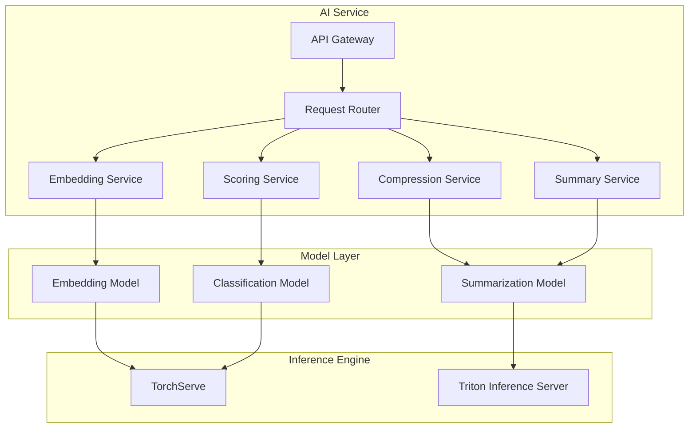

#### 6.3.3 模型管理

```go
// 模型管理器
type ModelManager struct {
    models map[ModelType]Model
    mu     sync.RWMutex
}

func (m *ModelManager) LoadModel(modelType ModelType, config ModelConfig) error {
    m.mu.Lock()
    defer m.mu.Unlock()
    
    model, err := loadModel(config)
    if err != nil {
        return err
    }
    
    m.models[modelType] = model
    return nil
}

func (m *ModelManager) Predict(ctx context.Context, modelType ModelType, input interface{}) (interface{}, error) {
    m.mu.RLock()
    model, ok := m.models[modelType]
    m.mu.RUnlock()
    
    if !ok {
        return nil, ErrModelNotLoaded
    }
    
    return model.Predict(ctx, input)
}
```

### 6.4 上下文服务 (Context Service)

#### 6.4.1 功能职责

- 上下文窗口管理
- 上下文压缩
- 上下文持久化
- 跨会话上下文恢复

#### 6.4.2 上下文生命周期

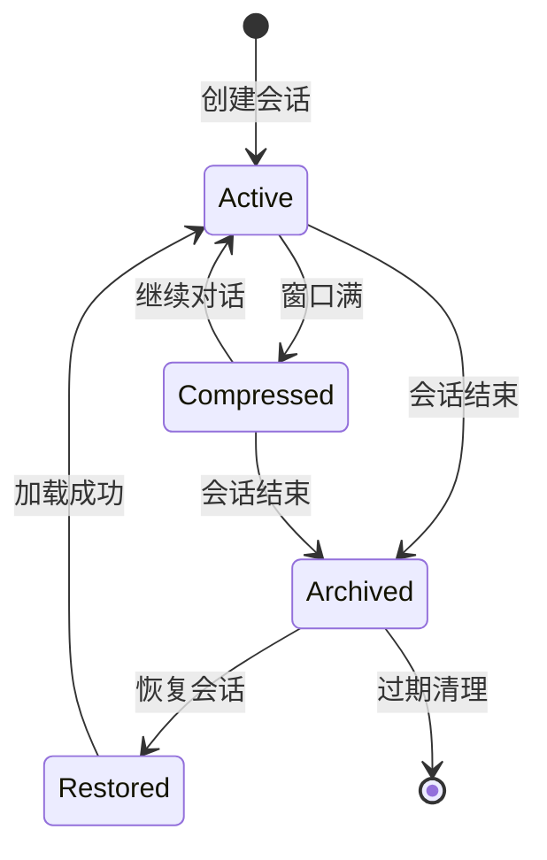

---

## 7. 数据流与交互

### 7.1 记忆存储数据流

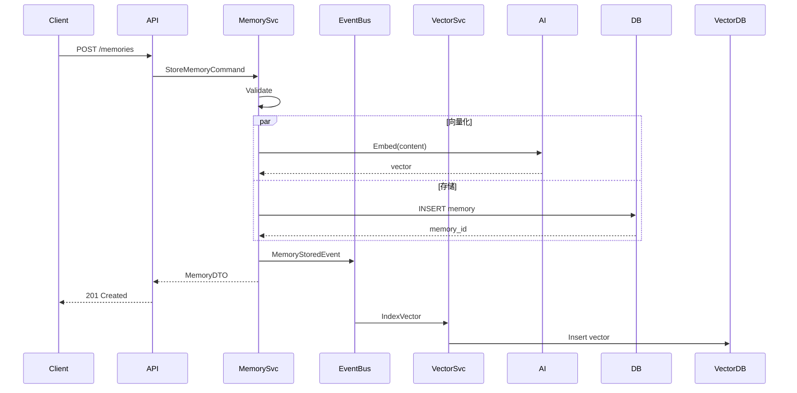

### 7.2 记忆检索数据流

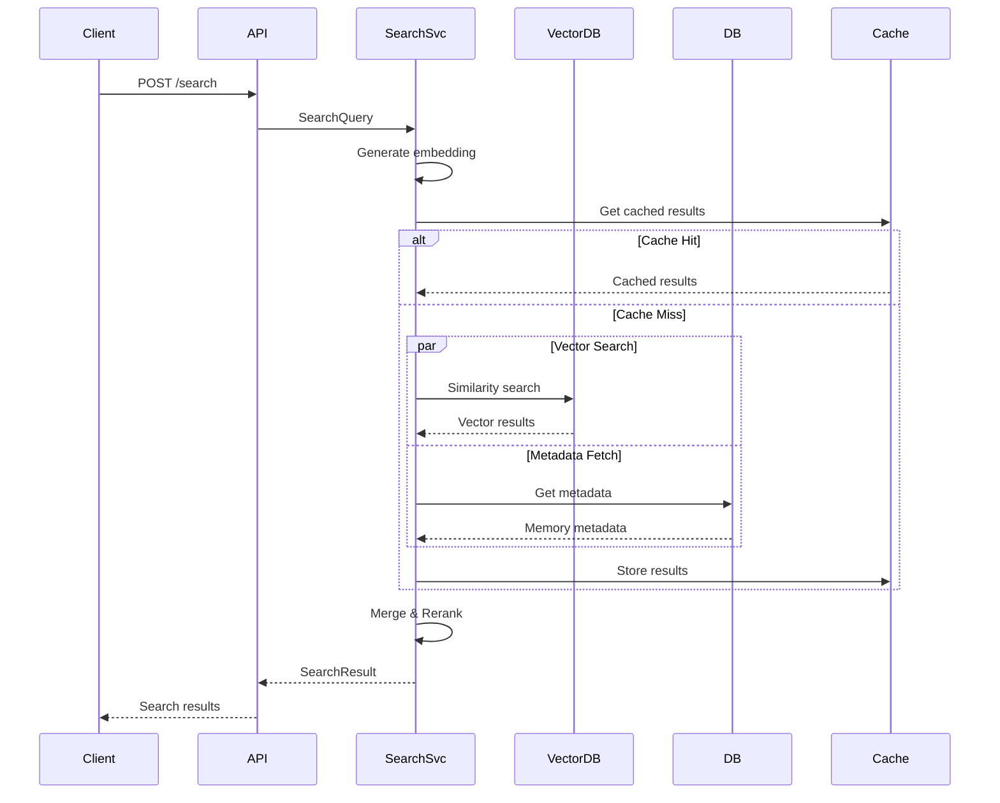

### 7.3 上下文管理数据流

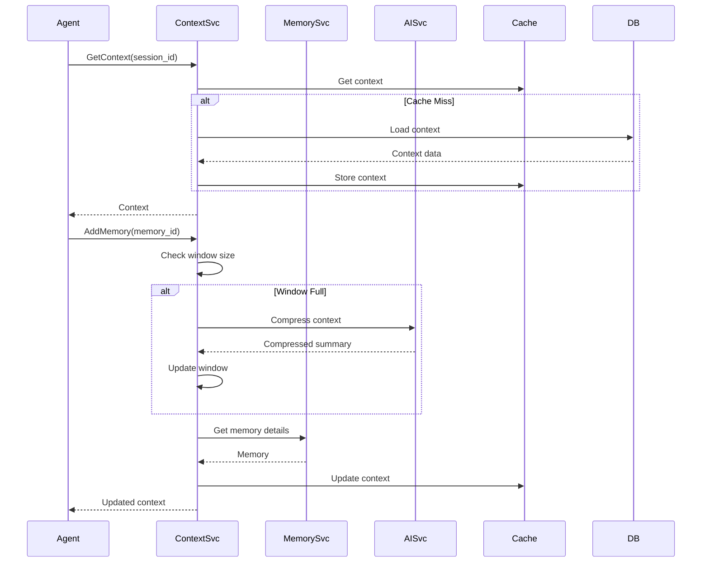

---

## 8. 技术选型说明

### 8.1 编程语言

| 语言 | 使用场景 | 选择理由 |
|------|----------|----------|
| **Go** | 核心服务 | 高性能、并发友好、云原生生态 |
| **Python** | AI服务 | ML/AI库丰富、快速原型 |
| **TypeScript** | SDK/Web | 类型安全、开发体验好 |
| **Rust** | 高性能组件 | 极致性能、内存安全 |

### 8.2 数据存储

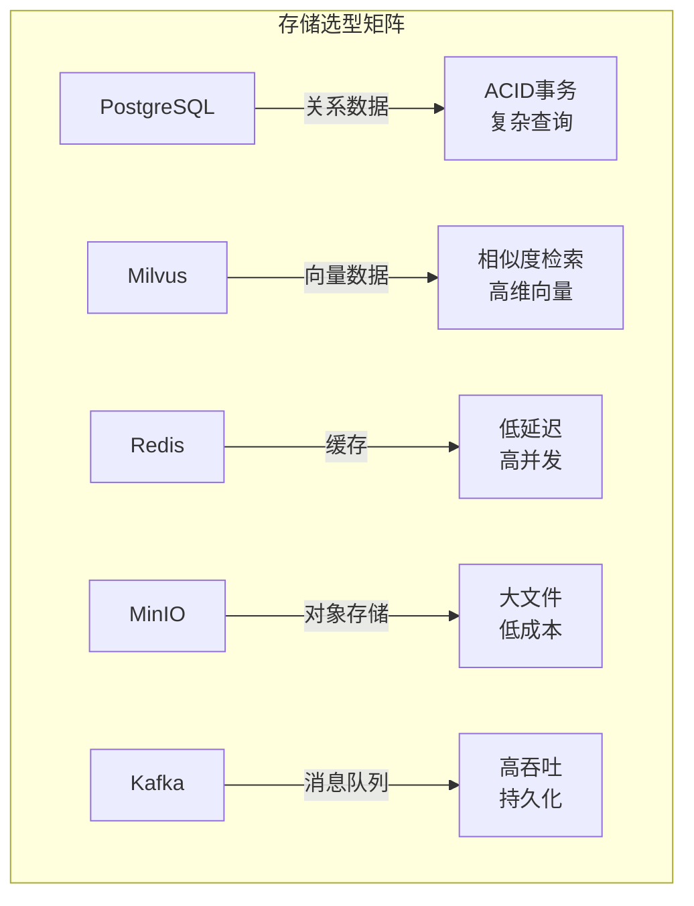

#### 8.2.1 PostgreSQL

- **用途**: 关系型数据存储（记忆元数据、用户信息）
- **版本**: 15+
- **扩展**: TimescaleDB（时序数据）、pgvector（向量支持）
- **部署**: Patroni + etcd 高可用集群

#### 8.2.2 Milvus

- **用途**: 向量数据存储与检索
- **版本**: 2.3+
- **索引**: HNSW（默认）、IVF_FLAT
- **特性**: GPU加速、分布式部署、多副本

#### 8.2.3 Redis

- **用途**: 缓存、会话存储、分布式锁
- **模式**: Cluster 模式
- **持久化**: RDB + AOF
- **淘汰策略**: allkeys-lru

### 8.3 基础设施

| 组件 | 选型 | 用途 |
|------|------|------|
| **容器编排** | Kubernetes | 服务部署与编排 |
| **服务网格** | Istio | 流量管理、安全通信 |
| **监控** | Prometheus + Grafana | 指标采集与可视化 |
| **日志** | Loki + Grafana | 日志聚合与查询 |
| **追踪** | Jaeger | 分布式链路追踪 |
| **网关** | Istio Gateway | 流量入口管理 |

### 8.4 技术选型原则

1. **成熟稳定**: 优先选择经过大规模验证的技术
2. **云原生优先**: 优先选择云原生技术栈
3. **社区活跃**: 选择社区活跃、文档完善的项目
4. **团队熟悉**: 考虑团队技术栈和技能储备
5. **可替换性**: 避免供应商锁定，保持可替换性

---

## 9. 扩展性设计

### 9.1 水平扩展架构

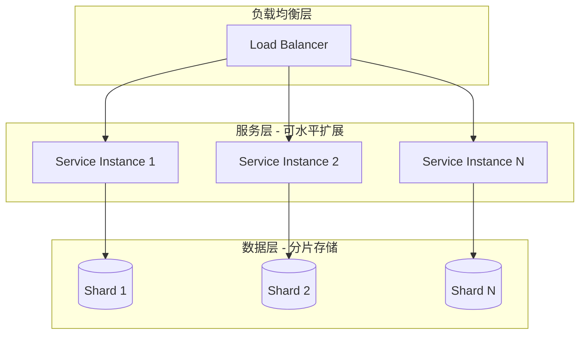

### 9.2 分片策略

#### 9.2.1 记忆数据分片

```go
// 基于租户ID的分片策略
type TenantShardStrategy struct {
    shardCount int
}

func (s *TenantShardStrategy) GetShard(tenantID TenantID) int {
    hash := fnv32(string(tenantID))
    return int(hash) % s.shardCount
}

// 基于时间范围的分片策略
type TimeRangeShardStrategy struct {
    shardDuration time.Duration
}

func (s *TimeRangeShardStrategy) GetShard(t time.Time) string {
    shardIndex := t.Unix() / int64(s.shardDuration.Seconds())
    return fmt.Sprintf("shard_%d", shardIndex)
}
```

#### 9.2.2 向量索引分片

```yaml
# Milvus 分片配置
milvus:
  shard:
    num: 4  # 分片数量
  replica:
    num: 2  # 副本数量
  resource:
    queryNode:
      replicas: 6
    dataNode:
      replicas: 4
    indexNode:
      replicas: 2
```

### 9.3 自动扩缩容

#### 9.3.1 HPA配置

```yaml
apiVersion: autoscaling/v2
kind: HorizontalPodAutoscaler
metadata:
  name: memory-service-hpa
spec:
  scaleTargetRef:
    apiVersion: apps/v1
    kind: Deployment
    name: memory-service
  minReplicas: 3
  maxReplicas: 100
  metrics:
  - type: Resource
    resource:
      name: cpu
      target:
        type: Utilization
        averageUtilization: 70
  - type: Resource
    resource:
      name: memory
      target:
        type: Utilization
        averageUtilization: 80
  - type: Pods
    pods:
      metric:
        name: http_requests_per_second
      target:
        type: AverageValue
        averageValue: "1000"
  behavior:
    scaleUp:
      stabilizationWindowSeconds: 60
      policies:
      - type: Percent
        value: 100
        periodSeconds: 60
    scaleDown:
      stabilizationWindowSeconds: 300
      policies:
      - type: Percent
        value: 10
        periodSeconds: 60
```

#### 9.3.2 VPA配置

```yaml
apiVersion: autoscaling.k8s.io/v1
kind: VerticalPodAutoscaler
metadata:
  name: memory-service-vpa
spec:
  targetRef:
    apiVersion: apps/v1
    kind: Deployment
    name: memory-service
  updatePolicy:
    updateMode: "Auto"
  resourcePolicy:
    containerPolicies:
    - containerName: memory-service
      minAllowed:
        cpu: 100m
        memory: 256Mi
      maxAllowed:
        cpu: 4000m
        memory: 8Gi
      controlledResources: ["cpu", "memory"]
```

### 9.4 容量规划

| 组件 | 单节点容量 | 扩展上限 | 扩展方式 |
|------|-----------|----------|----------|
| Memory Service | 10K QPS | 1M QPS | HPA |
| PostgreSQL | 10TB | 100TB | 分片 |
| Milvus | 1B vectors | 100B vectors | 集群 |
| Redis | 100GB | 10TB | Cluster |
| Kafka | 1M msg/s | 10M msg/s | 分区扩展 |

---

## 10. 安全性设计

### 10.1 安全架构

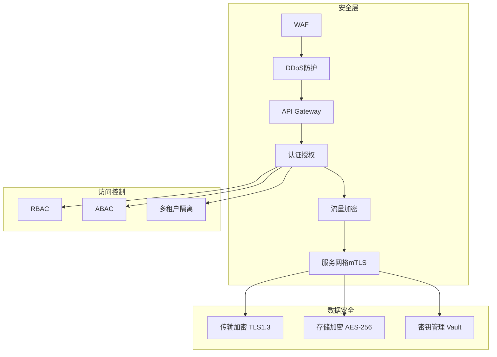

### 10.2 认证与授权

#### 10.2.1 认证方案

```go
// JWT认证中间件
func JWTAuthMiddleware(secretKey []byte) gin.HandlerFunc {
    return func(c *gin.Context) {
        tokenString := c.GetHeader("Authorization")
        if tokenString == "" {
            c.AbortWithStatusJSON(401, gin.H{"error": "missing token"})
            return
        }
        
        token, err := jwt.Parse(tokenString, func(token *jwt.Token) (interface{}, error) {
            return secretKey, nil
        })
        
        if err != nil || !token.Valid {
            c.AbortWithStatusJSON(401, gin.H{"error": "invalid token"})
            return
        }
        
        claims := token.Claims.(jwt.MapClaims)
        c.Set("user_id", claims["sub"])
        c.Set("tenant_id", claims["tenant_id"])
        c.Next()
    }
}
```

#### 10.2.2 授权模型

```go
// RBAC权限检查
type RBACAuthorizer struct {
    policyManager PolicyManager
}

func (a *RBACAuthorizer) Authorize(ctx context.Context, subject Subject, resource Resource, action Action) error {
    roles := a.policyManager.GetRoles(subject)
    
    for _, role := range roles {
        if a.policyManager.HasPermission(role, resource, action) {
            return nil
        }
    }
    
    return ErrUnauthorized
}

// ABAC属性检查
func (a *RBACAuthorizer) AuthorizeABAC(ctx context.Context, subject Subject, resource Resource, action Action, env Environment) error {
    attributes := map[string]interface{}{
        "subject.tenant_id": subject.TenantID,
        "resource.tenant_id": resource.TenantID,
        "time": env.Time,
        "location": env.Location,
    }
    
    return a.policyManager.EvaluatePolicy(attributes)
}
```

### 10.3 数据加密

#### 10.3.1 传输加密

- **协议**: TLS 1.3
- **证书管理**: cert-manager 自动签发和轮换
- **服务间通信**: mTLS（Istio 自动管理）

#### 10.3.2 存储加密

```go
// 加密存储包装器
type EncryptedStore struct {
    underlying Store
    cipher     Cipher
}

func (s *EncryptedStore) Store(ctx context.Context, key string, value []byte) error {
    encrypted, err := s.cipher.Encrypt(value)
    if err != nil {
        return err
    }
    return s.underlying.Store(ctx, key, encrypted)
}

func (s *EncryptedStore) Retrieve(ctx context.Context, key string) ([]byte, error) {
    encrypted, err := s.underlying.Retrieve(ctx, key)
    if err != nil {
        return nil, err
    }
    return s.cipher.Decrypt(encrypted)
}
```

### 10.4 多租户隔离

#### 10.4.1 隔离级别

| 级别 | 实现方式 | 适用场景 |
|------|----------|----------|
| **Shared** | 行级安全策略 | 标准租户 |
| **Schema** | 独立Schema | 高级租户 |
| **Database** | 独立数据库 | 企业租户 |

#### 10.4.2 行级安全实现

```sql
-- PostgreSQL 行级安全策略
ALTER TABLE memories ENABLE ROW LEVEL SECURITY;

CREATE POLICY tenant_isolation ON memories
    USING (tenant_id = current_setting('app.current_tenant')::UUID);

-- 应用层设置租户上下文
SET app.current_tenant = 'tenant-uuid';
```

### 10.5 审计日志

```go
// 审计日志记录器
type AuditLogger struct {
    store AuditStore
}

func (l *AuditLogger) Log(ctx context.Context, event AuditEvent) error {
    entry := AuditEntry{
        ID:        uuid.New(),
        Timestamp: time.Now(),
        UserID:    GetUserID(ctx),
        TenantID:  GetTenantID(ctx),
        Action:    event.Action,
        Resource:  event.Resource,
        Result:    event.Result,
        IP:        GetClientIP(ctx),
        UserAgent: GetUserAgent(ctx),
    }
    
    return l.store.Store(ctx, entry)
}
```

---

## 11. 部署架构

### 11.1 部署拓扑

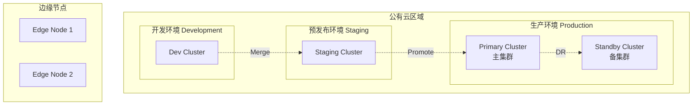

### 11.2 生产环境架构

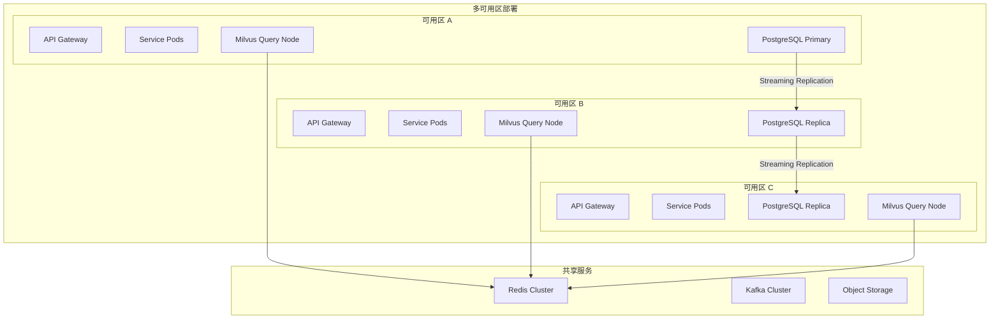

### 11.3 资源规划

#### 11.3.1 计算资源

| 服务 | 副本数 | CPU/副本 | 内存/副本 | 存储 |
|------|--------|----------|-----------|------|
| API Gateway | 3 | 2核 | 4GB | - |
| Memory Service | 5 | 4核 | 8GB | - |
| Search Service | 5 | 4核 | 8GB | - |
| AI Service | 3 | 8核 | 32GB | 100GB SSD |
| PostgreSQL | 3 | 8核 | 32GB | 1TB SSD |
| Milvus | 6 | 4核 | 16GB | 500GB SSD |
| Redis | 6 | 2核 | 8GB | - |
| Kafka | 5 | 4核 | 16GB | 500GB SSD |

#### 11.3.2 网络规划

```yaml
# 网络分段
network_segments:
  dmz:
    cidr: 10.0.0.0/24
    services: [ingress-gateway, waf]
  
  application:
    cidr: 10.0.1.0/24
    services: [app-services, background-jobs]
  
  data:
    cidr: 10.0.2.0/24
    services: [databases, caches]
  
  management:
    cidr: 10.0.3.0/24
    services: [monitoring, logging, bastion]
```

### 11.4 灾备方案

#### 11.4.1 RTO/RPO目标

| 场景 | RTO | RPO | 策略 |
|------|-----|-----|------|
| 单点故障 | <1分钟 | 0 | 高可用架构 |
| 可用区故障 | <5分钟 | <1秒 | 跨AZ复制 |
| 区域故障 | <30分钟 | <5分钟 | 跨区域备份 |
| 数据损坏 | <1小时 | <1小时 | 时间点恢复 |

#### 11.4.2 故障转移流程

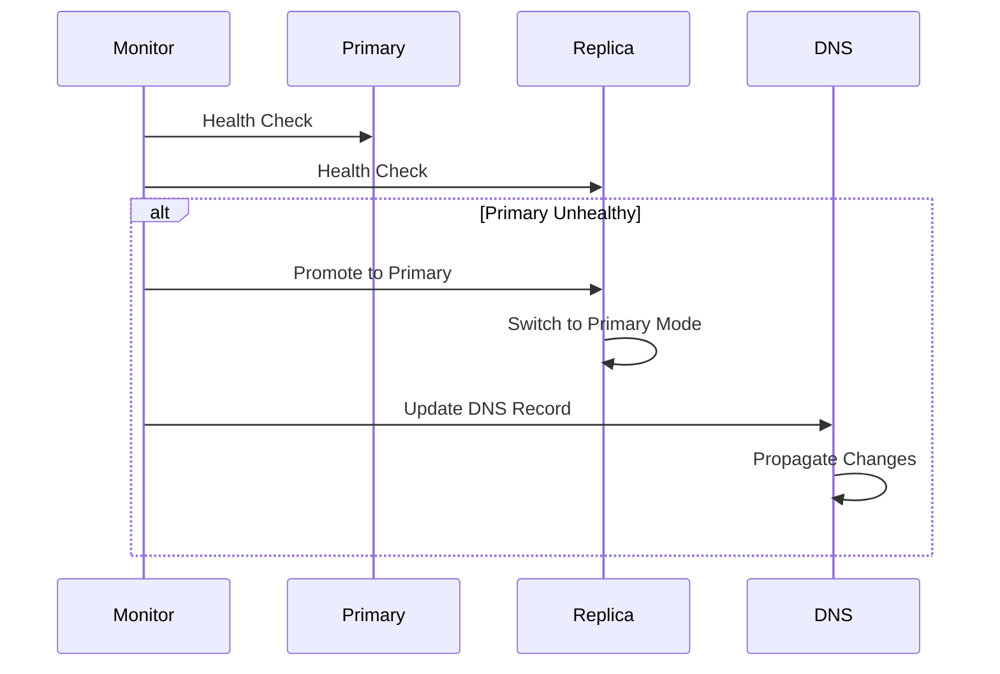

---

## 附录

### A. 架构决策记录 (ADR)

| 编号 | 决策 | 状态 | 日期 |
|------|------|------|------|
| ADR-001 | 采用微服务架构 | 已接受 | 2025-01 |
| ADR-002 | 使用 PostgreSQL + Milvus 存储 | 已接受 | 2025-01 |
| ADR-003 | 采用事件驱动通信 | 已接受 | 2025-02 |
| ADR-004 | 使用 Kubernetes 部署 | 已接受 | 2025-02 |
| ADR-005 | 采用 Istio 服务网格 | 已接受 | 2025-03 |

### B. 参考架构

- [The Twelve-Factor App](https://12factor.net/)
- [Microsoft Azure Well-Architected Framework](https://docs.microsoft.com/azure/architecture/framework/)
- [AWS Well-Architected Framework](https://aws.amazon.com/architecture/well-architected/)

### C. 术语表

| 中文 | English | 定义 |
|------|---------|------|
| 领域驱动设计 | Domain-Driven Design (DDD) | 以业务领域为核心的软件设计方法 |
| 命令查询职责分离 | CQRS | 分离读写操作的架构模式 |
| 事件溯源 | Event Sourcing | 以事件流为唯一事实来源的持久化模式 |
| 服务网格 | Service Mesh | 处理服务间通信的基础设施层 |
| 水平Pod自动伸缩 | HPA | Kubernetes 自动扩缩容机制 |

---

**文档版本历史**

| 版本 | 日期 | 作者 | 变更说明 |
|------|------|------|----------|
| 1.0 | 2026-05-16 | 架构团队 | 初始版本 |

---

*本文档由 Agent Memory System 架构团队编写，版权归属于项目所有方。*
